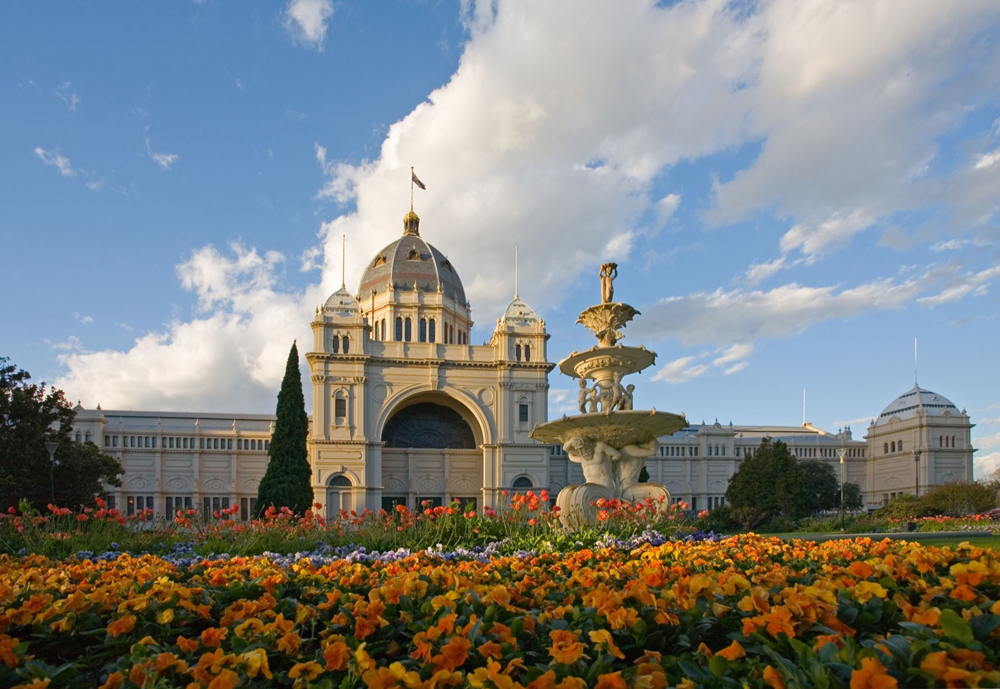
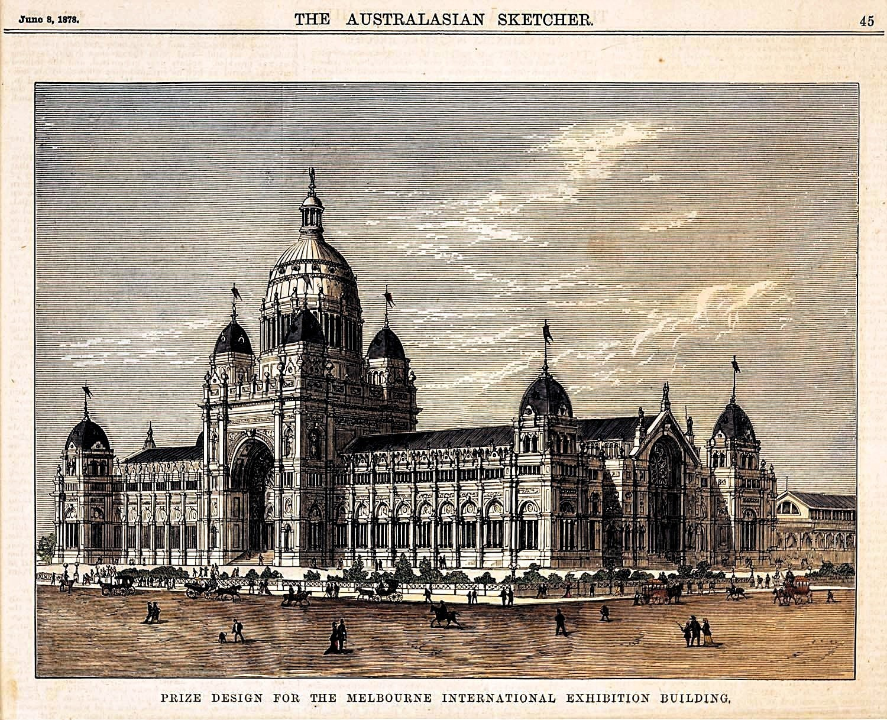
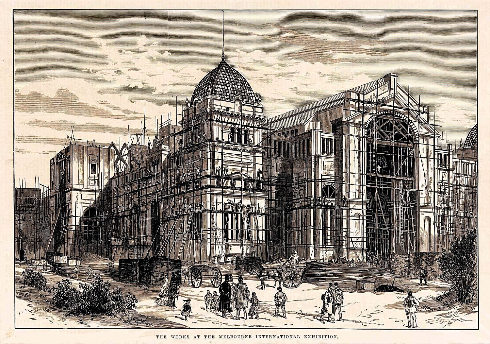
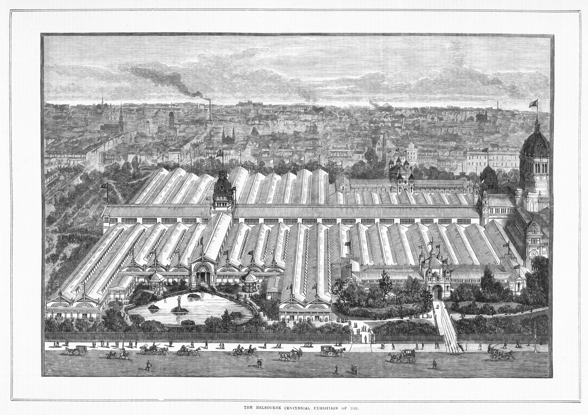
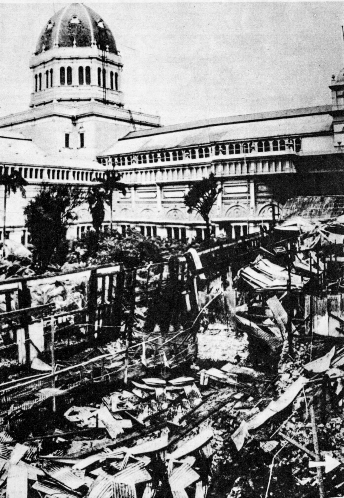
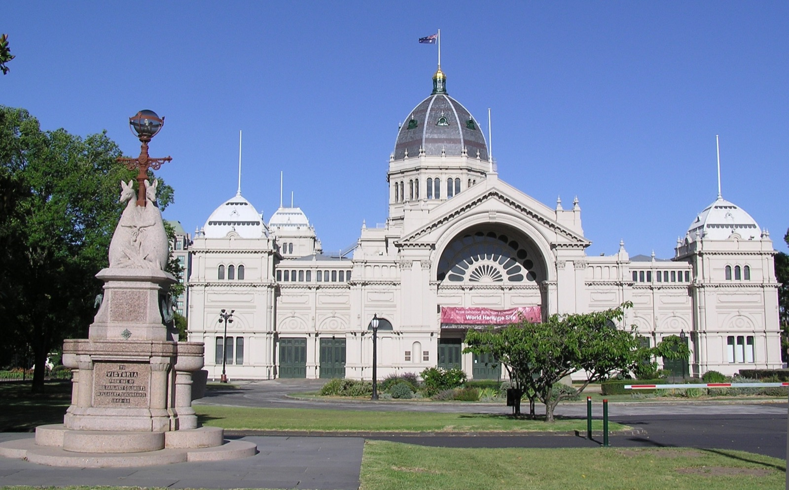
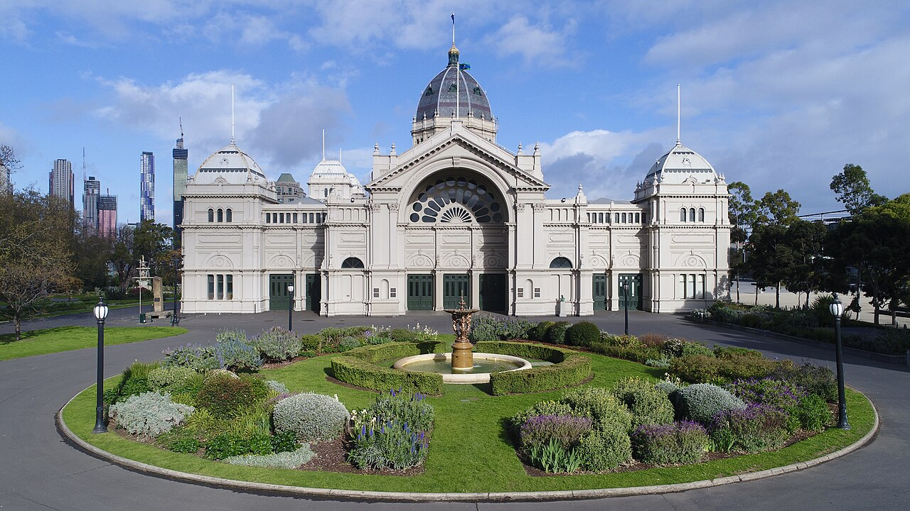
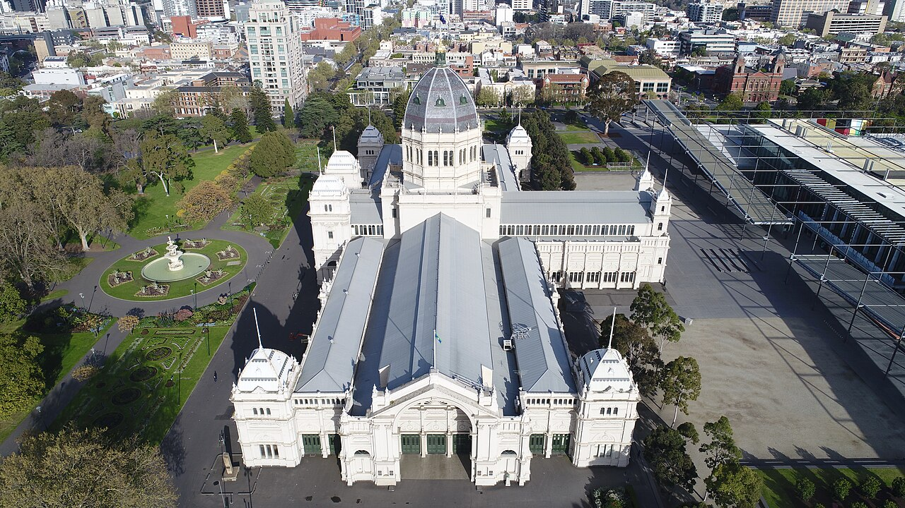

# Royal Exhibition Building

| | |
|---|---|
| **Location** | Carlton Gardens, 9 Nicholson Street, Carlton, Melbourne, Victoria, Australia |
| **Near** | Melbourne city centre (approx. 1.5 km south) |
| **Built** | 1879–1880 |
| **Architect** | Joseph Reed (Reed & Barnes) |
| **Style** | Eclectic: Byzantine, Romanesque, Lombardic and Italian Renaissance |
| **Type** | [Exhibition hall](../../../README.md#exhibition-hall) |
| **Original use** | Main hall of the Melbourne International Exhibition of 1880–81 |
| **Status** | In use as an exhibition venue; UNESCO World Heritage Site (2004) |
| **Features** | [Dome](../../../GLOSSARY.md#dome), [Landscaped park](../../../GLOSSARY.md#landscaped-park) |

*The south front from Carlton Gardens. The dome, flanking towers and ornate arcade are all original to 1880. Photo: Wikimedia Commons (licence to be confirmed).*

## Overview

The Royal Exhibition Building is a huge domed hall in the Carlton Gardens, on the northern edge of central Melbourne. It is one of the last major 19th-century exhibition halls in the world still standing, and in 2004 became the first building in Australia to be listed as a UNESCO World Heritage Site, together with its gardens.

## The main story

- **1879** – Joseph Reed wins the design competition (first prize £300, from 18 entries). Governor Sir George Bowen lays the foundation stone on 19 February 1879.
- **1880** – The Great Hall is finished in time for the Melbourne International Exhibition, which opens in October 1880. Large temporary annexes surround it.
- **1888** – Hosts the Centennial International Exhibition.
- **1901** – The first Parliament of Australia is opened here by the Duke of York, after the Federation of the Australian colonies. Most sources give 9 May 1901.
- **20th century** – Used for exhibitions, as a hospital, for migrants and for exams. The annexes are demolished over time.
- **2004** – Inscribed on the UNESCO World Heritage List with the Carlton Gardens.

## The alternative view

### A palace in a young city

In 1880 Melbourne was a colonial city less than 50 years old, yet it produced a domed exhibition palace in about 18 months. The alternative view asks whether a city that young could have built something this large and ornate so quickly, or whether the scale suggests something older.

### The same style around the world

The dome and Renaissance-style front are close in spirit to exhibition halls, capitols and palaces built in Europe and the Americas at the same time. Old world research sees this as part of a shared worldwide style rather than local taste.

### Temporary buildings, removed

Like other world's fairs, the 1880 exhibition used large "temporary" annexes that were later demolished. What did those annexes look like, how were they built, and why were they removed?

### A world's fair survivor

Most great exhibition halls of the era were lost to fire or demolition, including the Crystal Palace, the Trocadéro and most of Chicago's White City. Melbourne's is a rare survivor, which makes it a good place to study how these buildings were really constructed.

### What would support the alternative view

- Structural features or foundations that don't match an 1879–80 build
- Gaps in the construction records or contractor accounts
- Evidence of buried levels beneath the hall or gardens

### What would weaken it

- Reed's competition drawings and construction contracts
- Dated photographs of the build
- Heritage surveys from restoration work

## Open questions for contributors

- **Opening of Parliament:** 9 May 1901 or 25 May 1901? Most sources say 9 May.
- **Build time:** How long did the Great Hall take from foundation stone to opening?
- **The annexes:** When was each annex demolished, and are there photos?
- **Underground:** What is below the hall and the gardens?
- **Photos:** Historic photos from 1880–1900 are likely to be public domain.

## Images

*Prize design for the Melbourne International Exhibition Building. From* The Australasian Sketcher*, 8 June 1878. The completed building followed this design closely. Public domain.*

*"The Works at the Melbourne International Exhibition" — engraving showing construction in progress, c.1879. Public domain.*

*Bird's-eye view of the Melbourne Centennial Exhibition of 1888. The main hall (right, with dome) is almost hidden behind the vast temporary annexes. Public domain.*

*Demolition or collapse of the exhibition annexes, date uncertain. The main dome survives in the background. Source: National Library of Australia (licence to be confirmed).*

*East facade and entrance. A stone memorial stands in the foreground gardens. Photo: Wikimedia Commons (licence to be confirmed).*

*South facade from the circular garden, with the rose window above the main arch. Melbourne's CBD skyline is visible to the left. Photo: Wikimedia Commons (licence to be confirmed).*

*Aerial view looking north-west, showing the full plan of nave, transepts and dome set within Carlton Gardens. Photo: Wikimedia Commons (licence to be confirmed).*

## Sources

- Wikipedia – Royal Exhibition Building: https://en.wikipedia.org/wiki/Royal_Exhibition_Building
- Museums Victoria – History of the Royal Exhibition Building: https://museumsvictoria.com.au/reb/stories/history/
- Victorian Heritage Database – Royal Exhibition Building (report): https://vhd.heritagecouncil.vic.gov.au/places/228/download-report
- University of Melbourne Archives – Palace of industry: https://library.unimelb.edu.au/asc/whats-on/exhibitions/primary-sources-50-years-of-the-archives/the_stories/palace_of_industry
- eMelbourne – Exhibition Building: https://www.emelbourne.net.au/biogs/EM01274b.htm
