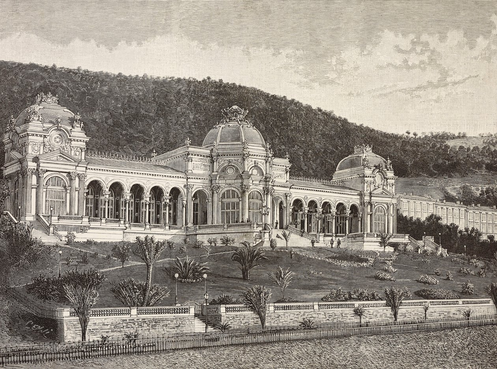
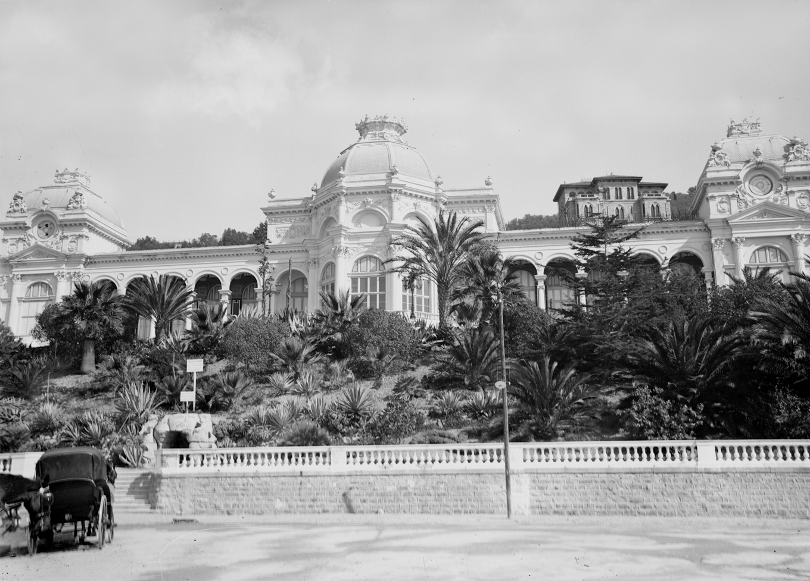
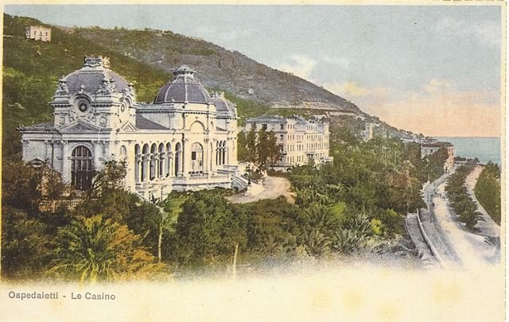
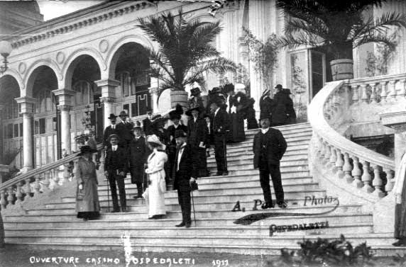
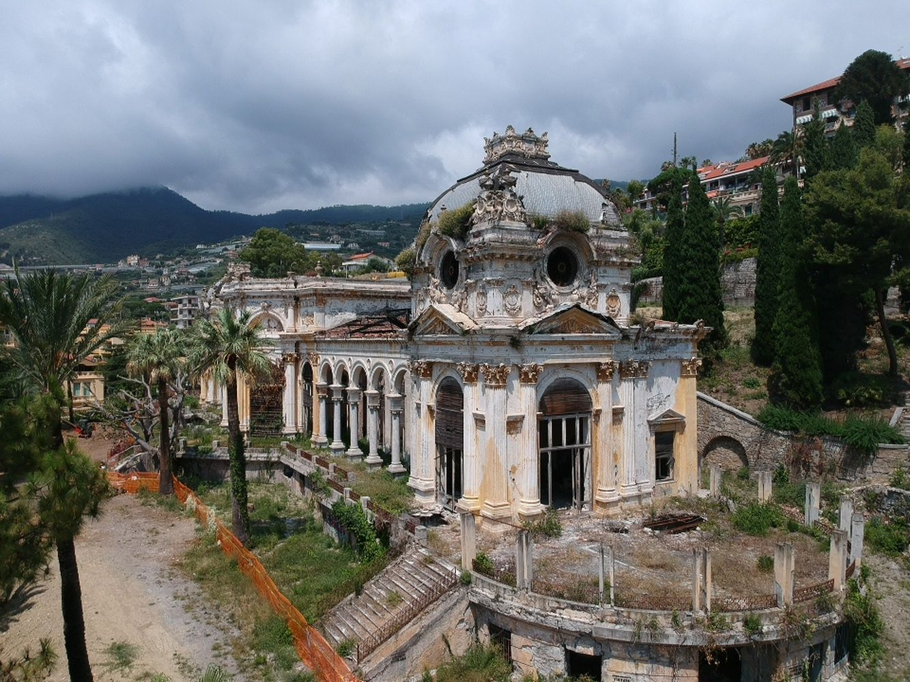

# Villa Sultana (Villa "La Sultana")

| | |
|---|---|
| **Location** | Corso Regina Margherita 93, Ospedaletti (IM), Liguria, Italy |
| **Near** | Sanremo (approx. 5 km east) |
| **Built** | 1883–1884 |
| **Architect** | S.M. Biasini of Nice (1841–1913) |
| **Style** | Eclectic, French-influenced; three domes |
| **Type** | [Villa](../../../README.md#villa), [Casino](../../../README.md#casino) |
| **Original use** | Casino and private club |
| **Status** | Abandoned / derelict |
| **Features** | [Dome](../../../GLOSSARY.md#dome), [Landscaped park](../../../GLOSSARY.md#landscaped-park) |

*Villa Sultana as a casino: 19th-century engraving showing the three domes, arcades and landscaped grounds.*

## Overview

Villa Sultana stands in the centre of Ospedaletti, above the old fishing village and roughly 250 metres from the sea. It is set in a park of about 14,000 m², planted with tall trees, palms and botanically valuable species.

Although often associated with Sanremo, the villa is in Ospedaletti. The link comes from its casino licence, which was issued by the Sub-Prefect of Sanremo.

## The main story

The villa was conceived as a place of leisure where European aristocracy, particularly visitors from Eastern Europe, could gather to gamble or socialise at the club.

- **1884** – Opened as Italy's first casino, licensed by the Sub-Prefect of Sanremo. Guests typically arrived by train from Nice or by omnibus from Sanremo.
- **1905** – The operating company transferred the casino licence to the city of Sanremo. The villa continued as a private club for wealthy tourists.
- **1914** – The outbreak of the First World War ended the Belle Époque and the villa's heyday.
- **1939–1945** – Long since closed, the villa was used to house German and Italian troops during the Second World War.
- **Post-war to late 1950s** – Altered and used as a private residence.
- **1960s onwards** – Left empty and abandoned, falling into neglect and decay.

## Conservation

The villa has been nominated many times in FAI's *I Luoghi del Cuore* heritage census (2003, 2004, 2006, 2014, 2016, 2018, 2020, 2022).

A 2016 report estimated the cost of restoration at around €40 million, expected to be funded entirely by private investors.

## The alternative view

The official account is of a speculative leisure venture, put up quickly to catch the wealthy winter crowd on the Riviera. Looked at from an "old world" perspective, several things invite a second look.

### A very fast build

The villa is recorded as built in 1883–1884 and open as a casino in 1884. That is roughly a year or so for a three-domed building with ornate façades, in a small fishing village, at a time when materials would have come by sea or along the newly opened coastal railway. Was it really built from scratch in that time, or was an existing structure finished, refaced or repurposed and then given a new construction date?

### Too grand for the place

In the 1880s Ospedaletti was a small fishing village. A palatial casino set in a 14,000 m² landscaped park seems out of proportion to the settlement around it. Supporters of the alternative view ask whether the building came first and the "resort" story was attached to it later.

### Architecture shared across the world

The three domes and the eastern-inspired name ("La Sultana") echo exhibition halls, pavilions, bathhouses and palaces built across Europe, Russia, the Americas and beyond in the same decades. In alternative history circles this shared style is seen as a sign of a single, older building tradition (sometimes called *Tartarian*) rather than a fashion that spread independently.

### Short-lived purpose, long abandonment

The casino licence lasted around 21 years (1884–1905). After that the villa drifted through uses (private club, troop barracks, private residence) and has stood empty since the 1960s. A 2016 estimate put restoration at around €40 million, yet nothing appears to have happened. Why has such a large and prominent building been left to decay for over sixty years?

### Conflicting records

Sources do not agree on when the casino closed: 1905 (FAI), 1914, or 1926 (Museum of Gaming History). Gaps and contradictions like this are often where the alternative view starts asking whether the documented history is the whole story.

### The 1887 earthquake

On 23 February 1887, only three years after the casino opened, the Ligurian earthquake caused heavy damage along this coast, including Ospedaletti and Sanremo. How the villa came through it, and whether any repairs or rebuilding were recorded, is worth looking into.

### The 1911 photo: no shadows

In the photo captioned *"Ouverture Casino Ospedaletti 1911"* (see [Images](#images)), none of the people on the steps appear to cast a shadow. If the figures were added to a photo of the empty building later, it would raise the question of whether the building was really in use as a casino at that time, or whether the scene was staged to give it a history.

Points to weigh up:

- **The building has no shadows either.** The balustrade, balusters and arches don't cast clear shadows on the steps. That suggests soft, overcast light or open shade, which gives no hard shadows to anyone. A pasted-in figure would stand out more if the building had strong shadows and the people didn't.
- **The people overlap naturally.** Figures stand in front of and behind each other, and in front of the balustrade at different heights. That is harder to fake than a single figure, though photo montage was already possible in 1911.
- **The copy is small.** The image here is only 572 × 377 pixels and heavily compressed, which can hide faint shadows around feet and edges.

**How to test it:** find a larger scan or an original print, and check:

- whether the feet show any darkening where they meet the steps
- whether the light on faces and clothing comes from the same direction as the light on the building
- whether the edges of the figures look cut out

Other photos of the same event, or a newspaper report of a 1911 opening, would also help.

### What would support the alternative view

- Maps, surveys or images of the site that show a large structure **before 1883**
- Evidence of buried or filled-in lower floors, windows or doorways below current ground level
- Construction methods or materials that don't match a quick 1880s build
- An absence of building records: no plans, contracts, invoices or construction photos

### What would weaken it

- Surviving plans, permits or contracts from S.M. Biasini or the operating company
- Construction-period photos, engravings or newspaper reports
- Pre-1883 maps showing the site as empty land or gardens

## Open questions for contributors

- **Casino dates:** FAI gives 1884–1905 for the casino. The Museum of Gaming History gives 1884–1914, with final closure in 1926. The likely explanation is that the licensed casino ended in 1905 while the private club continued, but this needs confirming.
- **Current status:** No information found on restoration plans after 2016.
- **The 1911 photo:** A photo of guests on the casino steps is captioned *"Ouverture Casino Ospedaletti 1911"* (Casino opening, Ospedaletti, 1911). Was there a reopening in 1911, after the licence moved to Sanremo in 1905? The people in it also appear to cast no shadows (see [The 1911 photo: no shadows](#the-1911-photo-no-shadows)). Can anyone find a larger scan, the original print, or other photos of the same event?
- **Lower level:** The present-day photo shows openings in the wall below the semicircular terrace. What is behind them, and was this level ever at ground level?
- **Image sources:** The source, date and licence of each image below need confirming.
- **Photos:** More historic and current images would be welcome (check licensing).
- **Pre-1883 maps:** Do any maps or cadastral surveys of Ospedaletti from before 1883 show a building on the site?
- **Construction records:** Do Biasini's plans, permits or contracts survive, for example in archives in Nice or Imperia?
- **Ground level:** Are there basement levels, buried windows or doors visible around the building?
- **1887 earthquake:** Was the villa damaged, and were repairs recorded?

## Images

Click any image to enlarge it.

*Early photograph from the promenade below the gardens. A horse-drawn carriage waits in the foreground.*

*Postcard: "Ospedaletti – Le Casino". The casino above the coastal railway, with the sea on the right.*

*Guests on the casino steps, captioned "Ouverture Casino Ospedaletti 1911" (Casino opening, Ospedaletti, 1911). Photo: A. P… (name partly hidden).*

*The villa today: derelict, with vegetation on the dome and an open, roofless arcade. Image dated 2020.*

_Image sources and licences are still to be confirmed._

## Sources

- FAI – I Luoghi del Cuore: https://fondoambiente.it/luoghi/villa-sultana
- Liguria Business Journal (2016): https://liguria.bizjournal.it/2016/08/10/ospedaletti-un-super-teatro-difficile-recupero-villa-sultana
- Museum of Gaming History: https://chipguide.themogh.org/cg_chip2.php?id=ITXXCD
