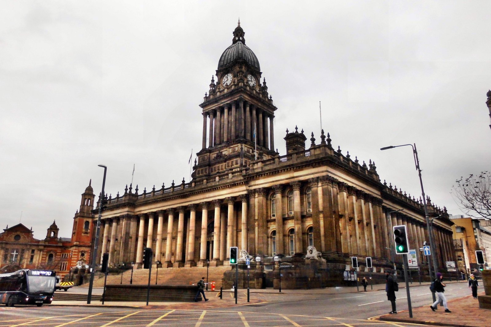
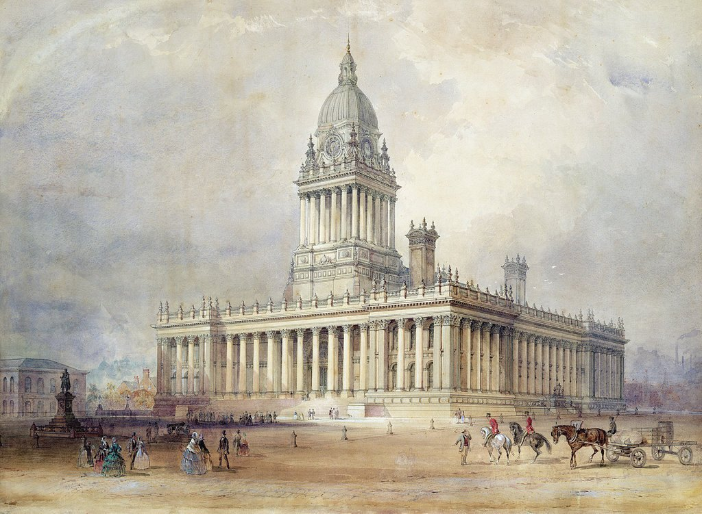
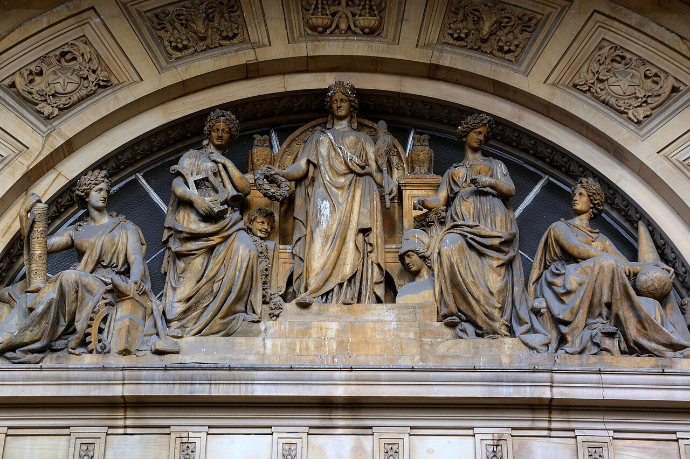
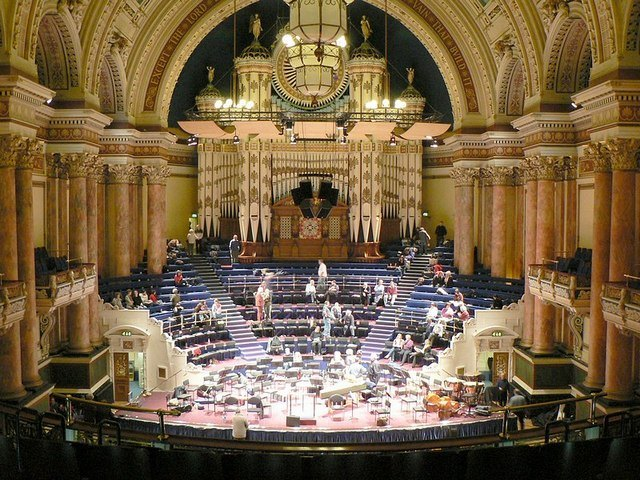

# Leeds Town Hall

| | |
|---|---|
| **Location** | The Headrow, Leeds, West Yorkshire, England |
| **Near** | Millennium Square, Leeds Art Gallery and Central Library |
| **Built** | 1853–1858 (tower added to the design in 1856; altered 1877) |
| **Architect** | Cuthbert Brodrick; contractor Samuel Atack, then Addy and Nicholls |
| **Style** | Neoclassical (Corinthian), with a Baroque clock tower |
| **Type** | [Town hall](../../../README.md#town-hall) |
| **Original use** | Council offices, courts, a police station and cells, and a great hall for concerts and meetings |
| **Status** | In use as a concert and events venue. Grade I listed |
| **Features** | [Clock tower](../../../GLOSSARY.md#clock-tower), [Tower](../../../GLOSSARY.md#tower), [Undercroft](../../../GLOSSARY.md#undercroft), [Portico](../../../GLOSSARY.md#portico) |

*Leeds Town Hall today from the Headrow, with the lions of 1867 by the front steps. Supplied by the owner, apparently from Wikimedia Commons; photographer and licence to be confirmed.*

## Overview

Leeds Town Hall is a huge classical building on the Headrow, with a portico and rows of Corinthian columns on all sides, and a tall clock tower above the main front. For more than a century it was the tallest building in Leeds. Inside is the Victoria Hall, a great concert hall with an organ, and beneath it a basement that once held a police station and the cells of the town's lock-up, the Bridewell.

It was designed by Cuthbert Brodrick, who won the competition in 1852 at the age of 29. The building was not finished as first planned: the tower was added to the design partway through, the cost rose to about three times the accepted tender, and the first contractor went bankrupt before it was finished. Queen Victoria opened it on 7 September 1858, with crowds reported at 200,000 lining the streets.

## The main story

Leeds was booming on the wool trade, and its council wanted a town hall that would show the city's importance, rivalling Liverpool's [St George's Hall](../st-georges-hall-liverpool/st-georges-hall-liverpool.md), then rising across the Pennines.

- **1852** – Cuthbert Brodrick, a 29-year-old architect from Hull, wins the design competition, which is judged by Sir Charles Barry, architect of the [Palace of Westminster](../palace-of-westminster/palace-of-westminster.md). A map of 1852 shows Park House on the site.
- **1853** – The tender of the contractor Samuel Atack, £41,825, is accepted, and building begins. The foundation stone is laid in 1853 (the exact date and who laid it still need confirming).
- **1853–1858** – The building goes up in millstone grit from about seventeen quarries, including Rawdon Hill for the carving and Sturdy and Pool, with columns of Darley Dale stone from Derbyshire.
- **1856** – A tall clock tower, not in the original design, is added on the suggestion of Barry.
- **March 1857** – Atack goes bankrupt, after costly changes to the plans and underestimated costs. Addy and Nicholls complete the tower and interior.
- **7 September 1858** – Queen Victoria opens the Town Hall. The final cost is about £122,000, roughly three times the original tender.
- **1858–1859** – A large organ is installed in the Victoria Hall (by Gray and Davison, completed in 1859; **Reported**).
- **1864** – The Bridewell, the police lock-up in the western basement with thirteen cells, a police office and rooms for the gaoler, is extended out under the front steps.
- **1867** – Four Portland stone lions by William Day Keyworth are placed at the front.
- **1877** – The building is altered.
- **20th century** – The courts and police move out over time; the hall remains a concert venue, and the Bridewell cells survive beneath the steps.

## Conservation

- Leeds Town Hall is **Grade I listed** (Historic England list entry 1255772).
- The Bridewell cells beneath the front steps survive and have been shown to visitors.
- The building has been closed for refurbishment in recent years (dates to be confirmed).

## The alternative view

The official account is of a Victorian city building a great civic hall, over budget and with a bankrupt builder, but completed and opened by the Queen. Looked at from an "old world" perspective, several things invite a second look: a tower added halfway through, a builder who went bankrupt, stone brought from seventeen quarries, a prison built into the basement under the front steps, and a classical temple in a northern wool town. Each point below carries an evidence label: **Documented**, **Observed**, **Reported** or **Speculative** (see the [research brief](https://github.com/martinv678/our-old-world/blob/main/CLAUDE.md)).

### A tower added halfway through

**Documented** – The clock tower, the building's most famous feature and for 108 years the highest point in Leeds, was not in Brodrick's winning design. It was added in 1856, three years into building, on the suggestion of Charles Barry, who had judged the competition. For the [skill and precision](../../../ALTERNATIVE-VIEW.md#skill-and-precision-the-master-builders-argument) argument, this shows a building that was not "right first time": the design changed as it went up, at great cost. It also raises a structural question: how was a tall stone tower added to a building whose foundations were already being laid for a design without one?

**How to test it:** compare Brodrick's competition drawings with the revised drawings of 1856, and look in the building committee's records for how the foundations were altered.

### The builder who went bankrupt

**Documented** – Samuel Atack's tender was £41,825, but the final cost was about £122,000, and Atack went bankrupt in March 1857, before the building was finished. Sources put this down to costly changes to the plans, underestimated costs, and an architect determined to see the scheme through "whatever the cost". For the [logistics argument](../../../ALTERNATIVE-VIEW.md#materials-and-delivery-the-logistics-argument), this is a reminder that big Victorian buildings did strain the builders of the time, financially and practically. The difference is that here the strain is recorded: the contract, the cost overrun and the bankruptcy are all documented.

### Stone from seventeen quarries

**Documented** (sources) / **Speculative** (logistics) – The building is made of millstone grit from about seventeen quarries, including Rawdon Hill for the carved work and Sturdy and Pool, with columns of Darley Dale stone from Derbyshire. Drawing stone from so many places points to the scale of the supply problem: each quarry had to cut, dress and deliver stone to a timetable. Leeds had canals (the Leeds and Liverpool Canal and the Aire and Calder Navigation) and railways by the 1850s, which could carry heavy stone. A [delivery check](../../../ALTERNATIVE-VIEW.md#materials-and-delivery-the-logistics-argument) needs the quantities from each quarry.

### A prison under the front steps

**Documented** (cells) / **Speculative** (mud flood) – Beneath the Town Hall is the Bridewell, the town's lock-up: at first thirteen cells, a police office and the gaoler's rooms in the western basement, extended out under the front steps in 1864. The rest of the basement held kitchens, a refreshment room under the main hall, boiler rooms and the organ's blowers. In mud flood research, spaces below a raised front and steps are checked for signs that they were once at ground level. Here, the cells and basement rooms are on the original plans and their use is recorded. The extension under the steps, eleven years after building began, shows the basement being added to, not dug out of something older.

**How to test it:** compare the basement plans of the 1850s and 1864 with the building today, and look for any windows or doors in the basement that open onto buried ground.

### What stood on the site before?

**Reported** – A map of 1852 is said to show Park House on the site of the Town Hall. This is exactly the kind of evidence the research brief's [map check](https://github.com/martinv678/our-old-world/blob/main/CLAUDE.md) asks for: if an ordinary house and grounds stood on the site in 1852, a much older building could not have been there.

### Out of place, as if discovered?

**Observed** (the watercolour) / **Speculative** (owner's view) – The owner doesn't believe the official construction story, based on the images. A watercolour of the Town Hall (see [Images](#images)) shows it standing in a wide, unpaved open space, with people in what the owner sees as 1700s dress, no proper roads, and small, plain buildings around it. To the owner, the Town Hall looks out of place among them, as if it had been discovered rather than built. This fits the research brief's theme of **out-of-place buildings**: grand buildings that seem too big and too fine for their surroundings.

Points to weigh up:

- **The clothes fit the 1850s.** The women in the watercolour wear very wide, bell-shaped skirts over hoops (crinolines), and the men wear top hats and frock coats: the fashions of about 1855–1865. In the 1700s, wide skirts were held out at the sides by panniers, with flatter fronts, and men wore three-cornered hats and breeches. The dress therefore points to the years the Town Hall was built, not earlier.
- **Unpaved streets were normal.** Many town squares and streets in the 1850s were surfaced with packed gravel or setts rather than smooth paving, and wide open spaces were often left around new public buildings.
- **It was meant to stand out.** The Town Hall was built to be far grander than anything around it, as a statement of the city's wealth. Most of the grand buildings near it today, such as the Art Gallery (1888) and the Civic Hall (1933), came later.
- **The watercolour may be a design drawing.** It looks like an architect's presentation view, which may have been painted before or during building to show what the finished hall would look like, with an idealised setting. Factory chimneys and smoke are visible on the right, showing industrial Leeds.

**How to test it:** find out who painted the watercolour and when (it may be by Brodrick or his office, and may be held by Leeds Museums and Galleries), and compare it with early photographs, maps and street views of Park Lane (now the Headrow) in the 1850s. The 1852 map of the site, showing Park House, is the key test: if an ordinary house stood there, the Town Hall wasn't already standing.

### A classical temple in a wool town

**Documented** (style) / **Speculative** (interpretation) – Like [St George's Hall](../st-georges-hall-liverpool/st-georges-hall-liverpool.md#built-like-the-romans) in Liverpool, finished a few years earlier, Leeds Town Hall is a Roman temple of a building, with Corinthian columns on every side, raised on a base above the street. Its tower is in the Baroque style of 17th-century churches. In the "shared worldwide architecture" theme, it belongs to the same family of classical civic buildings across Britain, Europe and America. The ordinary explanation is that northern cities competed to show their wealth in the most prestigious style of the day.

### Sound: a concert hall and its organ

**Documented** (hall) / **Reported** (organ details) / **Speculative** (cymatics) – The Victoria Hall was built for concerts, and its organ, completed in 1859, was one of the largest of its day. For the [sound and cymatics](../../../ALTERNATIVE-VIEW.md#sound-and-cymatics-the-resonance-argument) theme, its acoustics and the organ's size and tuning are worth recording.

### No construction images found

**Observed** (none found so far) – No photographs or engravings of Leeds Town Hall being built have been found yet, although it went up in 1853–58 in the middle of a large city, at a time when photography was well established. See the [photo record](../../../ALTERNATIVE-VIEW.md#missing-construction-photographs-the-photo-record-argument).

### Dates and inscriptions

**Speculative** – The foundation stone of 1853 and any dated stones or plaques haven't been checked yet for the [letters in dates](../../../ALTERNATIVE-VIEW.md#letters-in-dates-the-j-argument) argument.

### Anomaly log

| Anomaly | Evidence | Label | Source |
|---|---|---|---|
| Clock tower not in the original design; added in 1856 | Histories; listing | Documented | Wikipedia; Historic England |
| Cost rose from a £41,825 tender to about £122,000 | Histories | Documented | Historic England; Yorkshire Post |
| First contractor went bankrupt in March 1857 | Listing; histories | Documented | Historic England |
| Stone from about seventeen quarries, including Derbyshire | Listing | Documented | British Listed Buildings |
| Police cells in the basement, extended under the front steps in 1864 | Histories | Documented | Yorkshire Evening Post |
| Park House on the site in 1852 | Map caption | Reported | Wikipedia |
| No construction images found | Searches so far | Observed | This project |
| Watercolour shows the hall in an unpaved open space, looking out of place among small buildings | Owner-supplied image | Observed | Owner |

### Timeline check

**What we know:** building began in 1853 and the Town Hall opened on 7 September 1858, about five years. The tower was added in 1856, the first contractor went bankrupt in 1857, and the final cost was about £122,000.

**The working:**

- **Time:** five years is reasonable for a large stone building, especially with a change of design and a change of contractor.
- **Method:** load-bearing stone, cut at seventeen quarries and dressed and carved on site. This is slow, skilled work, and the cost overruns suggest it was harder than expected.
- **Delivery check:** the stone came from quarries around Leeds and from Derbyshire; the quantities from each haven't been found yet. Canals and railways could carry it, with carts for the last stretch.

**Working still needed:**

1. The volume of stone from each quarry.
2. The workforce, and what happened to the work when Atack went bankrupt.
3. How the foundations were changed to take the tower.

**Verdict for now:** **Plausible.** Five years, with a design change and a bankruptcy, is what you'd expect from a large Victorian stone building that ran over budget. The records of the overrun are themselves evidence that the building was built when and how the records say. The questions for the alternative view are the added tower, the missing construction images and what stood on the site before.

### Comparison buildings

| Building | Where | Built | Link |
|---|---|---|---|
| [St George's Hall](../st-georges-hall-liverpool/st-georges-hall-liverpool.md) | Liverpool, UK | 1841–54 | Classical rival across the Pennines |
| [Manchester Town Hall](../manchester-town-hall/manchester-town-hall.md) | Manchester, UK | 1868–77 | Later northern town hall, in Gothic |
| Birmingham Town Hall | Birmingham, UK | 1832–34 | Earlier Roman-temple civic hall (on the research list) |
| [Palace of Westminster](../palace-of-westminster/palace-of-westminster.md) | London, UK | c. 1840–70 | By Charles Barry, who judged the competition and suggested the tower |
| Leeds Corn Exchange | Leeds, UK | 1861–63 | Also by Brodrick: a domed oval trading hall (not yet on the research list) |
| Grand Hôtel, Scarborough | Scarborough, UK | 1863–67 | Also by Brodrick (not yet on the research list) |

### What would support the alternative view

- Older masonry or foundations in the basement or under the tower that predate 1853
- A map earlier than 1852 showing a large building on the site
- Contradictions between Brodrick's drawings and the building as built, beyond the recorded changes
- No reports of the works in progress in the Leeds newspapers of 1853–58

### What would weaken it

- The council and building committee records, including the contracts with Atack and with Addy and Nicholls
- Brodrick's competition and revised drawings
- The 1852 map showing Park House on the site
- Reports of the works and of the opening in the *Leeds Mercury* and *Leeds Intelligencer*

## Open questions for contributors

- **Foundation stone:** When exactly was it laid, by whom, and where is it?
- **The tower:** How were the foundations changed when the tower was added in 1856?
- **The bankruptcy:** What exactly caused Atack's bankruptcy, and how much of the building had he finished?
- **The quarries:** How much stone came from each of the seventeen quarries?
- **The site:** What does the 1852 map show of Park House and its grounds?
- **The organ:** Who built the organ, when, and how large was it?
- **Construction images:** Are there any engravings or photographs of the Town Hall being built?
- **The watercolour:** Who painted it, and when? Was it a design drawing made before the hall was finished?

## Leads to follow up

- **West Yorkshire Archive Service (Leeds):** the council and building committee records, the contracts and the 1850s maps.
- **Leeds Libraries (Leodis):** the city's online historic photograph collection, for early views of the Town Hall and the site.
- **Brodrick's drawings:** held in Leeds collections and the RIBA.
- **Period newspapers:** the *Leeds Mercury* and *Leeds Intelligencer*, 1852–58, for the competition, the building works and the opening.
- **Historic England:** list entry 1255772.
- **Leeds Geological Association:** its work on the building stones of Leeds.

## Research notes

<!-- Owner's notes: add observations, hunches and links here. Claude reads this section first and doesn't remove it. -->

- Owner's observation: no construction photographs. The owner doesn't believe the construction story based on the images, especially as the people in the watercolour look dressed in 1700s attire, with no roads. The Town Hall also seems out of place compared with the buildings around it, as if it was discovered. See [Out of place, as if discovered?](#out-of-place-as-if-discovered)

## Images

Click any image to enlarge it.

*The Town Hall today from the Headrow, darkened by age, with Keyworth's stone lions (1867) by the front steps. Supplied by the owner, apparently from Wikimedia Commons; photographer and licence to be confirmed.*

*A watercolour of the Town Hall in its new state, probably 1850s (artist and date to be confirmed; possibly a design or presentation drawing). The women's crinolines and the men's top hats are the fashions of about 1855–65. See [Out of place, as if discovered?](#out-of-place-as-if-discovered) Supplied by the owner; source and licence to be confirmed.*

*The sculpture in the arch over the main entrance: robed classical figures, the central one crowned and holding a wreath, with others holding a lyre (music), a globe (science), a column (architecture) and tools and a cogwheel (industry), with owls (wisdom) behind. The sculptor and the exact subjects need confirming. Supplied by the owner, apparently from Wikimedia Commons; photographer and licence to be confirmed.*

*The Victoria Hall, set up for a concert, with the organ filling the far end. Supplied by the owner, apparently from Wikimedia Commons; photographer and licence to be confirmed.*

**No construction images.** As the owner notes, none of these show the Town Hall being built; see [No construction images found](#no-construction-images-found).

Other images that would be useful:

- any **engraving or photograph** of the Town Hall being built in 1853–58
- **Brodrick's competition design**, without the tower
- the **1852 map** showing Park House on the site
- the **opening** by Queen Victoria on 7 September 1858
- the **Bridewell cells** beneath the steps

## Sources

- Wikipedia – Leeds Town Hall: https://en.wikipedia.org/wiki/Leeds_Town_Hall
- Wikipedia – Cuthbert Brodrick: https://en.wikipedia.org/wiki/Cuthbert_Brodrick
- Historic England – Leeds Town Hall (list entry 1255772): https://historicengland.org.uk/listing/the-list/list-entry/1255772
- British Listed Buildings – Town Hall, Leeds: https://britishlistedbuildings.co.uk/101255772
- Yorkshire Post – Cheers for Victoria at town hall opening: https://www.yorkshirepost.co.uk/heritage-and-retro/retro/cheers-for-victoria-at-town-hall-opening-1830254
- Yorkshire Evening Post – The story of Leeds Bridewell, the Victorian town lock-up: https://www.yorkshireeveningpost.co.uk/retro/the-story-of-leeds-bridewell-the-victorian-town-lock-up-5200322
- inkl (Yorkshire Evening Post) – The hidden underground prison tucked away under Leeds Town Hall: https://inkl.com/news/the-hidden-underground-prison-tucked-away-under-leeds-town-hall
- Secret Library Leeds – Cuthbert Brodrick: the architect of Victorian Leeds: https://secretlibraryleeds.net/2018/07/20/cuthbert-broderick-the-architect-of-victorian-leeds/
- Archiseek – 1858 Town Hall, Leeds: https://www.archiseek.com/?p=561413
- MyLearning – Victorian Leeds: building the Town Hall: https://www.mylearning.org/stories/victorian-leeds/building-the-town-hall
- Leeds Geological Association – Mineral resources: https://leedsga.org.uk/local-geology/mineral-resources/
