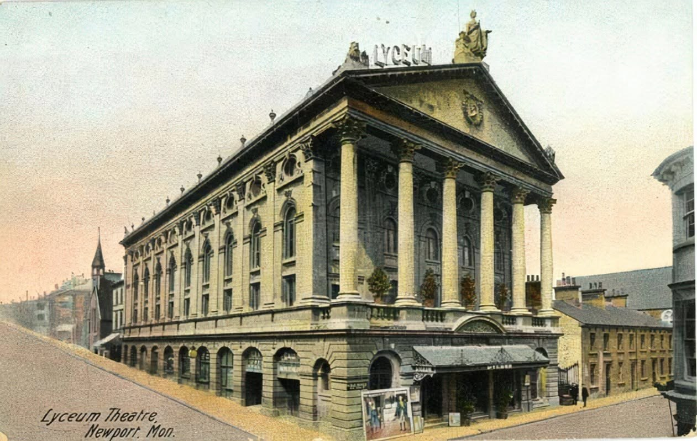
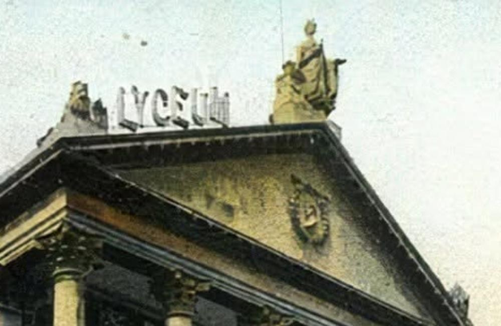
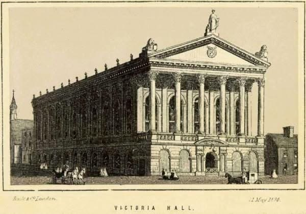
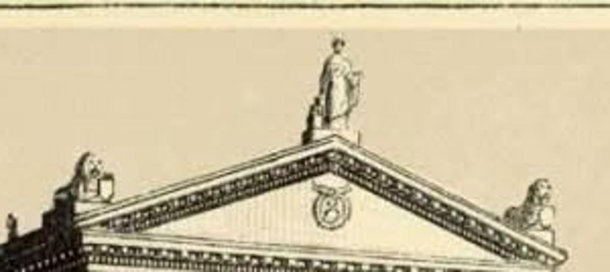
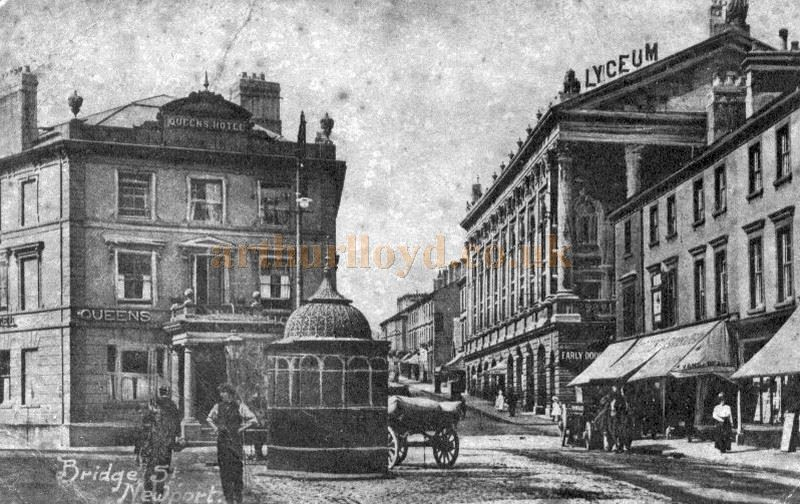
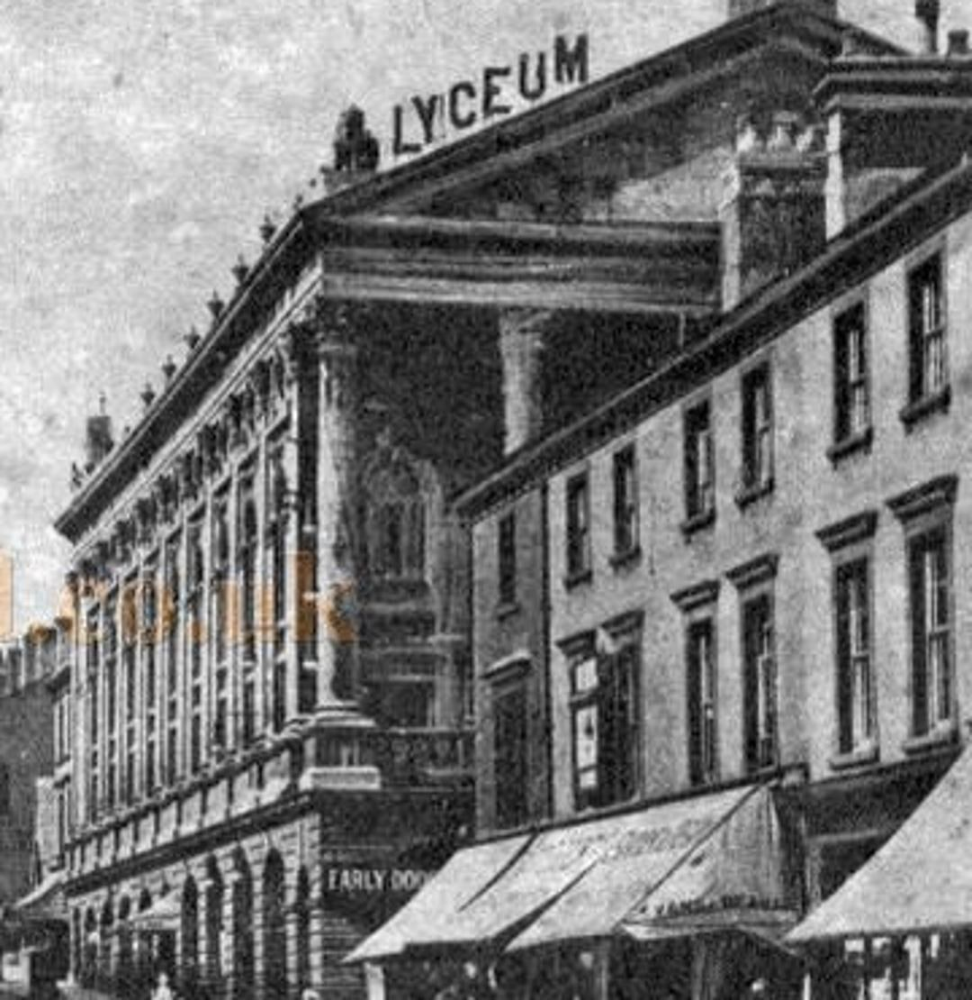

# Lyceum Theatre, Newport

| | |
|---|---|
| **Location** | 66 Bridge Street, Newport, Monmouthshire (now the City of Newport), Wales |
| **Near** | Newport city centre and the Westgate Hotel |
| **Built** | c. 1867 as the Victoria Assembly Rooms; gutted by fire 1896; rebuilt inside as the Lyceum Theatre 1896–1897 |
| **Architect** | Victoria Assembly Rooms: not yet known (built for Henry Pearce Bolt). Lyceum: W. G. R. Sprague; builder John Linton |
| **Style** | Classical, with a portico of six Corinthian columns |
| **Type** | [Theatre](../../../README.md#theatre) |
| **Original use** | Assembly rooms and public hall, later a theatre and then a cinema |
| **Status** | Demolished 1961. The site was used for an ABC cinema (1968) and is now a Travelodge and car park |
| **Fires** | 27/28 May 1896: the Victoria Theatre gutted; the Lyceum was built inside its surviving walls |
| **Features** | [Portico](../../../GLOSSARY.md#portico) |

*"Lyceum Theatre, Newport, Mon.", coloured postcard, probably about 1900–1910. Supplied by the owner; publisher and licence to be confirmed, though an image of this age is likely to be out of copyright.*

## Overview

The Lyceum Theatre stood on Bridge Street in the centre of Newport, behind a grand classical front with a portico of six tall Corinthian columns. It began as the Victoria Assembly Rooms, built in about 1867 for Henry Pearce Bolt, a mayor of Newport, and later became the Victoria Theatre. In May 1896 a fire gutted the building, and a new theatre, the Lyceum, was built inside its surviving outer walls to the design of W. G. R. Sprague, who went on to design several of London's West End theatres. It opened in October 1897.

For more than 60 years it was one of the finest theatres in Wales. Harry Houdini performed there in 1913. It later showed films, closed at the end of 1960, and was demolished in 1961 to make way, eventually, for an ABC cinema. Today a hotel and a car park stand on the site, and the theatre is remembered as one of Newport's great lost buildings.

## The main story

Newport grew fast in the 19th century as a port for the coal and iron of the South Wales valleys, and wanted public rooms and a theatre to match.

- **c. 1867** – The Victoria Assembly Rooms (also called the Victoria Hall) are built on Bridge Street for Henry Pearce Bolt, at a reported cost of £12,000, with a portico of six Corinthian columns.
- **1868** – The *Illustrated London News* publishes an engraving and description of the new Victoria Hall and Assembly Rooms, crediting Bolt with building and fitting them out.
- **1870s** – The building is used as a theatre, the Victoria Theatre. (Some sources give 1874 or 1876 for the Victoria Hall or Theatre, so the dates of the change need checking.)
- **27/28 May 1896** – A fire in the early morning guts the Victoria Theatre.
- **1896–1897** – The Lyceum Theatre is built within the surviving outer walls of the old building, for the manager Clarence Sounes, by the builder and councillor John Linton, to the design of W. G. R. Sprague. The cost is given as £20,000.
- **October 1897** – The Lyceum opens. It is described as one of the finest theatres of its time in Wales, seating about 1,250 (a 1950 yearbook gives 1,150 as a cinema).
- **1913** – Harry Houdini performs at the Lyceum.
- **20th century** – The Lyceum shows films as well as live shows.
- **3 December 1960** – It closes as a cinema.
- **1961** – The Lyceum is demolished. (Some sources give a later date, but the national record for Wales, Coflein, gives 1961.)
- **28 November 1968** – An ABC cinema, seating about 1,320, opens on the site.
- **1999 or 2008** – The ABC closes (sources disagree). A Travelodge and a car park now occupy the site.

## Conservation

- Nothing of the theatre survives above ground. It is recorded in Coflein, the national record of the historic environment of Wales (site 31973).
- Its loss is often cited in Newport as an example of the city's demolished Victorian heritage.

## The alternative view

The official account is of a Victorian assembly hall that burned, was rebuilt as a theatre inside its old walls, and was pulled down in the 1960s like many other theatres. Looked at from an "old world" perspective, several things invite a second look: a grand classical portico in a young industrial port town, a fire that gutted the building while leaving its front standing, a new interior built inside an older shell, and the demolition of the whole building in the 1960s. Each point below carries an evidence label: **Documented**, **Observed**, **Reported** or **Speculative** (see the [research brief](https://github.com/martinv678/our-old-world/blob/main/CLAUDE.md)).

### A Greek temple front in a coal port

**Documented** (portico) / **Speculative** (interpretation) – The building's front was a temple portico of six Corinthian columns, the same form as [St George's Hall](../st-georges-hall-liverpool/st-georges-hall-liverpool.md) in Liverpool and [Leeds Town Hall](../leeds-town-hall/leeds-town-hall.md). In the 1860s, Newport was a fast-growing industrial port, and a grand classical hall built by one man, the mayor Henry Pearce Bolt, fits the research brief's theme of **out-of-place buildings**: grand buildings in young or small towns. The ordinary explanation is that wealthy local men built showpiece halls to raise the standing of their towns, and classical porticos were the usual way to do it.

**How to test it:** find the architect and builder of the 1867 building, its plans and its costs, and compare the 1868 engraving with later photographs to see whether the front changed.

### A small Parthenon, near a Roman fortress

**Reported** (owner's observation) / **Speculative** (interpretation) – The owner describes the building as essentially a small Parthenon in the middle of Newport, covered in Roman statues, and points out that the Romans are also found right next door, at Caerleon.

The Roman connection is real and close:

- **Roman Caerleon.** Caerleon, about 3 miles (5 km) north-east of Newport's centre on the same river, the Usk, was the Roman legionary fortress of *Isca Augusta*, founded in about AD 75 as a base of the Second Augustan Legion. Its amphitheatre, bath house and barracks can still be seen, and the National Roman Legion Museum is there (**Documented**).
- **A Roman temple front.** The Lyceum's portico had six Corinthian columns. The Parthenon in Athens is a Greek temple with eight plainer Doric columns across its front, so in form the Lyceum was closer to a Roman temple such as the Maison Carrée at Nîmes, which also has six Corinthian columns across its front (**Documented** form).
- **The statues.** The owner reports that the building was covered in Roman statues. The images in this entry (see [Images](#images)) show what stood on the roof (**Observed**):
  - **In 1874**, a print of the Victoria Hall shows three sculptures on the pediment: a robed female figure standing at the top, and a lion at each of the lower corners. In the middle of the pediment is a roundel, which may hold a monogram.
  - **About 1900–1910**, a coloured postcard of the Lyceum shows a seated female figure at the top of the pediment, wearing a helmet or crown and holding a staff, much like the usual figure of **Britannia**, with a sculpted figure or beast at the left-hand corner beside the LYCEUM lettering. The roundel is still in the pediment.
  - **Standing or seated?** The top figure appears to be standing in the 1874 print but seated in the later postcard. This could be the engraver's licence, or a sign that the statue was replaced after the fire of 1896. It's worth checking against other photographs (**Observed**; explanation not known).
  - **The Roman link.** Britannia began as a Roman figure: the personification of the province of Britain on Roman coins of the 2nd century. So a Britannia on the roof is, in a sense, a Roman statue, though by the 19th century she was a national symbol.
  - Beyond these three sculptures and the ornaments along the parapet, no other statues can be seen at the resolution of these images. Their sculptor, and what happened to them in 1961, are still unknown.
- **The portico in the photograph.** The postcard shows the giant columns standing on an arcaded ground floor, rising through two storeys to a pediment, with a long side wall of arched windows and pilasters stretching down Bridge Street. A sign reading "EARLY DOORS", for the cheaper early entry to performances, hangs at street level (**Observed**).

On the owner's view, a Roman-style temple full of Roman statues, a few miles from a real Roman fortress, raises the question of whether the building, or its site, had an older Roman connection than the records of 1867 suggest (**Speculative**).

Points to weigh up:

- **Victorian Newport was proud of its Roman neighbour.** Roman finds at Caerleon were well known in the 19th century (a local museum of Roman finds is said to have opened there in about 1850, not yet confirmed), and Victorian builders across Britain used Roman and Greek forms and statues on public buildings, as at [St George's Hall](../st-georges-hall-liverpool/st-georges-hall-liverpool.md#built-like-the-romans) in Liverpool.
- **The building is recorded as new in 1867.** The *Illustrated London News* of 1868 describes it as newly built and fitted out for Henry Pearce Bolt. That account, and any plans, would show whether older fabric was reused.
- **The site is in the town, not at Caerleon.** No Roman finds are known from the site so far; any report from the 1961 demolition, or from later building work on the site, would show whether anything older lay underneath.

**How to test it:** find photographs that show the statues clearly and identify their subjects and maker; search the 1868 account and Newport's newspapers for who carved them; check whether any were saved in 1961; and look for any archaeological record from the site of 66 Bridge Street.

### Fire: gutted, but the walls survived

**Documented** (fire) / **Speculative** (interpretation) – On the morning of 27/28 May 1896, fire gutted the Victoria Theatre. The new Lyceum was built inside the surviving outer walls. In this project's "fire and demolition" theme, fires that clear the inside of a grand building, leaving its shell to be reused, are a recurring pattern: [Alexandra Palace](../alexandra-palace/alexandra-palace.md) was rebuilt after its fire in 1873, reportedly on its surviving walls. Theatre fires were common in the 19th century, because of gas lighting, timber stages and painted scenery, so the ordinary explanation is strong here. The cause of the 1896 fire hasn't been found yet.

### A new theatre inside an old shell

**Documented** (rebuilding) / **Speculative** (dating) – Because the Lyceum was built "within the exterior walls" of the older building, the building that stood until 1961 was partly of 1867 and partly of 1896–97. How much of the front was original, and how much was refaced by Sprague? This matters for any attempt to date the building from its photographs: the portico may be older than the theatre behind it. The owner's images now answer part of this: the print of 12 May 1874 and the postcard of about 1900–1910 show the same front, with six Corinthian columns on an arcaded ground floor, the same pediment roundel, the same side wall and the same urns, so the front of the 1867 Victoria Hall seems to have survived the 1896 fire and been kept by Sprague, with the LYCEUM lettering added and possibly a new statue on top (**Observed**).

### Demolished in the 1960s

**Documented** – The Lyceum closed at the end of 1960 and was demolished in 1961, and the site was then used for a new cinema of 1968, itself later closed. The 1960s saw many grand Victorian theatres, halls and stations across Britain demolished. In this project's "fire and demolition" theme, the loss of fine buildings that could have been kept is a recurring pattern. The ordinary explanations are the decline of live theatre and cinema audiences, high repair costs, and the planning fashions of the time.

### Dates in dispute

**Documented** (conflicting sources) – Sources give the building's origin as 1867, 1868, 1874 or 1876. The 1874 date can now be explained: the owner's print of the "Victoria Hall" is published by Rock & Co. of London and dated 12 May 1874, so it records the finished building in that year rather than its construction. Sources also give its demolition as 1961 or later. Some of this is because the building had several names (Victoria Assembly Rooms, Victoria Hall, Victoria Theatre, Lyceum), and some sources may mix it up with other buildings. Dates that don't agree are one of this project's themes, and here they should be settled from the *Illustrated London News* of 1868, local newspapers and the Coflein record.

### No construction images found

**Observed** (none found so far) – No photographs or engravings of either the 1867 building or the 1896–97 rebuilding being built have been found yet. The earliest image known so far is the 1868 engraving of the finished Victoria Assembly Rooms. See the [photo record](../../../ALTERNATIVE-VIEW.md#missing-construction-photographs-the-photo-record-argument).

### Dates and inscriptions

**Speculative** – No foundation stone, date stone or inscription from the building has been found yet. If any part of the front was salvaged in 1961, it may survive elsewhere in Newport.

### Anomaly log

| Anomaly | Evidence | Label | Source |
|---|---|---|---|
| Grand Corinthian portico on a hall built for one man in a young port town | 1868 engraving; Coflein | Documented | Coflein; *Illustrated London News* (via Newport Past) |
| Gutted by fire in 1896, with the outer walls surviving | Histories | Documented | Arthur Lloyd; Coflein |
| New theatre built inside the old walls | Histories | Documented | Arthur Lloyd |
| Origin dated 1867, 1868, 1874 or 1876 | Sources disagree | Documented | Coflein; Cinema Treasures; Newport Past |
| Demolished in 1961 for later redevelopment | Coflein; histories | Documented | Coflein; Wales Online |
| No construction images found | Searches so far | Observed | This project |
| Sculpted figure on the pediment corner, visible in an early postcard | Owner-supplied postcard | Observed | Arthur Lloyd (via owner) |
| Statue and two lions on the pediment already in 1874, before the fire | Dated print by Rock & Co., 12 May 1874 | Observed | Owner-supplied print |
| Top statue standing in 1874 but seated (Britannia-like) about 1900–1910 | Print and later postcard | Observed | Owner-supplied images |
| Roman-style temple front with Roman statues, about 3 miles from the Roman fortress at Caerleon | Owner's observation; Caerleon's Roman remains | Reported / Documented | Owner; Coflein; Museum Wales |

### Timeline check

**What we know:** the Victoria Assembly Rooms were built in about 1867 at a reported cost of £12,000. After the fire in May 1896, the Lyceum was built inside the old walls and opened in October 1897, about 17 months later, at a cost of £20,000.

**The working:**

- **The rebuild:** about 17 months to build a new theatre inside surviving walls is reasonable; the slowest parts of the work (the foundations and outer walls) were already done.
- **The original building:** its building time, workforce and materials haven't been found yet.
- **Delivery check:** Newport had docks, a canal and railways, and Welsh stone and brick were close at hand, so materials could arrive by sea, canal or rail. The quantities aren't known.

**Working still needed:**

1. The architect, builder and building time of the 1867 Victoria Assembly Rooms.
2. How much of the 1867 building survived the fire, and how much Sprague rebuilt.
3. The cause of the 1896 fire.

**Verdict for now:** **Plausible**, for both the 1867 building and the 1896–97 rebuilding. The questions for the alternative view are the gaps in the records: who designed the first building, what caused the fire, and how much of the old front survived until 1961.

### Comparison buildings

| Building | Where | Built | Link |
|---|---|---|---|
| [St George's Hall](../st-georges-hall-liverpool/st-georges-hall-liverpool.md) | Liverpool, UK | 1841–54 | Corinthian temple front for a hall of music and justice |
| [Leeds Town Hall](../leeds-town-hall/leeds-town-hall.md) | Leeds, UK | 1853–58 | Corinthian columns on a civic hall |
| [Alexandra Palace](../alexandra-palace/alexandra-palace.md) | London, UK | 1873; rebuilt 1875 | Entertainment palace burned and rebuilt |
| Lyceum Theatre | Sheffield, UK | 1897 | Opened the same year; a surviving theatre of the period (not on the research list) |
| Wyndham's Theatre | London, UK | 1899 | One of Sprague's later West End theatres (not on the research list) |
| Maison Carrée | Nîmes, France | c. 16 BC | Roman temple with a front of six Corinthian columns, the form the Lyceum's portico followed (not on the research list) |
| Parthenon | Athens, Greece | 447–432 BC | The Greek temple the owner compares it to; eight Doric columns across the front (not on the research list) |
| Roman fortress of Isca Augusta | Caerleon, Wales | c. AD 75 | Real Roman remains about 3 miles away (not on the research list) |

### What would support the alternative view

- Evidence that the portico or walls were older than 1867, or that the building's origin was never properly recorded
- An unexplained or suspicious cause for the 1896 fire
- Contradictions between the 1868 engraving and later photographs that point to an older structure
- Records of the 1961 demolition showing older fabric or foundations

### What would weaken it

- The *Illustrated London News* account of 1868, naming the architect and builder
- Local newspaper reports of the 1896 fire and its cause
- Sprague's drawings for the 1896–97 rebuilding
- The Coflein record and photographs taken before demolition

## Open questions for contributors

- **The first building:** Who designed the Victoria Assembly Rooms, and when exactly were they built: 1867 or 1868?
- **The name changes:** When did the Assembly Rooms become the Victoria Theatre?
- **The fire:** What caused the fire of May 1896? Was anyone hurt?
- **The front:** Was the Corinthian portico of 1867 kept in the Lyceum, or rebuilt by Sprague?
- **The demolition:** Was it demolished in 1961, or later? Was anything salvaged?
- **Capacity:** Did it seat 1,250 or 1,150?
- **The statues:** Who is the figure on top of the pediment (Britannia, Victoria, Minerva?), who carved it and the lions, and where did they go in 1961?
- **Standing or seated?** Was the top statue replaced after the 1896 fire, or is the difference between the 1874 print and the later postcard just the engraver's licence?
- **The roundel:** What is in the roundel in the pediment? Is it Henry Pearce Bolt's monogram, or the town's arms?
- **Roman remains:** Has anything Roman ever been found on or near the site on Bridge Street?

## Leads to follow up

- **Newport Past:** the 1868 *Illustrated London News* engraving of the Victoria Assembly Rooms, and other prints of Newport.
- **Newport Community Learning and Libraries:** local studies collections and the Newport photograph archive (also on Flickr).
- **Gwent Archives:** council and theatre records, planning files for the 1960s demolition.
- **Coflein (RCAHMW):** site 31973 and archive item 6195787.
- **Arthur Lloyd's theatre history website:** its detailed history of Newport's theatres.
- **Theatres Trust database:** records of lost theatres.
- **Welsh Newspapers Online (National Library of Wales):** the *South Wales Argus*, *Monmouthshire Merlin* and others for 1867–68, 1896–97 and 1960–61.
- **Britain from Above:** aerial view WPW032458, annotated as the Lyceum.
- **National Roman Legion Museum, Caerleon (Amgueddfa Cymru):** for Roman finds from Newport and the history of the Victorian excavations.
- **Cadw and the Glamorgan-Gwent Archaeological Trust:** for any archaeological records from Bridge Street.
- **Newport Museum and Art Gallery:** for any statues or carvings saved from the Lyceum.

## Research notes

<!-- Owner's notes: add observations, hunches and links here. Claude reads this section first and doesn't remove it. -->

- Owner's observation: the Lyceum was essentially a mini Parthenon in Newport, covered in Roman statues, with the Romans also found in neighbouring Caerleon. See [A small Parthenon, near a Roman fortress](#a-small-parthenon-near-a-roman-fortress).

## Images

Click any image to enlarge it.

*"Lyceum Theatre, Newport, Mon.", coloured postcard, probably about 1900–1910. Six Corinthian columns stand on an arcaded ground floor with the entrance canopy and posters; the side wall has arched and round windows and a row of urns along the parapet; the pediment carries a roundel and, on top, a seated figure and the LYCEUM lettering. Supplied by the owner; publisher and licence to be confirmed, though an image of this age is likely to be out of copyright.*

*Detail of the coloured postcard: the seated figure on top of the pediment, much like Britannia, with the LYCEUM lettering and a sculpted figure or beast at the corner. See [A small Parthenon, near a Roman fortress](#a-small-parthenon-near-a-roman-fortress).*

*"Victoria Hall", print published by Rock & Co., London, dated 12 May 1874: the building before the fire of 1896, already with its portico, its statue and lions on the pediment, and the urns along the side. Supplied by the owner; publisher and licence to be confirmed, though an image of this age is likely to be out of copyright.*

*Detail of the 1874 print: a standing robed figure on top, a lion at each corner, and a roundel in the pediment.*

*Postcard, "Bridge St, Newport", probably about 1900–1910. On the right, the Lyceum: giant Corinthian columns on an arcaded ground floor, a pediment lettered LYCEUM, and a long side wall down Bridge Street with an "EARLY DOORS" sign. On the left, the Queen's Hotel; in the street, a domed shelter, a horse-drawn cart and passers-by. Supplied by the owner; this copy is from Arthur Lloyd's theatre history website (arthurlloyd.co.uk) and carries its watermark. The postcard itself is likely out of copyright, but permission for this scan, or a clean copy of the postcard, should be sought.*

*Detail of the postcard above, enlarged three times: a sculpted figure stands on the left-hand corner of the pediment beside the LYCEUM lettering, and ornaments run along the top of the side wall. At this resolution the figure can't be identified. See [A small Parthenon, near a Roman fortress](#a-small-parthenon-near-a-roman-fortress).*

**No construction images.** This postcard shows the finished Lyceum; no image of either building being built has been found.

Other images that would be useful:

- the **1868 engraving** of the Victoria Assembly Rooms from the *Illustrated London News*
- **clearer photographs** of the portico, especially close-ups of the **statues**
- any image of the **1896 fire** or its aftermath
- **photographs of the demolition** in 1961
- the **site today**

## Sources

- Wikipedia – Isca Augusta (Caerleon): https://en.wikipedia.org/wiki/Isca_Augusta
- Coflein – Caerleon, Isca legionary fortress (site 95647): https://coflein.gov.uk/en/site/95647
- Museum Wales – Caerleon, City of the Legion: https://museum.wales/blog/1326/Caerleon---City-of-the-Legion/
- Arthur Lloyd – Theatres and halls in Newport, South Wales: http://www.arthurlloyd.co.uk/Newport.htm
- Coflein – Lyceum Theatre / Victoria Assembly Rooms, Bridge Street, Newport (site 31973): https://coflein.gov.uk/en/site/31973
- Coflein – archive item 6195787: https://coflein.gov.uk/en/archive/6195787
- Newport Past – The Victoria Assembly Rooms, Newport, 1868: https://www.newportpast.com/gallery/prints/victoria.htm
- Cinema Treasures – Lyceum Theatre, 66 Bridge Street, Newport: https://cinematreasures.org/theaters/73170
- Cinema Treasures – City Cinema (former ABC), Newport: https://cinematreasures.org/theaters/3441
- inkl (Wales Online) – The lost buildings of Newport: https://www.inkl.com/news/the-lost-buildings-of-newport-that-were-once-an-important-part-of-the-city
- Yahoo News – We need to "stop building tin sheds" in Newport and protect our heritage: https://uk.news.yahoo.com/stop-building-tin-sheds-newport-040000790.html
- Google Arts & Culture – Lyceum Theatre, Newport: https://artsandculture.google.com/asset/lyceum-theatre-newport/BwEUY4puXIeT-g
- Newport Photo Archive (Flickr) – Lyceum Theatre: https://www.flickr.com/photos/newportphotoarchive/20867683624
- Lantern (Media History Digital Library) – *Kinematograph Year Book* (1950): https://lantern.mediahist.org/catalog/kinematographyea37unse_0389
- Britain from Above – WPW032458: https://www.britainfromabove.org.uk/cy/image/WPW032458
- Wikipedia – W. G. R. Sprague: https://en.wikipedia.org/wiki/W._G._R._Sprague
