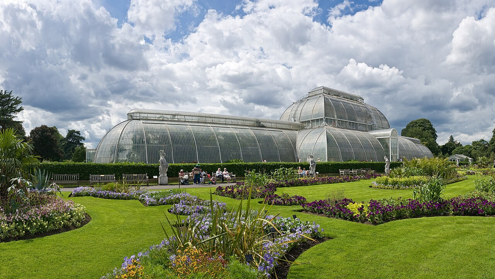
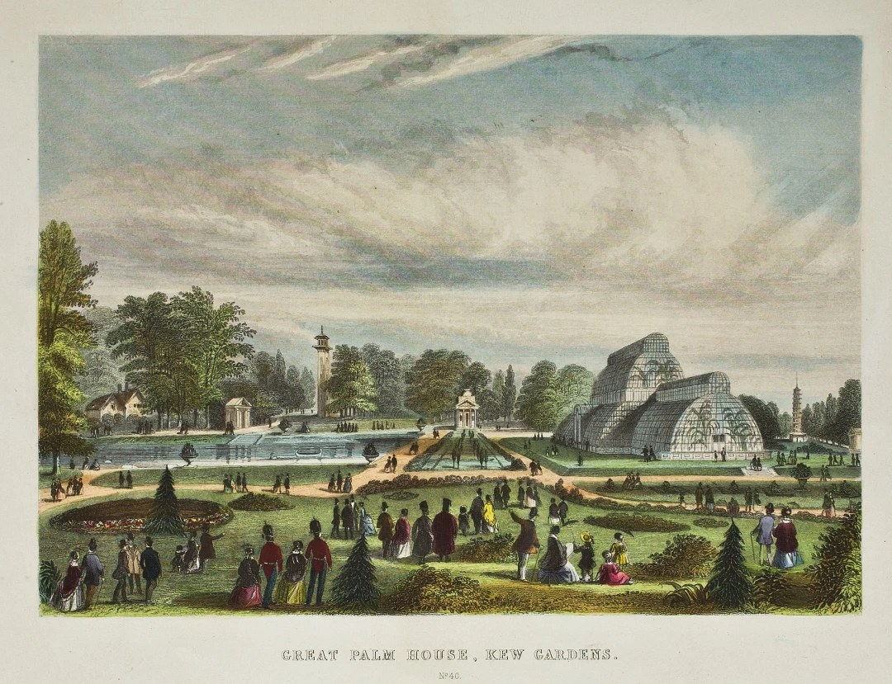

# Palm House, Kew Gardens

| | |
|---|---|
| **Location** | Royal Botanic Gardens, Kew, Richmond, London, England |
| **Near** | Kew Palace and Kew Green |
| **Built** | 1844–1848 |
| **Architect** | Decimus Burton (architect) and Richard Turner (ironfounder and engineer) |
| **Style** | Curvilinear wrought iron and glass |
| **Type** | [Glasshouse](../../../README.md#glasshouse) |
| **Original use** | Glasshouse for tropical palms and plants |
| **Status** | In use. Grade I listed, within the Kew World Heritage Site. Restored 1955–57 and 1985–88; due to close in 2027 for a five-year renovation |
| **Features** | [Iron and glass construction](../../../GLOSSARY.md#iron-and-glass-construction), [Underground tunnel](../../../GLOSSARY.md#underground-tunnel), [Tower](../../../GLOSSARY.md#tower), [Landscaped park](../../../GLOSSARY.md#landscaped-park) |

*The Palm House today, seen across its flower beds. Supplied by the owner, apparently from Wikimedia Commons; photographer and licence to be confirmed.*

## Overview

The Palm House is the great curved glasshouse beside the pond at Kew. It's about 110 m (362 ft) long, with a central section about 20 m (around 62–67 ft; sources differ) high and lower wings on each side, all made of curved wrought-iron ribs and glass. It was built between 1844 and 1848 to house tropical palms, and it is usually described as the first large building to use wrought iron on this scale.

It has a hidden side. Its boilers were placed beneath the building, and their smoke was carried away through a tunnel about 150 m long to a chimney disguised as an Italian bell tower, the Campanile, near Victoria Gate. A small railway in the tunnel brought coal to the boilers. The design is credited to the architect Decimus Burton and the Irish ironfounder Richard Turner, but who really designed it was disputed at the time and still is.

## The main story

The Palm House was built as Kew changed from a royal garden into a national botanic garden, to show the tropical plants arriving from the British Empire.

- **1840** – Kew becomes a national botanic garden. Sir William Hooker becomes its director the following year.
- **1844** – Building begins. Decimus Burton first proposes heavy cast-iron arches; Richard Turner, an ironfounder from Dublin, proposes instead to use wrought-iron "deck beams" of the kind used in shipbuilding, which can span wider spaces without columns.
- **1844–1848** – The building goes up. According to *The Builder* in 1848, the main ribs are made of nine-inch deck-beam iron, welded together to a length of about 42 ft and bent to the curve on a template. Turner is also responsible for the heating and ventilation.
- **1848** – The glass is tinted pale green with copper oxide, after tests to find a glass that would cut down the heat of the sun without blocking too much light.
- **c. 1848** – Burton's Campanile is built near Victoria Gate as the chimney for the boilers and as a water tower, linked to the Palm House by a tunnel of about 150 m, with a narrow railway for bringing coal to the twelve boilers under the building.
- **1848** – The Palm House is completed. *The Builder* estimates its cost at about £30,000, not including the chimney and tunnel.
- **1955–1957** – The first restoration: the glazing bars are cleaned and the whole building is reglazed.
- **September 1985 – October 1988** – A second, major restoration by the Property Services Agency. The structure is reported to have been taken down to its frame and rebuilt.
- **2003** – Kew becomes a UNESCO World Heritage Site.
- **From 2027** – A five-year renovation is planned, replacing all 16,000 panes with insulated glass, repainting the iron, and changing the heating to heat pumps.

## Conservation

- The Palm House is **Grade I listed**, and stands within the Royal Botanic Gardens, Kew World Heritage Site.
- The Campanile and the tunnel survive. The railway has gone and the tunnel now carries pipes; its route can sometimes be seen in snow, where the warmth melts a line on the ground above.
- The planned renovation aims to make it the first net-zero glasshouse of its kind.

## The alternative view

The official account is of a pioneering Victorian glasshouse, made possible by shipbuilding technology and an ingenious ironfounder. Looked at from an "old world" perspective, several things invite a second look: a chimney disguised as a bell tower and joined to the building by a secret tunnel with its own railway, a dispute over who designed it, the same curved glasshouse form appearing in several countries at once, and a structure taken down and rebuilt in the 1980s. Each point below carries an evidence label: **Documented**, **Observed**, **Reported** or **Speculative** (see the [research brief](https://github.com/martinv678/our-old-world/blob/main/CLAUDE.md)).

### A chimney disguised as a bell tower, and a tunnel with a railway

**Documented** – The Palm House's boilers sat beneath the building, but their chimney was placed about 150 m away and dressed as an Italian campanile, because a tall industrial chimney beside the glasshouse was thought to be ugly. A tunnel linked the two, carrying the smoke away and bringing coal to the boilers on a small railway. A gardener caught misbehaving is said to have been put on boiler duty, hauling coal wagons along the tunnel (**Reported**).

For this project, this is a good example of two recurring themes:

- **A disguised tower.** Like [Tower Bridge](../tower-bridge/tower-bridge.md#a-steel-bridge-in-medieval-clothes), where a steel frame was dressed in stone, a working industrial structure was made to look like an older building type.
- **A hidden underground system.** Tunnels and underground spaces are a major interest in mud flood research. Here, the tunnel's purpose is documented and ordinary.

It also helps with the "lost energy technology" theme. The Campanile was a real tower with a real technical function, heating, and it's documented. Like the [Natural History Museum](../natural-history-museum/natural-history-museum.md#towers-that-breathe)'s ventilation towers and Tower Bridge's hydraulics, it shows what a genuine 19th-century energy system leaves behind: boilers, flues, a coal supply and records. One source says the chimney was too far from the boilers to draw well, which made the heating less efficient: a mistake, which is relevant to the [skill and precision](../../../ALTERNATIVE-VIEW.md#skill-and-precision-the-master-builders-argument) argument.

### Who designed it?

**Documented** (dispute) – The Palm House is usually credited to Burton as architect and Turner as engineer. But Turner's supporters claimed at the time that it was entirely his design, and a letter to *The Building News* said it had an authoritative statement from Turner to that effect. Kew's historian Ray Desmond is reported to have found that Burton was heavily indebted to Turner's engineering skill, and that relations between the two were strained. As with the [Crystal Palace](../crystal-palace/crystal-palace.md), where a gardener produced the design in days, the question of who really designed a pioneering iron and glass building is not straightforward. Edward Diestelkamp's study, "Richard Turner and the Palm House at Kew Gardens" (1982), is the main source on this.

### The same glasshouse in several places at once

**Observed** / **Speculative** (interpretation) – Curved iron and glass glasshouses appeared across Britain and Ireland within a few years of each other: Paxton's Great Conservatory at Chatsworth (1836–41), Turner's own glasshouses at Belfast and at Glasnevin in Dublin, the Palm House at Kew (1844–48), the Crystal Palace (1850–51), and the Royal Horticultural Society's conservatory in South Kensington (1861), which the owner has noted looks like Paxton's work (see the [Royal Albert Hall](../royal-albert-hall/royal-albert-hall.md#the-glasshouse-behind-the-hall) entry). In the "shared worldwide architecture" theme, this is a family of buildings with the same form. The ordinary explanation is that a small number of designers and ironfounders, including Paxton and Turner, knew each other's work and built for a small circle of wealthy patrons and institutions.

### Made by shipbuilders

**Documented** (deck beams) / **Speculative** (logistics) – The ribs are made of wrought-iron deck beams, a product of shipbuilding, welded and bent to shape. The building is sometimes compared to the upturned hull of a ship. Turner's works were in Dublin, so where the 42 ft ribs were made, and how they were brought to Kew, is a good subject for a [delivery check](../../../ALTERNATIVE-VIEW.md#materials-and-delivery-the-logistics-argument): were they made in Dublin and shipped across the Irish Sea and up the Thames, or made in London?

### Glass that controlled the light

**Documented** – The glass was tinted pale green with copper oxide after tests to find a glass that would reduce the heat of the sun on the plants while letting light through. It's an early example of glass made to control light and heat. It was replaced in the 1955–57 restoration. For this project, it shows that the Victorians were experimenting with materials to manage light and heat, and recorded those experiments.

### Taken apart and rebuilt

**Reported** – In the major restoration of 1985–88, the Palm House is reported to have been taken down to its frame and rebuilt, with new glazing. How much of today's structure is the original 1840s iron, and how much was replaced? This is the same question raised by other buildings in this project that were moved or rebuilt, such as the [Crystal Palace](../crystal-palace/crystal-palace.md) and Temple Bar at the [Royal Courts of Justice](../royal-courts-of-justice/royal-courts-of-justice.md#temple-bar-a-gate-taken-down-next-door).

### No construction images found

**Observed** (none found so far) – No photographs or engravings of the Palm House being built have been found yet, by the owner or in online searches. The earliest image in this entry is a hand-coloured print of the finished building, probably from the 1850s–60s, which already shows the Campanile chimney across the pond. It was built in 1844–48, in the first years of photography, when photographs were rare and needed long exposures, so this is less surprising than for buildings of the 1870s. Engravings of the works in *The Builder* or the *Illustrated London News* are more likely. See the [photo record](../../../ALTERNATIVE-VIEW.md#missing-construction-photographs-the-photo-record-argument).

### Dates and inscriptions

**Speculative** – No date stones, maker's plates or inscriptions on the Palm House or the Campanile have been checked yet for the [letters in dates](../../../ALTERNATIVE-VIEW.md#letters-in-dates-the-j-argument) argument. Cast iron and wrought iron often carry founders' marks and dates, which would be worth recording.

### Anomaly log

| Anomaly | Evidence | Label | Source |
|---|---|---|---|
| Chimney disguised as an Italian bell tower, 150 m from the building | Surviving Campanile; histories | Documented | Ian Visits; Victorian Web |
| Tunnel with a railway for coal under the gardens | Surviving tunnel; histories | Documented | Ian Visits |
| Chimney too far from the boilers to draw well | Secondary source | Reported | Exploring London |
| Who designed it was disputed at the time | Letters to *The Building News*; later research | Documented | Wikipedia; Diestelkamp (1982) |
| Ribs made from shipbuilders' deck beams | *The Builder*, 1848 | Documented | Grace's Guide |
| Green glass tinted with copper oxide to control heat | Period accounts | Documented | Gardenvisit (period text) |
| Reportedly taken down to its frame and rebuilt in 1985–88 | Restoration accounts | Reported | RICS library record |
| No construction images found | Searches so far | Observed | This project |

### Timeline check

**What we know:** building began in 1844 and finished in 1848, about four years. The building is about 110 m long and up to about 20 m high, with main ribs about 42 ft long, and was estimated to cost about £30,000 without the chimney and tunnel.

**The working:**

- **Method:** the structure is a repeated system of identical curved ribs, made by bending welded deck-beam iron on a template, then glazed with small curved panes. Like the Crystal Palace, it was essentially one bay repeated many times.
- **Time:** four years is generous for a building of this size made of repeated parts, compared with the Crystal Palace's nine months a few years later. The time was probably taken up by developing the method (welding and bending wrought iron at this scale was new), testing the glass, and building the tunnel and Campanile.
- **Delivery check:** the weight of iron and the number of original panes haven't been found yet. The key question is where the ribs were made and how they reached Kew; Kew is on the Thames, so river delivery was possible.

**Working still needed:**

1. The weight of iron and the original number of panes.
2. Where the ironwork was made, and how it was delivered.
3. The size of the workforce.

**Verdict for now:** **Plausible.** Four years for a building made of repeated parts is not fast. The interest here is in the hidden tunnel and the disguised chimney, the design dispute, and how much of the original survived the 1980s rebuilding.

### Comparison buildings

| Building | Where | Built | Link |
|---|---|---|---|
| Great Conservatory, Chatsworth | Derbyshire, UK | 1836–41 | Paxton's glasshouse; demolished 1920 |
| Palm House, Belfast Botanic Gardens | Belfast, UK | From 1839 | Iron by Richard Turner |
| Curvilinear Range, National Botanic Gardens | Glasnevin, Dublin, Ireland | From 1843 | Richard Turner's own glasshouses |
| [The Crystal Palace](../crystal-palace/crystal-palace.md) | London, UK | 1850–51 | Iron and glass on a giant scale; burned 1936 |
| Temperate House, Kew | London, UK | 1859–63 | Burton's later glasshouse at Kew, the largest surviving Victorian glasshouse |
| RHS Great Conservatory, South Kensington | London, UK | 1861 | By Fowke; demolished (see the [Royal Albert Hall](../royal-albert-hall/royal-albert-hall.md#the-glasshouse-behind-the-hall)) |
| [Royal Exhibition Building](../../australia/royal-exhibition-building/royal-exhibition-building.md) | Melbourne, Australia | 1879–80 | Later exhibition hall in the same tradition |

### What would support the alternative view

- Evidence that the ironwork or the Campanile is older than 1844
- Contradictions between the Kew records and the building as it stands
- No records of where the iron was made or how it was delivered
- Underground features (the tunnel, the boiler rooms) that don't match the 1840s plans

### What would weaken it

- Kew's archive of drawings, letters and accounts, and Turner's and Burton's papers
- *The Builder*'s detailed reports of 1848 and the records of the restorations
- Founders' marks and dates on the ironwork
- Records of the 1985–88 restoration, showing what was original and what was replaced

## Open questions for contributors

- **The design:** How much of the design was Burton's and how much was Turner's?
- **The ironwork:** Where were the ribs made, and how were they delivered to Kew?
- **The height:** Is the central section 62 ft or 67 ft high?
- **The glass:** Who made the original green glass, and how many panes were there?
- **The 1980s restoration:** Was the building really taken down to its frame? How much original iron survives?
- **The Campanile:** When exactly was it built, and was it a water tower as well as a chimney?
- **Construction images:** Are there any engravings of the Palm House being built in *The Builder* or the *Illustrated London News*?

## Leads to follow up

- **Kew archives:** the Royal Botanic Gardens' library and archives, including Hooker's correspondence, the drawings and the accounts.
- **Diestelkamp (1982):** "Richard Turner and the Palm House at Kew Gardens", *Transactions of the Newcomen Society* 54.
- **Ray Desmond:** his history of Kew.
- **Period journals:** *The Builder* (1848) and *The Building News*, including the letters on Turner's role, and the *Illustrated London News*.
- **Turner's papers:** archives in Dublin relating to the Hammersmith Ironworks and the Glasnevin glasshouses.
- **Restoration records:** the Property Services Agency's records of the 1985–88 restoration.
- **Historic England:** the Grade I listing.

## Research notes

<!-- Owner's notes: add observations, hunches and links here. Claude reads this section first and doesn't remove it. -->

- Owner's observation: there are no construction photographs of the Palm House, only images of the finished building. See [No construction images found](#no-construction-images-found).

## Images

Click any image to enlarge it.

*The Palm House today, seen across its flower beds. Supplied by the owner, apparently from Wikimedia Commons; photographer and licence to be confirmed.*

*"Great Palm House, Kew Gardens", hand-coloured print numbered 46, probably 1850s–60s (date not confirmed; the women's crinolines suggest these years). The Palm House is on the right, with palms visible through the glass. Across the pond stands a tall tower, which appears to be Burton's Campanile, the disguised chimney for the boilers, and on the far right is the Pagoda of 1762. Supplied by the owner; publisher and licence to be confirmed, though a print of this age is likely to be out of copyright.*

**No construction images.** The owner has looked and found no photographs or engravings of the Palm House being built, only views of the finished building like the print above.

Other images that would be useful:

- any **engraving** of the Palm House being built in 1844–48
- the **Campanile** near Victoria Gate today
- the **tunnel** and its railway, and the boiler rooms
- the Palm House **during the 1985–88 restoration**, stripped to its frame
- **founders' marks** or dates on the ironwork

## Sources

- Wikipedia – Palm House, Kew Gardens: https://en.wikipedia.org/wiki/Palm_House,_Kew_Gardens
- Grace's Guide – Palm House, Kew Gardens (including *The Builder*, 1848): https://gracesguide.co.uk/Palm_House,_Kew_Gardens
- British Listed Buildings – The Palm House, Kew: https://britishlistedbuildings.co.uk/101262670-the-palm-house-kew-ward
- Ian Visits – Kew Gardens' private underground railway: https://www.ianvisits.co.uk/blog/2018/01/10/kew-gardens-private-underground-railway/
- Victorian Web – Kew Gardens water tower and chimney (the Campanile): https://victorianweb.org/art/architecture/industrial/2.html
- Exploring London – The Palm House, Kew Gardens: https://exploring-london.com/2013/01/30/10-of-londons-greatest-victorian-projects-3-the-palm-house-kew-gardens/
- Gardenvisit – Glazing the Palm House at Kew Gardens (period text): https://www.gardenvisit.com/book/gardening_tools_equipment_and_buildings/chapter_6_structures_used_in_gardening/glazing_the_palm-house_at_kew_gardens
- Linda Hall Library – Decimus Burton: https://www.lindahall.org/about/news/scientist-of-the-day/decimus-burton/
- Weeds, Roots, Leaves – In search of Richard Turner: https://weedsrootsleaves.com/2024/11/
- RICS library – PSA restores Palm House at Kew: https://rics.koha.openfifth.net/bib/45447
- Kew – Plans submitted to renovate the Palm House: https://www.kew.org/about-us/press-media/palm-house-renovation
- Gardens Illustrated – Kew Gardens renovation of the Palm House: https://www.gardensillustrated.com/news/kew-gardens-renovation-palm-house
- Time Out – Kew Gardens' Palm House will soon close: https://www.timeout.com/london/news/kew-gardens-iconic-palm-house-will-soon-close-for-four-years-071625
- Science Museum Group – The Palm House, Kew Gardens (Dufaycolor print): https://collection.sciencemuseum.org.uk/objects/co8228738/the-palm-house-kew-gardens-dufaycolor-print
