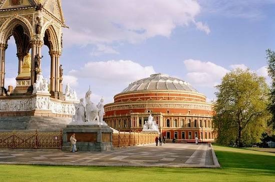
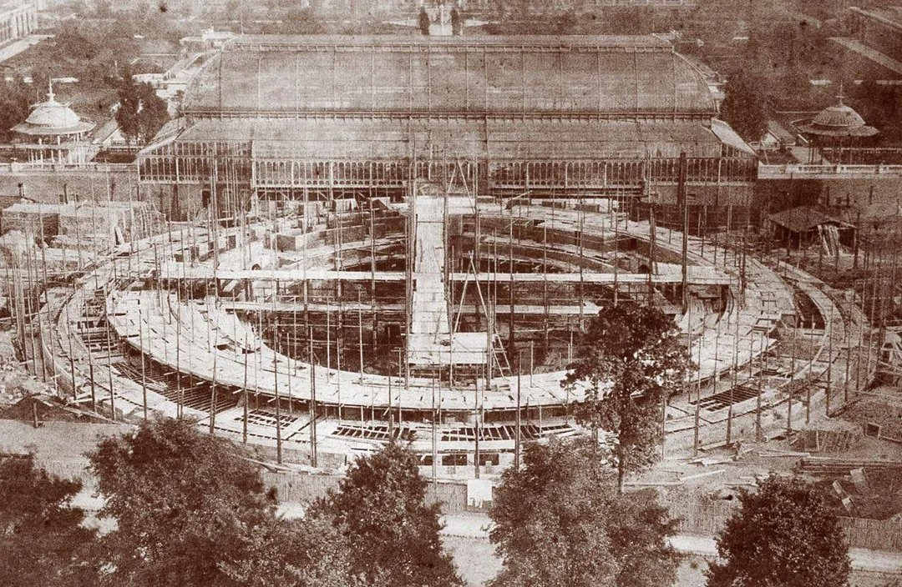
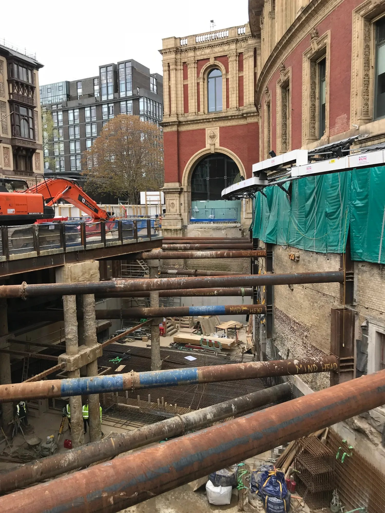

# Royal Albert Hall

| | |
|---|---|
| **Location** | Kensington Gore, South Kensington, City of Westminster, London, England |
| **Near** | Kensington Gardens and the Albert Memorial |
| **Built** | 1867–1871 |
| **Architect** | Captain Francis Fowke (died 1865) and Henry Y. D. Scott, Royal Engineers; dome designed by Rowland Mason Ordish; built by Lucas Brothers |
| **Style** | Italianate, modelled on Roman amphitheatres: red brick and terracotta, with an iron and glass dome |
| **Type** | [Concert hall](../../../README.md#concert-hall) |
| **Original use** | "Central Hall of Arts and Sciences": concerts, exhibitions and public meetings |
| **Status** | In use as a concert hall. Grade I listed. Renovated 1996–2004 |
| **Features** | [Dome](../../../GLOSSARY.md#dome), [Iron and glass construction](../../../GLOSSARY.md#iron-and-glass-construction), [Inscriptions](../../../GLOSSARY.md#inscriptions) |

*The Royal Albert Hall seen from the steps of the Albert Memorial in Kensington Gardens, with the memorial's canopy and one of its corner sculpture groups on the left. Modern photo; photographer, source and licence to be confirmed.*

## Overview

The Royal Albert Hall is a huge oval concert hall in South Kensington, facing Kensington Gardens and the Albert Memorial. It stands on land bought with the profits of the Great Exhibition of 1851, at the heart of the cultural district nicknamed "Albertopolis". Its walls are of red brick and terracotta, around the top runs a mosaic frieze with a long inscription, and above everything is an elliptical dome of wrought iron and glass.

The hall was planned as a memorial to Prince Albert, who died in 1861. Its designer, Captain Francis Fowke, died before construction began, and the building was completed by another Royal Engineer, Henry Scott. Queen Victoria laid the foundation stone on 20 May 1867, renamed the hall after her husband at that ceremony, and opened it on 29 March 1871. It's best known today as the home of the Proms.

## The main story

The hall was the centrepiece of Prince Albert's plan to use the Great Exhibition's profits for a permanent district of museums, colleges and halls devoted to the arts and sciences.

- **December 1851** – After the Great Exhibition closes, the Royal Commission for the Exhibition of 1851 begins buying land in South Kensington, including Gore House and its grounds, following Prince Albert's scheme.
- **1850s** – Albert's plans include a great central hall, but nothing is built while he lives.
- **14 December 1861** – Prince Albert dies.
- **1862** – The International Exhibition is held on Commission land nearby, in a building designed by Captain Francis Fowke. It's demolished in 1864, and its materials go to build [Alexandra Palace](../alexandra-palace/alexandra-palace.md).
- **1860s** – Henry Cole of the South Kensington Museum takes up the idea of a hall as a memorial to Albert. Cole and Fowke visit Roman amphitheatres in France, and a model of a large oval hall is approved by Queen Victoria in 1864. The designers are also said to have been influenced by the ideas of Gottfried Semper.
- **December 1865** – Fowke dies, soon after the plans are approved. Henry Scott, another Royal Engineer in Cole's department, completes the design.
- **1865–1867** – The hall is paid for partly by selling seats in advance at £100 each. The Commission provides the land and offers to cover the rest of the cost if £150,000 can be raised. The total cost is about £200,000. Buyers of the seats (and their successors, the "seatholders") still own about 1,300 of the hall's roughly 5,200 seats.
- **April 1867** – Queen Victoria signs the Royal Charter of the Corporation of the Hall of Arts and Sciences. The contractors Lucas Brothers begin preliminary work.
- **20 May 1867** – The Queen lays the foundation stone before a crowd reported at about 7,000. At the ceremony she adds Albert's name, making it the Royal Albert Hall of Arts and Sciences.
- **1867–1870** – The walls go up in about 6 million red bricks with about 80,000 blocks of terracotta decoration, made by Gibbs and Canning. The wrought iron dome, designed by Rowland Mason Ordish, is made by the Fairbairn Engineering Company, trial-assembled at their works in Manchester, taken apart and brought to London, where the hall is filled with timber scaffolding to put it up. The building is reported as completed by Christmas 1870.
- **29 March 1871** – The hall is opened. After a speech by the Prince of Wales, the Queen is too overcome to speak, and the Prince announces that "The Queen declares this Hall is now open". The hall's echo is noticed immediately.
- **1871** – The Grand Organ by "Father" Henry Willis, with 111 stops, is described as the largest in the world at the time.
- **1873** – Electric lighting is demonstrated in the hall. Full electric lighting is installed in 1888 (one source gives 1879).
- **1949** – The canvas awning hung under the dome to reduce the echo is replaced with fluted aluminium panels.
- **24 February 1958** – The hall is listed (now Grade I).
- **Late 1968 – 1969** – Fibreglass acoustic diffusers, nicknamed "mushrooms", are hung below the dome (usually given as 135). In 2001 some are removed and the rest rearranged.
- **1996–2004** – A major renovation is carried out in about 30 separate projects while the hall stays open. A deep basement is dug at the rear for plant and loading, the south steps to Prince Consort Road are taken down and rebuilt around a new south porch, and the organ is rebuilt by Mander Organs.
- **2017 – c. 2019** – The "Great Excavation": Sir Robert McAlpine digs two new basement levels on the south-west side of the hall, about 40 m by 20 m and 10 m deep, adding about 930 m² of space. The works expose the hall's lower walls below today's ground level.

## Conservation

- The hall is **Grade I listed** (first listed 24 February 1958).
- It's run by a charity, the Corporation of the Hall of Arts and Sciences, under its Royal Charter of 1867. The seatholders are members of the Corporation.
- The 1996–2004 renovation won a European heritage award as the first comprehensive renovation since the hall opened.
- The frieze and terracotta have been cleaned and repaired in later conservation projects.

## The alternative view

The official account is of a well-documented Victorian memorial, designed by army engineers and paid for by a mix of exhibition profits and private subscriptions. Looked at from an "old world" perspective, several things invite a second look: a Roman amphitheatre rebuilt in brick in the 1860s, a dome assembled in another city, a hall that echoed from the day it opened, early electric light, and a long inscription that sets out the official history in stone. Each point below carries an evidence label: **Documented**, **Observed**, **Reported** or **Speculative** (see the [research brief](https://github.com/martinv678/our-old-world/blob/main/CLAUDE.md)).

### The history written in stone

**Documented** (inscription) / **Observed** (how the dates are written) – A terracotta inscription about a foot high runs around the top of the building above the frieze. It states that the hall was "erected for the advancement of the Arts & Sciences and works of industry of all nations" in fulfilment of Prince Albert's intention, that the site was bought with the proceeds of the Great Exhibition of MDCCCLI (1851), and that the Queen laid the first stone on the twentieth day of May MDCCCLXVII (1867).

For the [letters in dates](../../../ALTERNATIVE-VIEW.md#letters-in-dates-the-j-argument) argument, this is a useful test case: the years are written in Roman numerals, starting with **M** (1,000), not with a "1" that could be read as an I or J. It's unusual for a building to carry its own official history around its walls in this way. The alternative view asks why the founders felt the need to state the origin of the site and the date of the first stone so prominently (**Speculative**).

Points to weigh up:

- **Victorian memorial buildings often carried dedications.** A memorial to Albert stating its purpose and dates is in keeping with the period.
- **Roman numerals were the formal style.** Writing dates as MDCCCLXVII on a public monument was normal in the 19th century, so the numerals themselves aren't an anomaly.

**How to test it:** photograph the whole inscription and transcribe it exactly, then compare it with the foundation stone itself (if it's visible) and with the dates in the Corporation's records.

### A Roman amphitheatre in 1860s London

**Documented** (design source) / **Speculative** (interpretation) – The hall's oval plan was taken directly from Roman amphitheatres: Cole and Fowke visited amphitheatres in France before the design was approved. In this project's "shared worldwide architecture" theme, the question is why a Victorian concert hall copied the form of a building type supposedly 1,800 years old, and whether the "classical revival" of the 19th century was really a revival or a continuation of an older building tradition that had never stopped. The ordinary answer is that Victorian architects studied and copied ancient buildings on purpose. Which amphitheatres they visited, and how closely the hall follows them, can be checked in Fowke's and Cole's papers.

### The dome built twice

**Documented** – The wrought iron frame of the dome, reported as about 338 tonnes carrying about 279 tonnes of glazing, was first put together on the Fairbairn works in Manchester, then taken apart, carried to London and reassembled on the hall. An often-repeated story says that when the scaffolding was removed the dome dropped by only about five-sixteenths of an inch; this hasn't been traced to a primary source yet (**Reported**).

This is the same pattern seen at the [Crystal Palace](../crystal-palace/crystal-palace.md): structures assembled in one place and moved to another. Here, though, the trial assembly is well documented and is a normal engineering precaution for a roof of this size. The precision is the interesting part. How did Victorian engineers achieve it with the tools of the day? Fairbairn's own records would show the method.

**Documented** (construction photographs) – The hall's own archive has published period photographs of the building going up, including the dome being built: see [Construction of the Royal Albert Hall in pictures](https://www.royalalberthall.com/about-the-hall/building-and-history/our-history/construction-of-the-royal-albert-hall-in-pictures). Photographs of the iron frame being raised are strong evidence that the dome was built in 1867–71 as the official story says, rather than inherited from an earlier structure. The Science Museum Group also holds a print titled "Building of Royal Albert Hall", dated 1867–71, and the V&A has published an article on how the dome was designed.

**How to use the photos:** check each one's date and caption, and compare the stages of the dome shown with the reported sequence (trial assembly in Manchester, then re-erection in London on timber scaffolding filling the hall). Note the resolution any analysis is based on, as the research brief asks.

### A hall that echoed from the first day

**Documented** – The echo was noticed at the opening on 29 March 1871 and wasn't properly dealt with for nearly a century. A canvas awning was hung under the dome, then replaced with aluminium panels in 1949, and the "mushroom" diffusers were added in 1968–69. It was joked that the hall was the only place where a British composer could be sure of hearing his work twice.

**Speculative** – In alternative history research, large domed halls with strong acoustic effects are sometimes linked to ideas about sound or resonance being used for purposes other than music. There's no evidence of this here, and the simpler explanation is that the acoustics of a giant elliptical dome weren't well understood in the 1860s. It's recorded as a hunch to test, not a finding.

### Early electric light under a glass dome

**Documented** (dates) / **Speculative** (energy theme) – Electric lighting was demonstrated in the hall as early as 1873, only two years after it opened, and fully installed by 1888 (one source says 1879). For this project's "lost energy technology" theme, the combination of a huge iron and glass dome and very early electric light is worth noting. The ordinary explanation is that the hall was a showpiece of science and industry, and early electric demonstrations were held in exactly this kind of venue. Records of the 1873 demonstration (who ran it, and how the power was generated) would show which explanation fits.

### The designer who didn't see it built

**Documented** – Captain Francis Fowke designed both the 1862 International Exhibition building and the first plans for the hall, but died in December 1865, before work on the hall began. His 1862 building was demolished after one season and moved to Muswell Hill to become Alexandra Palace, which burned down 16 days after opening. Another grand 19th-century building in this project, the [Galleria Vittorio Emanuele II](../../italy/galleria-vittorio-emanuele-ii/galleria-vittorio-emanuele-ii.md) in Milan, also lost its architect just before it was finished: Giuseppe Mengoni died in a fall from scaffolding the day before the final inauguration in 1877. The cause of Fowke's death, and how much of the final design was his rather than Scott's, need checking.

### Paid for in seats

**Reported** – Seats were sold in advance at £100 each to raise the money, and the seatholders still own about 1,300 of the seats today. They're often said to hold them on 999-year leases, but this hasn't been confirmed in the sources reached so far. It's an unusual arrangement for a public building, and the original subscription lists would show who paid for the hall and when.

### Ground levels and the buried walls

**Observed** (slope and exposed walls) / **Speculative** (mud flood) – The ground falls from Kensington Gore on the north side to Prince Consort Road on the south, where steps led down from the hall. Two modern projects have dug down beside it: the 1996–2004 works, which made a deep basement behind the hall (reported as 18 m) and a tunnel under it for services, and the Great Excavation of 2017–19, which dug two basement levels about 10 m deep on the south-west side. In mud flood research, buildings with walls running well below today's ground are checked for signs that the ground was once lower.

**A photo of the Great Excavation** (from [Kevin Kelly Architects](https://www.kevinkellyarchitects.com/projects/royal-albert-hall), see [Images](#images); it appears to be from 2017–19, as Sir Robert McAlpine hoarding is visible) shows the side of the hall cut open, with the excavation held apart by steel props. What it shows:

- **The walls go a long way down.** The hall's wall continues roughly a full storey or more below today's ground level, down to the excavation floor (**Observed**).
- **Two kinds of wall.** Above ground the wall is red brick with carved terracotta window surrounds. Below ground it changes to plain yellow-grey brick, with patches of older red brick and no decoration (**Observed**).
- **An opening in the buried wall.** At the far right of the photo, low down in the exposed wall, there appears to be a framed opening with a stone surround (**Observed**). It's only partly in view, so it's not clear whether it's a window, a door, a light well or a later service opening.

Points to weigh up:

- **Plain brick below ground fits a basement that was always underground.** Builders didn't put terracotta decoration on walls that were never meant to be seen. If this level had once been at street level, you'd expect it to be faced and decorated like the walls above.
- **The hall had lower levels from the start.** The construction photo described below shows the lower storeys being built from an open site in 1867–71.
- **The opening is the part worth checking.** Victorian basements often had windows onto light wells or areas below pavement level. Comparing its position with the original drawings would show whether it was planned as a below-ground window.

**How to test it:** find a larger copy of the excavation photo, ideally with a date, and look closely at the opening and the join between the two kinds of brick. Compare them with Fowke and Scott's section drawings, and with any report from the 1996–2004 or 2017–19 works on what was found below ground (older structures, fill or buried surfaces).

### The construction photo: building from the ground up

**Documented** (photo) / **Observed** (what it shows) – An early construction photo (see [Images](#images); via [Kevin Kelly Architects](https://www.kevinkellyarchitects.com/projects/royal-albert-hall)) shows the hall at an early stage, probably 1867–68 (date not confirmed). It's taken from high up on the north side, with trees from Kensington Gardens in the foreground. The oval ring of the lower walls and the arena are surrounded by timber scaffolding, with stacks of building materials around them.

What it shows:

- **The hall's lower levels being built on an open site.** The ring of walls rises from cleared ground, with the deeper centre (the arena) inside it. This supports the official account that the lower storeys were built new in 1867, rather than being an older building dug out of the ground. It weakens a mud flood reading for the Albert Hall itself (**Observed**).
- **The ground level then and now.** The hoarding and road in the foreground can be compared with today's street level on the north side, to see whether the ground has been raised since 1867.

### The glasshouse behind the hall

**Observed** (photo) / **Documented** (identity) / **Speculative** (pattern) – Behind the half-built hall in the construction photo stands a large curved iron and glass conservatory, with two small domed pavilions to either side. This is the Royal Horticultural Society's Great Conservatory, which opened in 1861 at the north end of the Society's garden in South Kensington, on land leased from the 1851 Exhibition Commissioners. It's credited to Captain Francis Fowke, the hall's own designer, with Sydney Smirke (who designed the garden's arcades).

As the owner has noted, it looks very like Joseph Paxton's glasshouses: the curved roof recalls his Great Conservatory at Chatsworth (1836–41) and the arched transept of the [Crystal Palace](../crystal-palace/crystal-palace.md). The resemblance is real, and it's no accident: Paxton's buildings set the pattern for large Victorian glasshouses, and the Commissioners who leased the garden had put up the Crystal Palace ten years earlier.

What stands out for this project:

- **Another lost glasshouse.** The Society's garden closed in the 1880s (sources give 1882 or 1888) and the conservatory was later demolished; its exact demolition date hasn't been found yet. Chatsworth's Great Conservatory was demolished in 1920, the Crystal Palace burned in 1936, and Fowke's 1862 Exhibition building was taken down in 1864. Almost all of the great glasshouses of this period have gone (**Speculative** as to any pattern beyond cost and fire risk).
- **One designer, one district.** Fowke designed the conservatory, the 1862 Exhibition building and the first plans for the hall, all within a few hundred metres of each other in a few years, and he died in 1865.
- **The domed pavilions.** The two small domed buildings beside the conservatory haven't been identified yet. They may be the garden's bandstands, which the Survey of London also credits to Fowke.

**How to test it:** the Survey of London volume 38 (on British History Online) describes the Horticultural Society's garden and has plates of the conservatory. Compare its plans and dates with the construction photo, and look for when and why the conservatory was taken down.

### Anomaly log

| Anomaly | Evidence | Label | Source |
|---|---|---|---|
| Official history and dates written around the building in Roman numerals | Terracotta inscription | Documented | London Remembers |
| Oval plan copied from Roman amphitheatres | Design history | Documented | Royal Albert Hall archive (AIM25); Country Life |
| Dome trial-assembled in Manchester, then rebuilt in London | Engineering histories | Documented | Grace's Guide; Designing Buildings |
| Dome said to have dropped only 5/16 in when scaffolding was removed | Often repeated, not yet traced | Reported | – |
| Severe echo from the opening day; not fixed until 1969 | Histories of the hall | Documented | Designing Buildings; Institute of Acoustics |
| Electric light demonstrated in 1873 | Histories of the hall | Documented | Wikipedia; Grace's Guide |
| Designer died before construction began | Histories of the hall | Documented | Country Life; AIM25 |
| Seats sold in advance; seatholders still own about 1,300 seats | Histories of the hall | Reported | New World Encyclopedia; Wikipedia |
| Period photographs show the dome under construction | Hall's published construction photographs | Documented | [Royal Albert Hall](https://www.royalalberthall.com/about-the-hall/building-and-history/our-history/construction-of-the-royal-albert-hall-in-pictures) |
| Hall on a slope, with steps down to the south; deep basement dug 1996–2004 | Visible on site; project records | Observed | Designing Buildings; GCG |
| Hall's walls run a storey or more below today's ground; plain brick below, decorated red brick above | Photo of the Great Excavation | Observed | Kevin Kelly Architects; Sir Robert McAlpine |
| Framed opening with a stone surround in the buried wall | Photo of the Great Excavation | Observed | Kevin Kelly Architects |
| Lower walls built up from an open site in 1867–68 | Early construction photo | Observed | Kevin Kelly Architects |
| Paxton-style conservatory behind the site, by Fowke, since demolished | Early construction photo; Survey of London | Documented | Kevin Kelly Architects; British History Online |

### Timeline check

**What we know:** preliminary work began in April 1867, the foundation stone was laid on 20 May 1867, the building was reported complete by Christmas 1870, and it opened on 29 March 1871. That's about 3 years 8 months from the start of work to completion.

**The working:**

- **Brickwork:** about 6 million bricks over roughly 3 years of wall-building (about 150 working weeks) is about 40,000 bricks a week, or about 6,700 a day over a six-day week. A Victorian bricklayer is often said to have laid around 500–1,000 bricks a day (a commonly quoted figure, not confirmed here), so this needs only about 7 to 14 bricklayers working at once, plus labourers. Even allowing for the curved walls and terracotta, that's comfortable.
- **Delivery check:** about 6 million bricks at roughly 3 kg each is about 18,000 tonnes. At about 6,700 bricks a day and about 500 bricks to a one-horse load, that's about 13 cart-loads a day, or four or five carts making three or four trips each from a wharf or yard nearby. The open question is the total for South Kensington, where the hall, the museums and new housing were all going up in the same years. See the [logistics argument](../../../ALTERNATIVE-VIEW.md#materials-and-delivery-the-logistics-argument) for the method.
- **Terracotta:** about 80,000 blocks made off site by Gibbs and Canning and fixed over the same period is about 530 blocks a week.
- **Dome:** the iron frame was made and test-assembled in Manchester before delivery, so the work in London was mainly re-erection and glazing.
- **Money:** about £200,000 over four years is about £50,000 a year.

**Working still needed:**

1. The actual workforce figures from Lucas Brothers' records or period newspapers.
2. The dates the dome was assembled in Manchester and re-erected in London.
3. The floor area and the volume of brickwork, from the drawings, to check the 6 million brick figure.
4. The source of the five-sixteenths of an inch story.

**Verdict for now:** **Plausible.** Nearly four years is a reasonable time for a brick building of this size with a prefabricated iron roof, and the construction is unusually well recorded. The stronger questions for the alternative view are about the design's ancient model, the inscription, the acoustics and the early electricity, not the speed of the build.

### Comparison buildings

| Building | Where | Built | Fate |
|---|---|---|---|
| 1862 International Exhibition building | South Kensington, London, UK | 1861–62 | Also designed by Fowke; demolished 1864, materials used for Alexandra Palace |
| [Alexandra Palace](../alexandra-palace/alexandra-palace.md) | London, UK | 1873; rebuilt 1875 | Built by Kelk and Lucas; burned 1873 and 1980 |
| [The Crystal Palace](../crystal-palace/crystal-palace.md) | London, UK | 1850–51; rebuilt 1852–54 | Its profits bought the hall's site; destroyed by fire 1936 |
| Albert Memorial | Kensington Gardens, London, UK | 1864–76 | Survives, facing the hall |
| [Natural History Museum](../natural-history-museum/natural-history-museum.md) | South Kensington, London, UK | 1873–81 | Survives; built on the 1862 Exhibition site; Fowke won its design competition |
| Royal Horticultural Society's Great Conservatory | South Kensington, London, UK | 1861 | By Fowke; stood just south of the hall; garden closed 1880s, demolished |
| Great Conservatory, Chatsworth | Derbyshire, UK | 1836–41 | Paxton's glasshouse; demolished 1920 |
| [Royal Exhibition Building](../../australia/royal-exhibition-building/royal-exhibition-building.md) | Melbourne, Australia | 1879–80 | Survives |
| [Galleria Vittorio Emanuele II](../../italy/galleria-vittorio-emanuele-ii/galleria-vittorio-emanuele-ii.md) | Milan, Italy | 1865–77 | Iron and glass; architect died before completion |

### What would support the alternative view

- Evidence of structures on the site older than the official 1867 start, from pre-1867 maps or from the 1996–2004 excavations
- Gaps or contradictions in the Lucas Brothers and Fairbairn records, or in the Corporation's own minutes
- Evidence that the 1873 electric demonstration used something other than an ordinary generator
- Differences between the inscription's dates and the dates in the primary records

### What would weaken it

- The Corporation's archive of drawings, contracts, minutes and subscription lists, held at the hall
- Construction-period photographs, engravings and newspaper reports from 1867–71. The hall's [construction photographs](https://www.royalalberthall.com/about-the-hall/building-and-history/our-history/construction-of-the-royal-albert-hall-in-pictures), which show the dome being built, already point this way
- Fairbairn's records of the dome's manufacture and trial assembly
- Pre-1867 maps showing Gore House and its grounds on the site

## Open questions for contributors

- **The dome:** Where does the "five-sixteenths of an inch" story come from, and is it in a primary source?
- **Amphitheatres:** Which Roman amphitheatres did Cole and Fowke visit, and how closely does the hall follow them?
- **Fowke's death:** What did Fowke die of, and how much of the final design was his?
- **Seatholders:** Were the seats really sold on 999-year leases? Do the original subscription lists survive?
- **Electric light:** Who ran the 1873 demonstration, and how was the power produced? Was full lighting installed in 1879 or 1888?
- **The frieze:** Is it called "The Triumph of Arts and Sciences" or "The Triumph of Art and Letters"? Sources disagree. Is it really 800 ft long?
- **Capacity:** The figure is usually given as about 5,200 to 5,300 seats today. What was it in 1871?
- **The excavations:** What was found below ground during the 1996–2004 works and the 2017–19 Great Excavation?
- **The buried opening:** What is the framed opening low down in the wall exposed by the Great Excavation, and is it on the original drawings?
- **The construction photo:** When exactly was the early photo of the lower walls taken, and by whom?
- **The conservatory:** When was the Horticultural Society's conservatory demolished, and what were the two small domed pavilions beside it?

## Leads to follow up

- **Construction photographs:** the hall's own page [Construction of the Royal Albert Hall in pictures](https://www.royalalberthall.com/about-the-hall/building-and-history/our-history/construction-of-the-royal-albert-hall-in-pictures) shows the dome being built. The originals, with their dates and photographers, should be in the hall's archive.
- **Science Museum Group and V&A:** the print "Building of Royal Albert Hall" (1867–71) and the V&A article on designing the dome.
- **Royal Albert Hall archive:** the Corporation's own archive, catalogued on AIM25 and the hall's online catalogue (catalogue.royalalberthall.com), with drawings, minutes and photographs.
- **Royal Commission for the Exhibition of 1851:** its archive covers the land purchase and the planning of Albertopolis. Some of Prince Albert's papers on the scheme are online at albert.rct.uk.
- **Victoria and Albert Museum:** Henry Cole's diaries and papers, and the museum's records of Fowke's designs.
- **Period newspapers and journals:** the *Illustrated London News*, *The Builder* and *The Engineer* for 1867–71, for construction reports and the opening.
- **Grace's Guide:** entries on the Fairbairn Engineering Company, Lucas Brothers and the hall.
- **Royal Engineers Museum:** papers of Fowke and Scott.
- **Historic England:** the Grade I listing description.
- **Institute of Acoustics:** published papers on the hall's acoustics and the history of the echo.
- **Renovation records:** reports from the 1996–2004 works, including the basement excavation.
- **The Great Excavation:** Sir Robert McAlpine's project pages, and the time-lapse films made by Hideaway Media in 2017–19, which may show the buried walls and the opening in detail.
- **Survey of London, volume 38:** the chapters and plates on the Royal Horticultural Society's garden and conservatory (British History Online).

## Research notes

<!-- Owner's notes: add observations, hunches and links here. Claude reads this section first and doesn't remove it. -->

- Owner's observation: the photo of the Great Excavation shows "mud flood" levels, with the hall's walls continuing well below today's ground. See [Ground levels and the buried walls](#ground-levels-and-the-buried-walls).
- Owner's observation: the early construction photo shows the base of the building, with a Paxton-style glasshouse behind it, like the one at Chatsworth. See [The glasshouse behind the hall](#the-glasshouse-behind-the-hall).

## Images

Click any image to enlarge it.

*The hall today from the Albert Memorial, which faces it across Kensington Gore. The mosaic frieze and the inscription band run around the top of the drum, below the iron and glass dome. Photographer, source and licence to be confirmed.*

*The hall's lower walls and arena under construction, seen from the north, probably 1867–68 (date not confirmed). Behind is the Royal Horticultural Society's Great Conservatory (1861), with a small domed pavilion on each side. Photographer unknown. Via [Kevin Kelly Architects](https://www.kevinkellyarchitects.com/projects/royal-albert-hall).*

*The Great Excavation, c. 2017–19: the hall's wall continues a storey or more below today's ground, in plain brick below the red brick and terracotta above. A framed opening is partly visible low down on the far right. Via [Kevin Kelly Architects](https://www.kevinkellyarchitects.com/projects/royal-albert-hall).*

_Image licences are still to be confirmed. The construction photo is old enough that it is probably public domain; the excavation photo is modern and is likely to be in copyright, so permission from Kevin Kelly Architects (or removal and a link instead) may be needed._

Other images that would be useful:

- more of the hall **under construction** in 1867–71, especially the dome. The hall has published a set on its [construction in pictures](https://www.royalalberthall.com/about-the-hall/building-and-history/our-history/construction-of-the-royal-albert-hall-in-pictures) page
- the **foundation stone ceremony** on 20 May 1867 and the **opening** on 29 March 1871
- a clear, high-resolution view of the **inscription** showing the Roman-numeral dates
- the **south side and steps** to Prince Consort Road in the 1870s, for comparison with today
- the **interior** before and after the 1969 acoustic diffusers
- the **1862 International Exhibition building**, Fowke's earlier design

## Sources

- Kevin Kelly Architects – Royal Albert Hall (source of the two images): https://www.kevinkellyarchitects.com/projects/royal-albert-hall
- Sir Robert McAlpine – Project spotlight: Royal Albert Hall: https://www.srm.com/news-and-comment/project-spotlight-royal-albert-hall/
- Hideaway Media – The Great Excavation video: https://www.hideawaymedia.com/great-excavation-video-royal-albert-hall/
- British History Online – Survey of London, volume 38, plate 28: Royal Horticultural Society's Garden: https://www.british-history.ac.uk/survey-london/vol38/plate-28
- London Remembers – International Exhibition and RHS Garden, South Kensington: https://londonremembers.com/subjects/international-exhibition-rhs-garden-south-ken
- Royal Albert Hall – Construction of the Royal Albert Hall in pictures: https://www.royalalberthall.com/about-the-hall/building-and-history/our-history/construction-of-the-royal-albert-hall-in-pictures
- V&A – Designing the dome of the Royal Albert Hall: https://www.vam.ac.uk/blog/news/designing-the-dome-of-the-royal-albert-hall
- Science Museum Group – Photo entitled 'Building of Royal Albert Hall': https://collection.sciencemuseumgroup.org.uk/documents/aa110146271
- Wikipedia – Royal Albert Hall: https://en.wikipedia.org/wiki/Royal_Albert_Hall
- Designing Buildings – Royal Albert Hall: https://www.designingbuildings.co.uk/wiki/Royal_Albert_Hall
- Country Life – The Royal Albert Hall: a 19th-century marvel: https://www.countrylife.co.uk/architecture/the-royal-albert-hall-although-it-has-never-really-answered-its-founding-purposes-it-has-been-a-triumphant-success-224834
- AIM25 – Royal Albert Hall archive (identity statement): https://aim25.com/cats/135/19195.htm
- Royal Collection Trust – Prince Albert: the Great Exhibition's legacy: https://albert.rct.uk/explore/themes/great-exhibition-of-1851/a-legacy
- Grace's Guide – Royal Albert Hall: https://www.gracesguide.co.uk/Royal_Albert_Hall
- Grace's Guide – Fairbairn Engineering Co: https://www.gracesguide.co.uk/Fairbairn_Engineering_Co
- London Remembers – Royal Albert Hall frieze: https://londonremembers.com/memorials/royal-albert-hall-frieze
- Art UK – The Royal Albert Hall frieze: https://artuk.org/discover/stories/the-royal-albert-hall-frieze-the-art-that-surrounds-the-worlds-most-famous-stage
- Victorian Web – Queen Victoria and the Royal Albert Hall: https://victorianweb.org/history/victoria/17.html
- New World Encyclopedia – Royal Albert Hall: https://www.newworldencyclopedia.org/entry/Royal_Albert_Hall
- Institute of Acoustics – The Royal Albert Hall: past, present and future (R. A. Metkemeijer): https://www.ioa.org.uk/system/files/proceedings/ra_metkemeijer_the_royal_albert_hall_past_present_and_future.pdf
- V&A – Henry Cole and the Royal Albert Hall's Grand Organ: https://www.vam.ac.uk/blog/caring-for-our-collections/pulling-out-all-the-stops-henry-cole-and-royal-albert-halls-grand-organ
- European Heritage Awards – Royal Albert Hall: https://www.europeanheritageawards.eu/winners/royal-albert-hall-london/
- GCG – Royal Albert Hall: https://gcg.co.uk/royal-albert-hall.html
- Exploring London – 10 of London's greatest Victorian projects: Royal Albert Hall: https://exploring-london.com/tag/adele/
