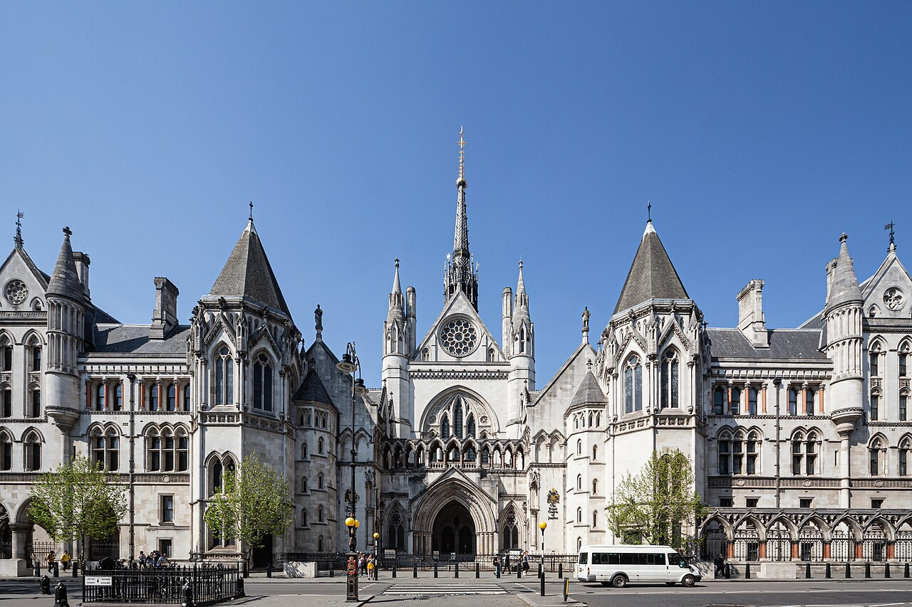
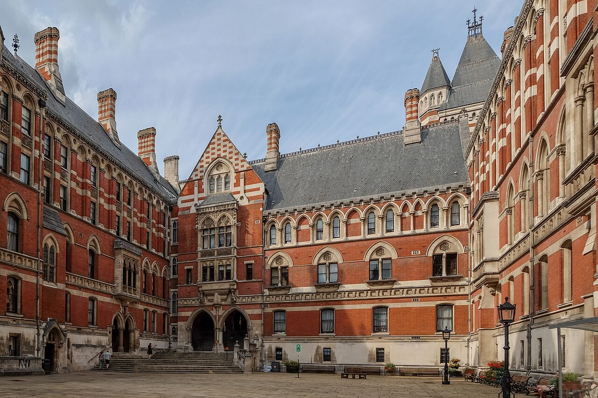
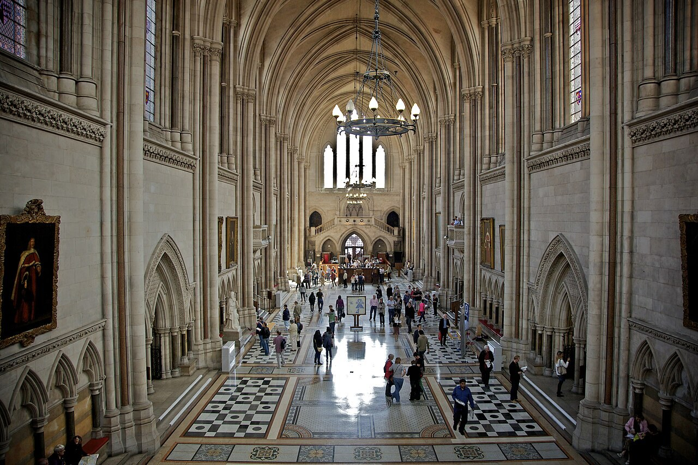
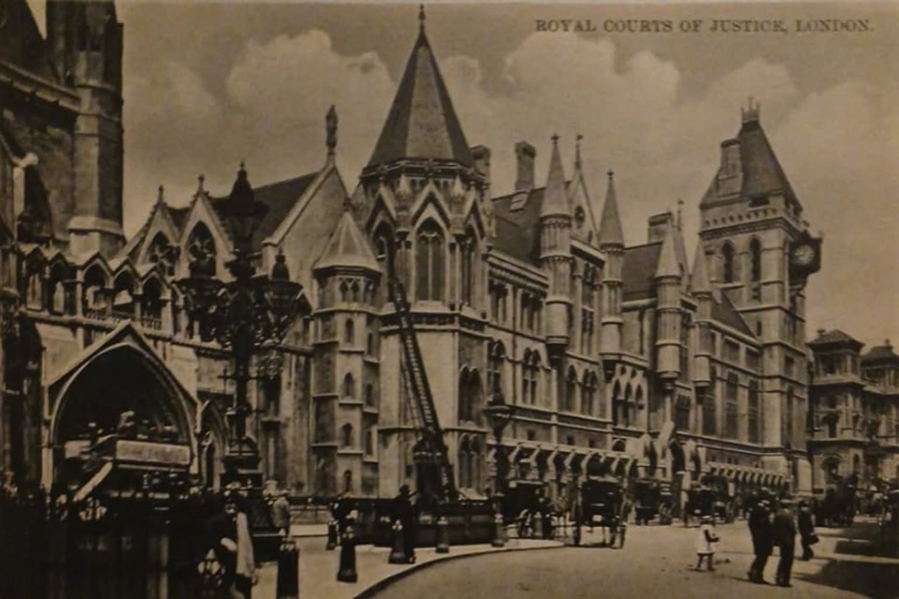
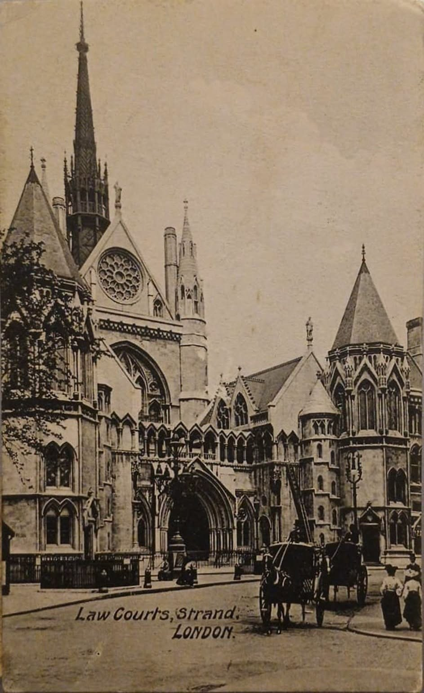

# Royal Courts of Justice

| | |
|---|---|
| **Location** | Strand, City of Westminster, London, England |
| **Near** | Temple Bar, Fleet Street and Lincoln's Inn |
| **Built** | 1873–1882 |
| **Architect** | George Edmund Street (died 1881); completed by his son Arthur Edmund Street with Arthur Blomfield; built by Bull and Sons of Southampton |
| **Style** | Gothic Revival: Portland stone and red brick |
| **Type** | [Law court](../../../README.md#law-court) |
| **Original use** | The central civil courts of England and Wales (the "Law Courts") |
| **Status** | In use as law courts. Grade I listed |
| **Features** | [Clock tower](../../../GLOSSARY.md#clock-tower), [Tower](../../../GLOSSARY.md#tower), [Spire](../../../GLOSSARY.md#spire), [Rose window](../../../GLOSSARY.md#rose-window) |

*The main front on the Strand, with the central entrance arch, rose window and flèche. Wikimedia Commons; author and licence to be confirmed.*

## Overview

The Royal Courts of Justice, usually called the Law Courts, line the north side of the Strand where it meets Fleet Street, close to the old boundary of the City of London at Temple Bar. Behind a long Gothic front of pale Portland stone, with towers, spires and a clock tower, the building contains courtrooms, offices and a vast vaulted Great Hall with a marble mosaic floor.

To make room for it, about 450 houses were demolished and thousands of people moved out. Its architect, George Edmund Street, won the commission in 1868 and worked on it for the rest of his life. He died in December 1881, a year before Queen Victoria opened the building on 4 December 1882, and his death is often put down to overwork on the courts.

## The main story

The building was planned to bring the higher courts, then scattered around Westminster Hall, Lincoln's Inn and elsewhere, together in one place.

- **1865** – After years of debate, Parliament settles on a site between the Strand and Carey Street.
- **1860s** – The site of about 6 acres is cleared. About 450 houses are demolished; one account says about 4,000 people are displaced.
- **1866–1867** – Twelve architects enter a design competition.
- **1868** – After disputes over the result (at one stage the work is to be shared with Edward Middleton Barry), George Edmund Street becomes sole architect in June 1868.
- **1873** – Building begins under the contractors Bull and Sons of Southampton. (Some sources give 1874.)
- **Mid-1870s** – The masons go on strike, threatening to spread to other trades and briefly halting work. The contractors bring in foreign workmen, mostly Germans, who have to be housed and fed inside the building because of hostility from the strikers.
- **January 1878** – Temple Bar, Christopher Wren's gateway on the Strand beside the site, is taken down to ease traffic and its stones are put into storage.
- **1879** – A question in Parliament reveals that the eastern wing, due to be finished in 1877, is late "owing to frosts, strikes, and other unforeseen circumstances".
- **1880** – The Temple Bar Memorial, designed by Horace Jones, is unveiled on the site of the old gate, in front of the courts.
- **18 December 1881** – Street dies, aged 57. His son Arthur Edmund Street and Arthur Blomfield complete the building.
- **4 December 1882** – Queen Victoria opens the Royal Courts of Justice, with the Lord Chancellor and the Prime Minister present.
- **Late 1880s** – Temple Bar is re-erected at Theobalds Park in Hertfordshire for the brewer Henry Meux (sources give 1880, 1887 or 1889).
- **5 February 1970** – The courts are listed Grade I, with their screen walls, gates, railings and lamps.
- **10 November 2004** – Temple Bar, dismantled at Theobalds from October 2003, reopens beside St Paul's Cathedral as the entrance to Paternoster Square.

## Conservation

- The building is **Grade I listed** (Historic England list entry 1264258), including its screen walls, gates, railings and lamps.
- The Temple Bar Memorial in the middle of the road outside is separately listed (list entry 1264445).
- A full-length memorial statue of Street by Henry Hugh Armstead, who also worked on the [Royal Albert Hall](../royal-albert-hall/royal-albert-hall.md) frieze, was put up in his honour. Its exact location in the building needs confirming.

## The alternative view

The official account is of a long, difficult Victorian building project that wore out its architect. Looked at from an "old world" perspective, several things invite a second look: a whole district erased to make room, an ancient city gate dismantled next door while the work went on, an architect who died just before completion, foreign workers housed inside the site, and sources that can't agree on what the building cost. Each point below carries an evidence label: **Documented**, **Observed**, **Reported** or **Speculative** (see the [research brief](https://github.com/martinv678/our-old-world/blob/main/CLAUDE.md)).

### A district erased

**Documented** (clearance) / **Reported** (numbers) – Around 450 houses on a site of about 6 acres were pulled down, and one account says about 4,000 people were displaced. The streets were described in Parliament in 1868 as "miserable". In this project's "reset" theme, the large-scale clearance of old districts in the 1860s–80s is something to examine: what exactly stood here, how old was it, and what records of it survive? The ordinary explanation is slum clearance for a public building, which was common in Victorian London.

**How to test it:** compare maps of the area before 1865 (for example the Ordnance Survey and earlier maps of the parish of St Clement Danes) with the plan of the courts. Look for surveys or photographs of the old streets before demolition, and for any older structures found during the digging of the foundations.

### The architect who didn't live to see it

**Documented** – Street was sole architect from 1868 until his death on 18 December 1881, a year before the opening. Those closest to him believed the stress of the project killed him. The building was completed by his son and by Arthur Blomfield.

This is now the fourth building in this project whose designer died before it was finished:

- Captain Francis Fowke, who designed the first plans for the [Royal Albert Hall](../royal-albert-hall/royal-albert-hall.md) and won the competition for the [Natural History Museum](../natural-history-museum/natural-history-museum.md), died in 1865 before either was built
- Giuseppe Mengoni fell from the scaffolding of the [Galleria Vittorio Emanuele II](../../italy/galleria-vittorio-emanuele-ii/galleria-vittorio-emanuele-ii.md) the day before its final inauguration in 1877
- Street died a year before the Law Courts opened

Large Victorian projects took many years, and architects of the period often died in harness, so this may be no more than coincidence (**Speculative**). It's recorded here as a pattern to keep track of.

### Temple Bar: a gate taken down next door

**Documented** – While the courts were being built, Temple Bar, the stone gateway designed by Christopher Wren that marked the western entrance to the City of London, was dismantled in January 1878 and its stones stored. It was later rebuilt at Theobalds Park in Hertfordshire as a gateway to a country estate, and in 2004 it was taken down again and rebuilt beside St Paul's Cathedral. Its old site is marked by the Temple Bar Memorial of 1880, topped by a dragon, which stands in the road in front of the courts.

So, at the very moment the Law Courts were rising, one of London's best-known old structures beside them was taken apart and moved away. The official reason is traffic, which was a real problem on the Strand. For this project, it's another example of the pattern of old buildings being dismantled, moved and rebuilt that also appears at the [Crystal Palace](../crystal-palace/crystal-palace.md) and with the 1862 Exhibition building.

**How to test it:** find photographs of Temple Bar standing beside the half-built courts in the 1870s, and the records of its dismantling and storage. Do the stones rebuilt in 2004 match the gate shown in the old photographs?

### Who really built it?

**Reported** – After the masons' strike, the contractors brought in foreign workmen, mostly Germans, who were housed and fed inside the building. This is a striking detail: a closed site, with workers living within it, and a workforce brought from abroad. The ordinary explanation is strike-breaking, which was a common response by Victorian contractors. Contemporary newspaper reports and the contractors' records would show how many came, for how long, and what they did.

### What did it cost?

**Documented** (conflict between sources) – Sources disagree on the cost by a large margin. One puts the building at under £1 million (with a further £70,000 for oak fittings in the courts); Historic England says the total cost was almost £2 million; another source gives about £2.2 million including the land. The difference is probably whether the cost of buying and clearing the site is included, but no source found so far explains it. Contradictory records are one of this project's themes.

### Late, by frost and strikes

**Documented** – A question in Parliament in 1879 shows the eastern wing was well behind its 1877 target, because of "frosts, strikes, and other unforeseen circumstances". Most Victorian buildings in this project are suspected of being finished too *fast*; this one was finished slowly, over about nine years, with recorded delays. That makes it a useful comparison: here the timeline looks like what you'd expect from a large hand-built stone building.

### No construction photographs found

**Observed** (none found so far) / **Speculative** (interpretation) – As the owner has pointed out, no photographs of the Royal Courts of Justice under construction have been found so far, even though the work went on for about nine years (1873–82) in the middle of London, on the busy Strand. Searches have turned up the competition designs of 1866–67, a finished-looking engraving of about 1878 in *Old and New London*, the engraving of the Great Hall in *The Builder* in 1882, and postcards of the completed building, but not a single view of the building site, the scaffolding or the half-built walls.

That stands out against the other London buildings in this project from the same years:

- the [Royal Albert Hall](../royal-albert-hall/royal-albert-hall.md) (1867–71) has a published set of construction photographs, including the dome going up
- [Tower Bridge](../tower-bridge/tower-bridge.md) (1886–94) was photographed in detail, with its bare steel towers before the stone was added
- the [Natural History Museum](../natural-history-museum/natural-history-museum.md) (1873–81), built in the same years, has surviving drawings and records of its construction

For the alternative view, a building of this size going up for nine years without being photographed would be a real gap in the record. If the building was already standing, in whole or in part, before 1873, there would be nothing to photograph, and the "construction" might have been a completion, refacing or fitting out of an existing structure (**Speculative**).

Points to weigh up:

- **Absence online isn't absence in the archive.** Many Victorian construction photographs survive only as prints in archives that haven't been put online, such as the Office of Works files at the National Archives, the London Metropolitan Archives and the Historic England Archive. The contractors, Bull and Sons, may also have commissioned photographs.
- **Photography of building sites wasn't yet routine.** In the 1870s, progress photographs were taken for some big projects but not all. Engravings in *The Builder* and the *Illustrated London News* were the usual way of recording progress, and these haven't been searched properly yet.
- **There's written evidence of the construction.** Questions in Parliament in the 1870s report on the progress and delays of the work, including the late eastern wing and the masons' strike. These describe a building site, not an existing building.
- **The site had to be cleared first.** About 450 houses were demolished in the 1860s. Maps from before and after would show whether anything large stood on the site before 1873.

**How to test it:** search the National Archives (Office of Works records for the Law Courts), the London Metropolitan Archives' Collage image collection, the Historic England Archive and the RIBA collections for photographs dated 1873–82. Look through *The Builder*, *The Building News* and the *Illustrated London News* for 1873–82 (many volumes are on the Internet Archive and HathiTrust) for engravings of the works in progress. If, after a proper search, no image of the building site exists at all, that would be a significant finding. This building is tracked in the project-wide [photo record table](../../../ALTERNATIVE-VIEW.md#missing-construction-photographs-the-photo-record-argument).

### A cathedral for the law

**Documented** (style) / **Speculative** (interpretation) – Street was mainly a church architect, and the building looks like a great medieval church or palace: the Great Hall is about 238 ft long and 80 ft high, vaulted in stone, with a mosaic floor of Italian marble. In the "shared worldwide architecture" theme, it belongs to a wave of huge Gothic and Romanesque public buildings put up across Europe in the same decades, such as the [Palace of Westminster](../palace-of-westminster/palace-of-westminster.md), [St Pancras](../st-pancras/st-pancras.md), Manchester Town Hall and the completion of [Cologne Cathedral](../../germany/cologne-cathedral/cologne-cathedral.md). The ordinary explanation is the Gothic Revival, a well-documented movement led by architects like Street.

### Dates and inscriptions

**Speculative** – No date stones, foundation stones or inscriptions on the building have been checked yet for the [letters in dates](../../../ALTERNATIVE-VIEW.md#letters-in-dates-the-j-argument) argument. The entrances, the Great Hall, the clock tower, Street's memorial statue and the Temple Bar Memorial should be searched for dated inscriptions, and for how the years are written.

### Anomaly log

| Anomaly | Evidence | Label | Source |
|---|---|---|---|
| About 450 houses demolished; about 4,000 people displaced | Histories of the site | Reported | Wikipedia; Old Bailey history site |
| Architect died a year before the opening, reportedly from overwork | Biographies | Documented | Britannica; Dictionary of National Biography |
| Fourth building in this project whose designer died before completion | Comparison with other entries | Documented | This project |
| Temple Bar dismantled beside the site in 1878, moved twice | Histories of Temple Bar | Documented | London Remembers; Historic England |
| Foreign workmen housed and fed inside the building during a strike | Secondary source | Reported | Wikipedia |
| Cost given as under £1 million, about £2 million or £2.2 million | Sources disagree | Documented | Wikipedia; Historic England; A View on Cities |
| East wing late "owing to frosts, strikes, and other unforeseen circumstances" | Parliamentary question, 1879 | Documented | Hansard |
| Start date given as 1873 or 1874 | Sources disagree | Documented | Wikipedia; Historic England |
| No construction photographs found for a nine-year build in central London | Searches so far | Observed | Owner; this project |
| A tall ladder stands against the same tower in two early postcards | Postcards c. 1900–1910 | Observed | Owner's postcards |

### Timeline check

**What we know:** building began in 1873 (or 1874) and the courts opened on 4 December 1882, about nine years later. The Great Hall is about 238 ft long and 80 ft high. The building is faced in Portland stone over red brick, with granite, marble and red sandstone details.

**The working:**

- **Time:** nine years is long for a Victorian building, even a big one. The [Natural History Museum](../natural-history-museum/natural-history-museum.md), started the same year, took about eight; the [Royal Albert Hall](../royal-albert-hall/royal-albert-hall.md) took about four.
- **Method:** unlike the iron and glass or terracotta buildings in this project, this is mainly hand-cut stone over brick, which is slow work. That fits the long timeline.
- **Interruptions:** a masons' strike, hard frosts, and the contractors' need to bring in and house foreign workers are all recorded.
- **Workforce:** figures haven't been found yet.
- **Delivery check:** if the often-quoted 35 million bricks is right, that's about 105,000 tonnes over about 8 years, or about 14,600 bricks a day: about 29–49 one-horse loads a day at 300–500 bricks a load (the load size is uncertain). Most London bricks came up the Thames by barge from Kent and Essex, so the road part was short. The Portland stone came by sea from Dorset. These figures need the real contract quantities to be confirmed. See the [logistics argument](../../../ALTERNATIVE-VIEW.md#materials-and-delivery-the-logistics-argument) for the method.

**Working still needed:**

1. The volume of stone and the number of bricks, from the contract documents. (A figure of 35 million bricks is sometimes quoted but hasn't been confirmed.)
2. The size of the workforce and how long the strike lasted.
3. Which parts were finished when, from the Office of Works records.

**Verdict for now:** **Plausible, and slow.** The building took about nine years, with recorded delays, which is what you'd expect from a large stone building. This is one of the few buildings in the project where the timeline itself raises no questions. The stronger points for the alternative view are the clearance of the district, Temple Bar and the conflicting costs.

### Comparison buildings

| Building | Where | Built | Link |
|---|---|---|---|
| [Palace of Westminster](../palace-of-westminster/palace-of-westminster.md) | London, UK | c. 1840–70 | Gothic Revival; the courts moved out of Westminster Hall into the new building |
| [St Pancras](../st-pancras/st-pancras.md) | London, UK | 1865–76 | Gothic Revival of the same years |
| [Natural History Museum](../natural-history-museum/natural-history-museum.md) | London, UK | 1873–81 | Started the same year; designer died before it was built |
| Temple Bar | London, UK | 1669–72 | Wren's gate beside the site; dismantled 1878, moved twice |
| Manchester Town Hall | Manchester, UK | 1868–77 | Gothic Revival public building (on the research list) |
| Palais de Justice | Brussels, Belgium | 1866–83 | Giant law court of the same years; its architect, Joseph Poelaert, died in 1879 before completion (on the research list) |
| [Cologne Cathedral](../../germany/cologne-cathedral/cologne-cathedral.md) | Cologne, Germany | 1248–1880 | Gothic, finished while the courts were being built |

### What would support the alternative view

- Older structures, foundations or buried levels found when the site was cleared and dug out
- Gaps or contradictions in the Office of Works records, contracts and accounts
- A proper search of the archives that still finds no photograph or engraving of the building site in 1873–82
- Differences between Temple Bar as rebuilt and as shown in photographs before 1878
- Evidence that the foreign workforce was larger or stayed longer than a strike would explain

### What would weaken it

- Street's drawings, which survive in quantity, and the Office of Works files
- Construction-period photographs, or engravings of the works in progress in *The Builder* and the *Illustrated London News*
- Maps, surveys and photographs of the streets cleared for the site
- The parliamentary papers on the site, the competition and the costs

## Open questions for contributors

- **Start date:** Did building begin in 1873 or 1874?
- **Cost:** What did the building cost, with and without the land?
- **The strike:** When did the masons' strike happen, how long did it last, and how many foreign workers were brought in?
- **The cleared streets:** What stood on the site, and how old were the buildings? How many people were displaced?
- **Temple Bar:** When exactly was it rebuilt at Theobalds Park (1880, 1887 or 1889)?
- **Street's statue:** Where is Armstead's statue of Street in the building? Is it the white statue on the left of the Great Hall photo?
- **The bricks:** Is the often-quoted figure of 35 million bricks right?
- **Construction photographs:** Does any photograph or engraving of the building site exist from 1873–82? Where?
- **The ladder:** What is the tall ladder standing against the tower to the east of the main entrance in both early postcards? It may be one of the wheeled fire escapes that were stationed at fixed points on London streets at the time.
- **The postcards:** When exactly were the two postcards published, and by whom?
- **The Great Hall:** Is it 38 ft or 48 ft wide? Sources differ.

## Leads to follow up

- **The National Archives:** Office of Works files on the site, the competition, the contracts and the costs.
- **Hansard:** the debates and questions on the site (1865–69) and the progress of the work (1870s).
- **RIBA Drawings Collection and the V&A:** Street's drawings for the Law Courts.
- **London Metropolitan Archives:** maps and records of the cleared streets, and photographs of the area before demolition.
- **Construction images:** the National Archives (Office of Works records), the London Metropolitan Archives' Collage image collection, the Historic England Archive and the RIBA collections, for any photograph of the works in 1873–82.
- **Period journals:** *The Builder* (which published the Great Hall in September 1882), the *Illustrated London News* and *The Times* for 1873–82, for the strike, the progress of the work and the opening.
- **Survey of London:** the volumes covering the Strand and St Clement Danes (British History Online).
- **Temple Bar Trust:** records and photographs of the gate's dismantling in 1878 and its return in 2004.
- **Historic England:** list entries 1264258 (the courts) and 1264445 (the Temple Bar Memorial).
- **The Victorian Society:** its material on Street, published for his bicentenary in 2024.

## Research notes

<!-- Owner's notes: add observations, hunches and links here. Claude reads this section first and doesn't remove it. -->

- Owner's observation: the biggest hole in the story is that there seem to be no photographs of the building being built, which is odd in the age of the camera. You'd expect a record of it. See [No construction photographs found](#no-construction-photographs-found).

## Images

Click any image to enlarge it.

*The main front on the Strand: pale Portland stone, with the central entrance arch, a rose window, a slender flèche and corner turrets. Wikimedia Commons; author and licence to be confirmed.*

*A courtyard within the Royal Courts of Justice. Away from the Strand, the walls are red brick banded with stone, matching the listing's description of "Portland stone ashlar and red bricks". The entrance on the left is reached up a flight of steps. Wikimedia Commons; author and licence to be confirmed.*

*The Great Hall, about 238 ft long and 80 ft high, with its stone vault and marble mosaic floor. A white marble statue stands in the arcade on the left; it may be Armstead's memorial statue of Street, but this needs confirming. Wikimedia Commons; author and licence to be confirmed.*

*Postcard, "Royal Courts of Justice, London", probably c. 1900–1910, looking east along the Strand towards the clock tower, with horse-drawn cabs. A tall ladder stands against the octagonal tower to the right of the main entrance. Supplied by the owner; publisher and date to be confirmed.*

*Postcard, "Law Courts, Strand, London", probably c. 1900–1910, showing the main entrance, rose window and flèche. The same ladder stands against the same tower. The street level at the entrance looks much as it does today. Supplied by the owner; publisher and date to be confirmed.*

_Image credits and licences are still to be confirmed (Wikimedia Commons was rate-limiting lookups). The postcards are old enough that they are probably public domain._

Other images that would be useful:

- the **streets on the site** before they were demolished
- the courts **under construction** in 1873–82: none found so far (see [No construction photographs found](#no-construction-photographs-found))
- **Temple Bar** standing beside the building site before 1878
- the **opening** by Queen Victoria on 4 December 1882
- the **Temple Bar Memorial** and its dragon
- any **dated inscriptions** on the building

## Sources

- Heritage Images – The New Law Courts, Westminster, London, c. 1878 (from *Old and New London*): https://www.heritage-images.com/preview/the-new-law-courts-westminster-london-c1878-1878-artist-unknown-2637429
- Hansard – House of Commons, 4 July 1876: the new Law Courts, the architects: https://api.parliament.uk/historic-hansard/commons/1876/jul/04/the-new-law-courts-the-architects
- Wikipedia – Royal Courts of Justice: https://en.wikipedia.org/wiki/Royal_Courts_of_Justice
- Historic England – Royal Courts of Justice (list entry 1264258): https://historicengland.org.uk/listing/the-list/list-entry/1264258
- British Listed Buildings – Royal Courts of Justice: https://britishlistedbuildings.co.uk/101264258-royal-courts-of-justice-the-law-courts-screen-walls-gates-railings-and-lamps-st-jamess-ward
- Historic England – Temple Bar Memorial (list entry 1264445): https://historicengland.org.uk/listing/the-list/list-entry/1264445
- Victorian Web – G. E. Street's Law Courts: https://victorianweb.org/art/architecture/feist/23.html
- Victorian Web – The Main (or Great) Hall: https://victorianweb.org/art/architecture/street/lawcourts/12.html
- Strandlines – George E. Street's Royal Courts of Justice: https://strandlines.london/?p=5724
- A View on Cities – Royal Courts of Justice: https://aviewoncities.com/london/royal-courts-of-justice
- Old Bailey history site – About the Royal Courts of Justice and Inns of Court: https://old-bailey.com/royal-courts-of-justice-and-inns-of-court/
- Hansard – House of Commons, 15 May 1868: https://api.parliament.uk/historic-hansard/commons/1868/may/15/observations
- Hansard – House of Commons, 18 February 1879: https://api.parliament.uk/historic-hansard/commons/1879/feb/18/question
- The Spectator, 18 February 1865 – the Palace of Justice bill: https://archive.spectator.co.uk/article/18th-february-1865/2/the-bill-for-providing-a-palace-of-justice-was-rea
- Britannica – George Edmund Street: https://www.britannica.com/biography/George-Edmund-Street
- Wikipedia – George Edmund Street: https://en.wikipedia.org/wiki/George_Edmund_Street
- The Victorian Society – Happy birthday, George Edmund Street: https://www.victoriansociety.org.uk/national-news/happy-birthday-george-edmund-street-the-victorian-society-celebrates-the-bicentenary-year-of-architect-g-e-street/
- London Remembers – Temple Bar: https://londonremembers.com/subjects/temple-bar
- Wikipedia – Temple Bar, London: https://en.wikipedia.org/wiki/Temple_Bar,_London
- Government Art Collection – The Great Hall of the Royal Courts of Justice (*The Builder*, 1882): https://artcollection.culture.gov.uk/?p=11241
