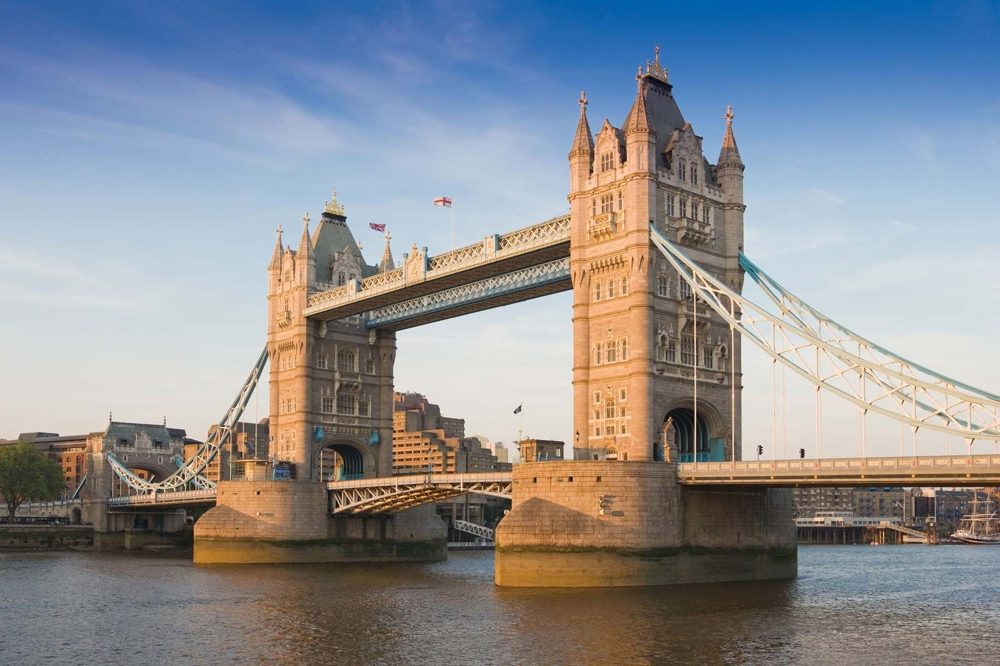
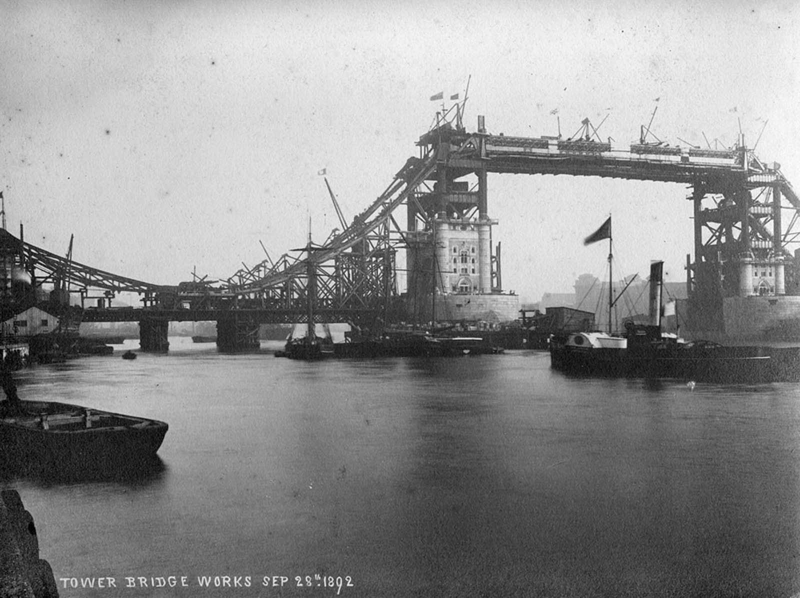
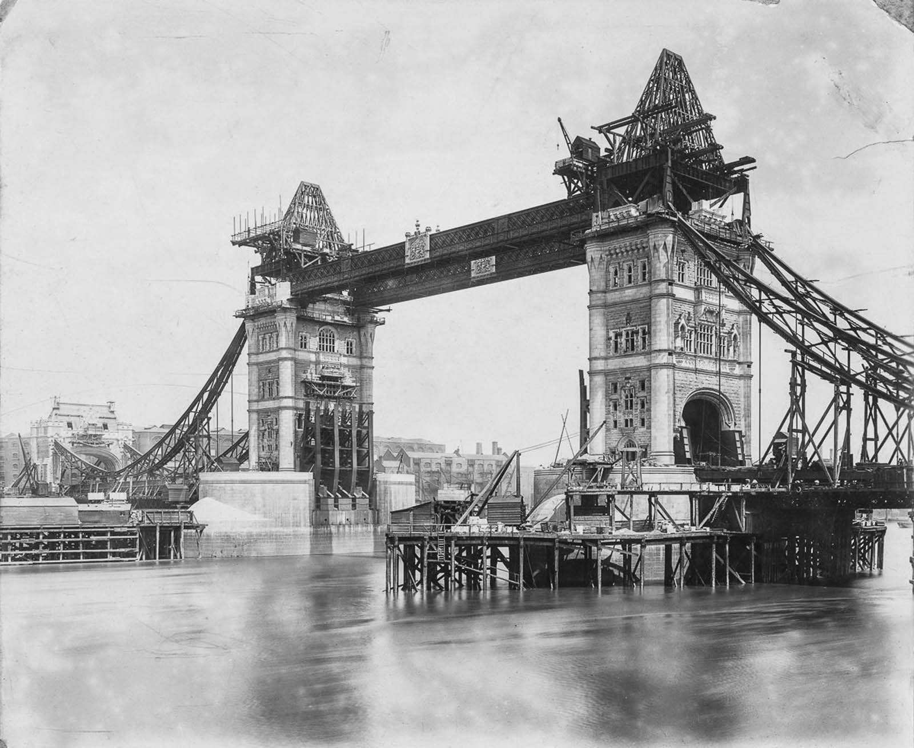
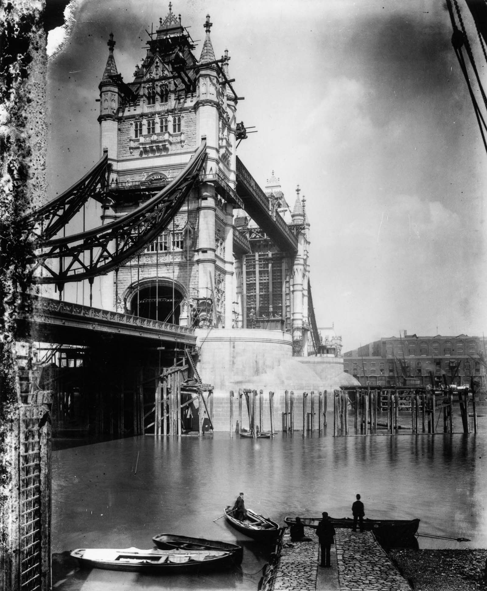
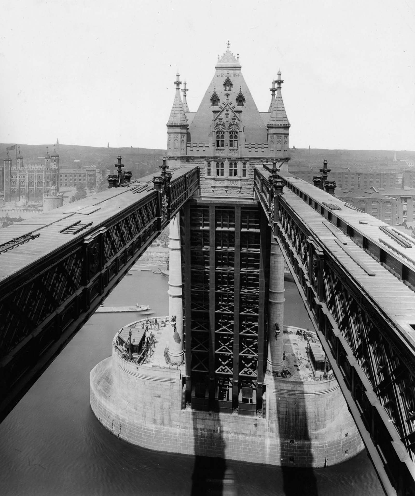
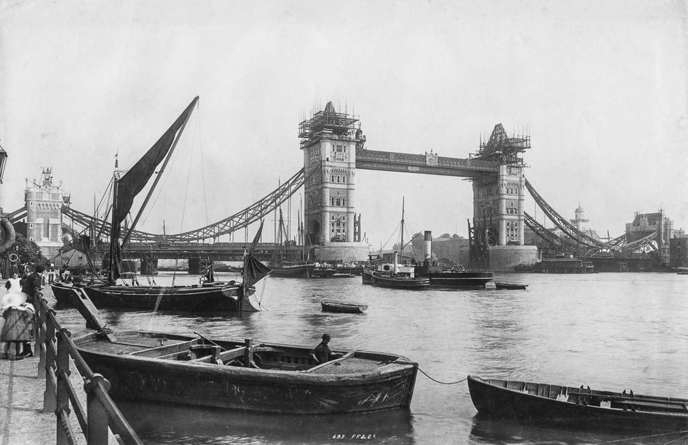
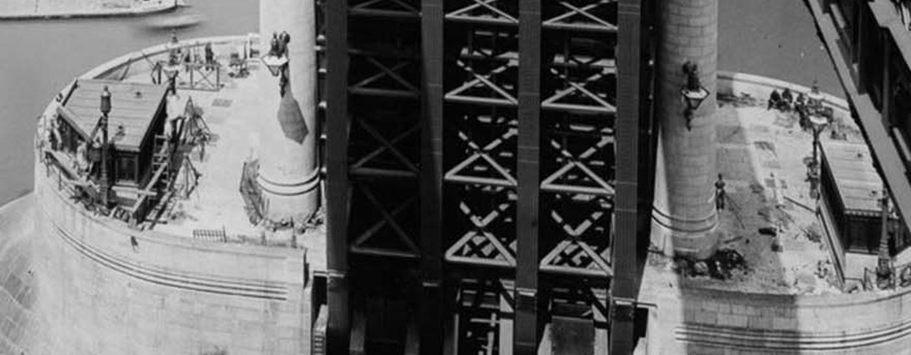

# Tower Bridge

| | |
|---|---|
| **Location** | Tower Bridge Road, over the River Thames between the London Boroughs of Tower Hamlets and Southwark, London, England |
| **Near** | The Tower of London |
| **Built** | 1886–1894 |
| **Architect** | Horace Jones (died 1887), with engineer John Wolfe Barry; masonry design completed by George D. Stevenson; steelwork by Sir William Arrol & Co.; hydraulics by Armstrong Mitchell |
| **Style** | Victorian Gothic: steel frame clad in Portland stone and Cornish granite |
| **Type** | [Bridge](../../../README.md#bridge) |
| **Original use** | Road bridge with opening bascules for river traffic, and high-level footways |
| **Status** | In use. Grade I listed. Walkways and engine rooms open as an exhibition |
| **Features** | [Tower](../../../GLOSSARY.md#tower) |

*Tower Bridge today, seen from the river in evening light, with the bascules lowered. Photographer, source and licence to be confirmed.*

## Overview

Tower Bridge crosses the Thames beside the Tower of London. It's a combined bascule and suspension bridge: two great towers stand on piers in the river, the roadway between them is carried on two bascules (leaves) that lift to let ships through, and two high-level walkways about 42 m above the water link the tops of the towers. The side spans to each bank hang from chains.

It looks like a medieval stone structure, but it isn't. Inside the stone and granite of the towers is a frame of more than 11,000 tons of steel, and the bascules were originally raised by steam-driven hydraulic machinery. The bridge was designed by the City of London's architect, Horace Jones, who died in 1887, a year after work started, and was completed by the engineer John Wolfe Barry. It opened on 30 June 1894.

## The main story

By the 1870s, the East End had grown so much that a new crossing was needed downstream of London Bridge, but it had to let tall ships reach the Pool of London.

- **1870** – The Tower Subway, a tunnel under the Thames close to the later bridge, opens. Its cable-hauled railway soon fails and it becomes a toll foot tunnel.
- **1876** – The City of London Corporation sets up the Special Bridge or Subway Committee to find a solution. More than 50 designs are submitted over the following years.
- **1884** – Horace Jones's design for a bascule bridge, developed with the engineer John Wolfe Barry, is approved.
- **1885** – An Act of Parliament authorises the bridge. It is reported to have required an opening span with a clear width of 200 ft (61 m) and headroom of 135 ft (41 m), and to have specified that the bridge be built in a Gothic style.
- **22 April 1886** – Work begins on site.
- **21 June 1886** – The Prince of Wales lays the foundation stone.
- **21 May 1887** – Horace Jones dies. Barry takes charge, and Jones's assistant George D. Stevenson redesigns the masonry, using Portland stone and Cornish granite. Jones is said to have intended brick.
- **1886–1894** – Five main contractors and about 432 workers build the bridge. Sir John Jackson builds the foundations, and two large piers are sunk into the riverbed. Sir William Arrol & Co. put up more than 11,000 tons of steel for the towers and walkways, which is then clad in stone. Armstrong Mitchell of Newcastle provide the hydraulic machinery: two 360 hp steam engines pump water at 750 psi into six accumulators, whose stored pressure drives the engines that raise the bascules.
- **30 June 1894** – The Prince and Princess of Wales open the bridge. The total cost is given as £1,184,000, paid by the Bridge House Estates, a charity founded in 1282 to maintain London Bridge. The bascules can be raised to their full angle of 86 degrees in about a minute. Under the Act, a tug has to be kept on station to help ships in trouble at the bridge, a rule that lasted until the 1960s.
- **1898** – With a free bridge next door, the Tower Subway closes to foot traffic and is used for water mains.
- **1910** – The high-level walkways are closed because so few people use them.
- **1942** – A third steam engine is added as a wartime precaution.
- **1974–1976** – The steam-driven hydraulics are replaced by an electro-hydraulic system using oil. The original engines, two accumulators and one of the hydraulic engines are kept in the old engine rooms.
- **1982** – The towers and walkways reopen to the public as the Tower Bridge Exhibition.
- **2014** – Glass floors are installed in the walkways (west on 10 November, east on 1 December).

## Conservation

- Tower Bridge is **Grade I listed**.
- It's owned and maintained by the City Bridge Foundation (formerly Bridge House Estates), a charity of the City of London Corporation.
- The Victorian engine rooms, steam engines and accumulators on the south side are preserved and open to visitors.
- The only parts of the original lifting machinery still in use are the final pinions, which engage with the racks on the bascules.

## The alternative view

The official account is of a modern Victorian engineering project, dressed in Gothic stone so that it would sit well beside the Tower of London. Looked at from an "old world" perspective, several things invite a second look: a steel structure disguised as a medieval one, an architect who died a year into the work, towers full of stored hydraulic power, and walkways built high above the river then closed after 16 years. Each point below carries an evidence label: **Documented**, **Observed**, **Reported** or **Speculative** (see the [research brief](https://github.com/martinv678/our-old-world/blob/main/CLAUDE.md)).

### A steel bridge in medieval clothes

**Documented** – The towers look like masonry, but they're steel frames clad in stone. The official Tower Bridge site says the stonework was added to protect the steel and give the bridge "a more pleasing appearance". It may have been Barry's idea to disguise the steel bridge as a stone one, and Jones is said to have wanted brick. Many people assume the bridge is centuries old, like the Tower beside it.

This is the clearest example in this project of a modern structure deliberately made to look old. It turns the usual alternative history question around. Elsewhere, the question is whether a building said to be new is really old. Here, a building that really is new was designed to look old.

Points to weigh up:

- **The steel frame was photographed before it was clad.** Construction photographs of the 1880s–90s show the bare steel towers standing in the river, before the stone went on. This is strong evidence that the bridge was built new in 1886–94. One photograph in the [Images](#images) section is dated on the plate "Tower Bridge works Sep 28th 1892" and shows the steel towers and walkways standing before the stone was finished; another, from the walkway, shows the bare braced steel inside a tower between its stone-clad corners. A good selection is gathered on [Rare Historical Photos](https://rarehistoricalphotos.com/tower-bridge-construction-old-photographs/). The London Metropolitan Archives hold a set of 50 construction photographs taken in about 1891–94, which can be seen in the London Picture Archive, and Historic England has a view of the bridge in its final stages of construction.
- **The "disguise" was a public choice, and reportedly a legal one.** The Gothic style was chosen so the bridge would suit the Tower of London, and the 1885 Act of Parliament is reported to have required it (**Reported**; the wording of the Act still needs checking). So the medieval look was decided in public, in law, before building began.
- **It shows how other buildings could be studied.** If a Victorian building can hide a modern frame behind historic-looking stone, then the structure inside other "old-looking" buildings is worth checking too. That can cut both ways: it may reveal modern construction, or older work.

**How to test it:** collect the construction photographs with their dates, and match each stage of the steelwork against the reported timeline. The London Metropolitan Archives' set of 50 photographs (London Picture Archive records 323335–323384) is the place to start.

### The architect who died a year in

**Documented** – Horace Jones died on 21 May 1887, about a year after work began. The bridge was completed by Barry, with Jones's assistant George Stevenson redesigning the stone exterior. This is the fifth building in this project whose designer died before it was finished:

- Harvey Lonsdale Elmes: [St George's Hall, Liverpool](../st-georges-hall-liverpool/st-georges-hall-liverpool.md) (died 1847; added later)
- Captain Francis Fowke: [Royal Albert Hall](../royal-albert-hall/royal-albert-hall.md) and [Natural History Museum](../natural-history-museum/natural-history-museum.md) (died 1865)
- Giuseppe Mengoni: [Galleria Vittorio Emanuele II](../../italy/galleria-vittorio-emanuele-ii/galleria-vittorio-emanuele-ii.md) (died 1877)
- George Edmund Street: [Royal Courts of Justice](../royal-courts-of-justice/royal-courts-of-justice.md) (died 1881)
- Horace Jones: Tower Bridge (died 1887)

As with the others, long projects and older architects make this likely to be coincidence (**Speculative**). It also means that, again, the final appearance of the building was decided by someone other than the original designer.

### Towers full of stored power

**Documented** (hydraulics) / **Speculative** (energy theme) – The bridge was powered by steam engines that pumped water at 750 psi into six accumulators: tall cylinders weighted to store the pressure until it was needed to raise the bascules. In this project's "lost energy technology" theme, towers and domes are sometimes said to have served a hidden purpose. At Tower Bridge, the technology really is there, but it's fully documented, well understood and preserved in the engine rooms. The hydraulic system was replaced with an oil-hydraulic system in 1974–76.

This makes Tower Bridge a useful benchmark. It shows what genuine 19th-century power systems look like: engine rooms, coal stores, boilers, pipework and maintenance records. If another building is said to have had a lost power system, these are the kinds of physical traces that should be found.

### Walkways nobody used

**Documented** – The high-level walkways were built so pedestrians could cross while the bascules were raised. They were closed in 1910 because few people used them, and remained closed for more than 70 years until 1982. One often-repeated story says they had become a haunt of pickpockets and prostitutes (**Reported**). It's an odd outcome for an expensive part of the design. Was the walkway's real purpose structural (to tie the towers together against the pull of the suspension chains) rather than for people? The engineering drawings would answer that.

### The tunnel underneath

**Documented** – Just upstream, the Tower Subway was dug under the Thames in 1869–70, with a cable-hauled railway that soon failed. It became a toll foot tunnel and closed to people in 1898, after the free bridge opened, and now carries pipes and cables. Old tunnels under rivers are of interest in mud flood and underground research. The Tower Subway is well documented and its entrance kiosk survives on Tower Hill.

### A benchmark for construction photographs

**Documented** – The owner's view is that these photographs hold up, and are a good example of what a real construction record looks like: they show the bridge going up stage by stage, not just the finished result. Put in order, the five photographs in this entry show:

1. **28 September 1892** (dated on the plate): the steel frames of both towers and the high walkways standing, with the stone only partly fixed
2. **probably 1893**: the towers clad up to the walkways, with bare steel pyramid frames for the roofs
3. **probably 1893–94**: scaffolding on the roofs and the side-span chains in place
4. **probably 1894**: the tops finished, with bare steel still visible on a tower's inner face below the walkways
5. **probably 1894**: the bridge nearly complete, with the last scaffolding on the towers

The London Metropolitan Archives' set of 50 photographs (about 1891–94) fills in more of the sequence. The earliest stage, the building of the piers in the river in 1886–89, isn't in this selection yet.

This makes Tower Bridge a useful **benchmark** for the [photo record argument](../../../ALTERNATIVE-VIEW.md#missing-construction-photographs-the-photo-record-argument). It shows what to expect when a building really was photographed while being built: a dated sequence, from bare structure to finished building, from more than one viewpoint. Buildings such as the [Royal Courts of Justice](../royal-courts-of-justice/royal-courts-of-justice.md#no-construction-photographs-found) and [Manchester Town Hall](../manchester-town-hall/manchester-town-hall.md#no-construction-photographs-found), for which only the finished building has been found so far, can be compared against it.

### Where are the workers?

**Observed** – The owner has noticed that the construction photographs show very few people. Looked at closely, the five photographs in this entry do show some: in the view from the walkway, several workmen can be made out on top of the pier, one standing by a column and a group sitting near the edge (see the detail in [Images](#images)); and the two riverside views show bystanders, boatmen and a woman with a child in the foreground. But hardly any workers can be seen on the steelwork, scaffolding or staging itself, even in the dated view of 28 September 1892, when the towers and walkways were being built with some 432 people on site each day.

Points to weigh up:

- **Long exposures.** Photographs of the 1890s often needed exposures of a second or more. Anyone moving, as most workers would be, blurs or disappears, while people standing still (bystanders, posing boatmen, men sitting on the pier) come out clearly. This is a well-known effect in Victorian street and building photographs.
- **Size and resolution.** At the size of these copies, a man on the walkway 42 m up is only a few pixels high. Larger scans of the originals would show whether workers are there.
- **When the photographs were taken.** Progress photographs were sometimes taken at breaks, at the end of the day or on Sundays, when the site was quiet (**Speculative**: not confirmed for these photographs).
- **The owner's wider pattern.** The same question has come up before: in the [Villa Sultana](../../italy/villa-sultana/villa-sultana.md#the-1911-photo-no-shadows) photograph of 1911, the people on the steps cast no shadows. Missing or oddly rendered people in early photographs is worth tracking across the project.

**How to test it:** find high-resolution scans of the originals in the London Metropolitan Archives' set (London Picture Archive records 323335–323384) and count the visible workers in each; look for posed group photographs of the workforce, which were often taken on big Victorian projects; and check newspaper reports for the time of day and conditions when progress photographs were taken.

### Dates and inscriptions

**Speculative** – The foundation stone of 21 June 1886 and any other dated stones or plaques on the bridge haven't been checked yet for the [letters in dates](../../../ALTERNATIVE-VIEW.md#letters-in-dates-the-j-argument) argument. Where is the foundation stone, and how is its date written?

### Anomaly log

| Anomaly | Evidence | Label | Source |
|---|---|---|---|
| Steel frame hidden inside stone towers to look old | Official history; construction photographs | Documented | Tower Bridge; Linda Hall Library |
| Steel towers and walkways standing before the cladding, photographed on 28 September 1892 | Dated construction photograph | Documented | Rare Historical Photos |
| Few workers visible on the structure in the construction photographs | Photographs in this entry | Observed | Owner; Rare Historical Photos |
| Many people assume the bridge is centuries old | Popular perception | Documented | London Pass |
| Architect died a year after work began; exterior redesigned by his assistant | Official history | Documented | Tower Bridge; Wikipedia |
| Fifth designer in this project to die before completion | Comparison with other entries | Documented | This project |
| Steam-powered hydraulic accumulators stored energy to lift the bascules | Engine rooms; official history | Documented | Tower Bridge |
| High-level walkways closed 1910, reopened 1982 | Official history | Documented | Tower Bridge |
| Walkways said to have attracted pickpockets and prostitutes | Often repeated | Reported | – |
| Jones originally intended brick | Secondary source | Reported | Blog post (see Sources) |
| The 1885 Act required a Gothic style | Secondary sources | Reported | Rare Historical Photos; Wikipedia |

### Timeline check

**What we know:** work began on 22 April 1886 and the bridge opened on 30 June 1894, about 8 years and 2 months. About 432 workers and five main contractors were involved, and more than 11,000 tons of steel were used.

**The working:**

- **Steel:** 11,000 tons over, say, 5 years of steel erection is about 2,200 tons a year, or about 42 tons a week. Sir William Arrol & Co. had just finished the Forth Bridge (1882–90), which used tens of thousands of tons of steel, so this was well within their capacity.
- **Workforce:** 432 workers is modest for a project of this size, but the steel was made in factories and the work was spread over eight years.
- **Foundations:** the two river piers were the slowest and hardest part, built inside caissons in the riverbed while the river stayed open to shipping.

**Working still needed:**

1. The volume of masonry and concrete, from the contract records. A figure of over 70,000 long tons of concrete in the two piers is given by Rare Historical Photos and Wikipedia, but hasn't been confirmed from the contract records.
2. The dates when each tower's steel frame was finished and when cladding started, from the construction photographs. By 28 September 1892 (a dated photograph), the steel of both towers and the high walkways was up and the cladding had begun.
3. How the 432 workers were split between the five contractors.

**Verdict for now:** **Plausible.** Eight years, with factory-made steel from one of the most experienced bridge builders of the day, is a reasonable timeline, and the construction is thoroughly photographed and recorded. The interest of this entry for the project lies in the disguise of new steel as old stone, not in the speed of the build.

### Comparison buildings

| Building | Where | Built | Link |
|---|---|---|---|
| Tower of London | London, UK | From 1078 | The medieval fortress the bridge was designed to match |
| Forth Bridge | Firth of Forth, Scotland | 1882–90 | Steel bridge by the same steel contractor, Arrol, with no disguise (on the research list) |
| [St Pancras](../st-pancras/st-pancras.md) | London, UK | 1865–76 | Gothic stone front with a modern iron shed behind |
| [Natural History Museum](../natural-history-museum/natural-history-museum.md) | London, UK | 1873–81 | Iron and steel frame hidden behind terracotta |
| [Palace of Westminster](../palace-of-westminster/palace-of-westminster.md) | London, UK | c. 1840–70 | Gothic Revival on the Thames, with iron in its roofs |
| [Royal Courts of Justice](../royal-courts-of-justice/royal-courts-of-justice.md) | London, UK | 1873–82 | Gothic Revival; architect died before completion |

### What would support the alternative view

- Older masonry inside the towers or piers that predates 1886
- Records showing the stone was cut, carved or supplied in a way that doesn't fit the official timeline
- Gaps in the construction photographs at key stages
- Earlier structures found in the riverbed when the piers were built

### What would weaken it

- The many construction photographs showing the bare steel frame before cladding
- The contract drawings and records of Barry, Arrol, Jackson and Armstrong Mitchell
- The engine rooms and machinery preserved on the south side
- Period reports in *The Engineer*, *Engineering*, *The Builder* and the *Illustrated London News*

## Open questions for contributors

- **Foundation stone:** Where is it, and what does its inscription say?
- **Brick or stone:** Did Jones really intend brick? Whose decision was it to clad the steel in stone?
- **Concrete:** Is the figure of over 70,000 long tons of concrete in the piers right?
- **The Act:** Does the 1885 Act really require a Gothic style? What are its exact words?
- **The workers:** Do the high-resolution originals of the construction photographs show workers on the steelwork? Was a group photograph of the workforce ever taken?
- **The walkways:** Were they mainly structural or mainly for people? Why were they closed in 1910?
- **Workforce:** Is 432 the total workforce or the number at any one time?
- **Competition:** How many designs were submitted to the Special Bridge or Subway Committee, and when?

## Leads to follow up

- **Tower Bridge archive and exhibition:** the official site's history pages and the engine rooms.
- **London Metropolitan Archives:** the City of London Corporation's records of the Special Bridge or Subway Committee, contracts and photographs.
- **Institution of Civil Engineers:** Barry's papers on the bridge in its *Minutes of Proceedings*, and its archive.
- **Friends of the National Libraries:** technical drawings of the construction, acquired with their help.
- **Period journals:** *The Engineer*, *Engineering*, *The Builder* and the *Illustrated London News*, 1884–94.
- **Construction photographs:** the London Metropolitan Archives' set of 50 photographs of about 1891–94 (London Picture Archive, records 323335–323384; for research use, with permission needed for anything else), the City of London's Tower Bridge collection (CLA/020, catalogued on AIM25), Historic England's photograph of the final stages, and the selection on [Rare Historical Photos](https://rarehistoricalphotos.com/tower-bridge-construction-old-photographs/). The Tower Bridge site also describes 130-year-old photographs found more recently, including some of the 1894 opening found by an engineer's great-grandson.
- **Tower Subway:** its history and the surviving entrance kiosk on Tower Hill.
- **Historic England:** the Grade I listing.

## Research notes

<!-- Owner's notes: add observations, hunches and links here. Claude reads this section first and doesn't remove it. -->

- Owner's view: these photographs hold up. They are a good example of construction photographs, because they show the bridge from start to finish rather than just the finished item. See [A benchmark for construction photographs](#a-benchmark-for-construction-photographs).
- Owner's observation: the construction photographs seem never to show people. See [Where are the workers?](#where-are-the-workers).

## Images

Click any image to enlarge it. All five construction photographs below are from the selection on [Rare Historical Photos](https://rarehistoricalphotos.com/tower-bridge-construction-old-photographs/), which credits its images to the London Stereoscopic Company, Wikimedia Commons and the Tower Bridge organisation. The individual photographers and licences still need confirming; photographs of this age are generally out of copyright.

*Tower Bridge today, for comparison with the construction photographs below: the same steel frame, now fully clad in granite and Portland stone. Photographer, source and licence to be confirmed.*

*"Tower Bridge works Sep 28th 1892" (date written on the photograph). The steel frames of both towers and the high walkways are up, with cranes on top. The right-hand tower is still mostly bare steel above its stone base; the left-hand tower is partly clad. The suspension chains of the north side span are being erected on timber staging.*

*Probably 1893 (date not confirmed). Both towers are now clad in stone up to the walkways, but their roofs are still bare steel pyramid frames, with a crane on top of the right-hand tower. Timber staging stands in the river around the piers. Bare steel can still be seen on the inner face of the left-hand tower, below the walkway.*

*Probably 1893–94 (date not confirmed). One tower seen from the riverbank, with scaffolding still on its roof and turrets. The steel suspension chains of the side span hang from the tower, and lines of timber piles from the temporary staging stand in the water.*

*Probably 1894 (date not confirmed), looking from one of the high walkways towards a tower, with the Tower of London on the left. The top of the tower is finished, but below the walkways its inner face is still bare, cross-braced steel between the stone-clad corner turrets. This is the clearest view of the steel frame that the stone was built around.*

*Nearly complete, probably 1894 (date not confirmed), seen from the riverside, with a Thames sailing barge, a steam tug and rowing boats. Scaffolding is still on the tops of both towers. The plate is marked "493. FF&Co.", which may be the catalogue number of Francis Frith & Co., the photographic publishers (to be confirmed).*

*Detail of the view from the walkway, enlarged: several workmen can be made out on top of the pier, one standing to the left of the right-hand column and a group sitting near the right-hand edge, with more figures by the railing at the top left. See [Where are the workers?](#where-are-the-workers).*

Other images that would be useful:

- the **piers** being built in the river (1886–89)
- the **opening** on 30 June 1894
- the **engine rooms**, steam engines and accumulators
- the **walkways**, then and now
- the **foundation stone**

## Sources

- Rare Historical Photos – The innovative construction of London's Tower Bridge seen through old photographs, 1886–1895: https://rarehistoricalphotos.com/tower-bridge-construction-old-photographs/
- London Picture Archive (London Metropolitan Archives) – Tower Bridge construction: https://www.londonpicturearchive.org.uk/view-item?i=323066
- AIM25 – City of London: Tower Bridge collection (CLA/020): https://atom.aim25.com/index.php/tower-bridge
- Historic England – Tower Bridge during the final stages of construction (AA83/01330): https://historicengland.org.uk/images-books/photos/item/AA83/01330
- Tower Bridge – Discovering 130-year-old photographs: https://www.towerbridge.org.uk/discovering-130-year-old-photographs
- Southwark News – A towering achievement: photos show Tower Bridge being built: https://www.southwarknews.co.uk/history/towering-achievement-photos-show-tower-bridge-built/
- Southwark News – Rare photos of Tower Bridge's 1894 opening discovered by engineer's great-grandson: https://southwarknews.co.uk/area/borough/rare-photos-of-tower-bridges-1894-opening-discovered-by-engineers-great-grandson/
- Tower Bridge – Timeline: the construction of Tower Bridge: https://www.towerbridge.org.uk/stories/timeline-the-construction-of-tower-bridge
- Tower Bridge – How was Tower Bridge built?: https://www.towerbridge.org.uk/stories/how-was-tower-bridge-built
- Tower Bridge – How does Tower Bridge work?: https://www.towerbridge.org.uk/stories/how-does-tower-bridge-work
- Tower Bridge – How did the engine rooms work?: https://www.towerbridge.org.uk/stories/how-did-the-engine-rooms-work
- Tower Bridge – Sir John Wolfe Barry: https://www.towerbridge.org.uk/stories/sir-john-wolfe-barry
- Tower Bridge – Glass floor: https://www.towerbridge.org.uk/your-visit/glass-floor
- Institution of Civil Engineers – Tower Bridge: https://www.ice.org.uk/what-is-civil-engineering/infrastructure-projects/tower-bridge
- Linda Hall Library – John Wolfe Barry: https://www.lindahall.org/about/news/scientist-of-the-day/john-wolfe-barry/
- Wikipedia – Tower Bridge: https://en.wikipedia.org/wiki/Tower_Bridge
- Victorian Web – Tower Bridge: https://victorianweb.org/art/architecture/feist/34.html
- Londonist – A brief history of Tower Bridge: https://londonist.com/london/a-brief-history-of-the-tower-bridge
- Londonist – 10 years of Tower Bridge's glass walkways: https://londonist.com/london/features/glass-walkway-tower-bridge-10-years
- London Pass – Tales from Tower Bridge: five urban myths debunked: https://londonpass.com/en/things-to-do/tower-bridge-debunking-urban-myths
- Hydraulics Online – Amazing hydraulics: the story of Tower Bridge: https://hydraulicsonline.com/amazing-hydraulics-the-story-of-tower-bridge-london/
- Friends of the National Libraries – Technical drawings relating to the construction of Tower Bridge: https://grants.fnl.org.uk/technical-drawings-relating-construction-tower-bridge
- TYWKIWDBI (blog, 2011) – Photos of Tower Bridge reveal its steel: https://tywkiwdbi.blogspot.com/2011/12/photos-of-tower-bridge-reveal-its-steel.html
