# Pennsylvania Station, New York

| | |
|---|---|
| **Location** | Seventh to Eighth Avenue, West 31st to West 33rd Street, Midtown Manhattan, New York City, New York, USA |
| **Near** | Madison Square Garden (on the site today) and the James A. Farley Building (Moynihan Train Hall) across Eighth Avenue |
| **Built** | 1904–1910; demolished 1963–1966 |
| **Architect** | Charles Follen McKim of McKim, Mead & White, completed by William Symmes Richardson; built by the George A. Fuller Company |
| **Style** | Beaux-Arts classical (Roman Revival): a steel frame clad in pink Milford granite outside and Italian travertine and plaster inside |
| **Type** | [Railway station](../../../README.md#railway-station) |
| **Original use** | New York terminus of the Pennsylvania Railroad and the Long Island Rail Road, reached by tunnels under the Hudson and East rivers |
| **Status** | Demolished 1963–1966. The tracks and platforms remain in use below Madison Square Garden as today's Penn Station |
| **Features** | [Portico](../../../GLOSSARY.md#portico), [Iron and glass construction](../../../GLOSSARY.md#iron-and-glass-construction), [Underground tunnel](../../../GLOSSARY.md#underground-tunnel), [Rooftop sculpture](../../../GLOSSARY.md#rooftop-sculpture) |

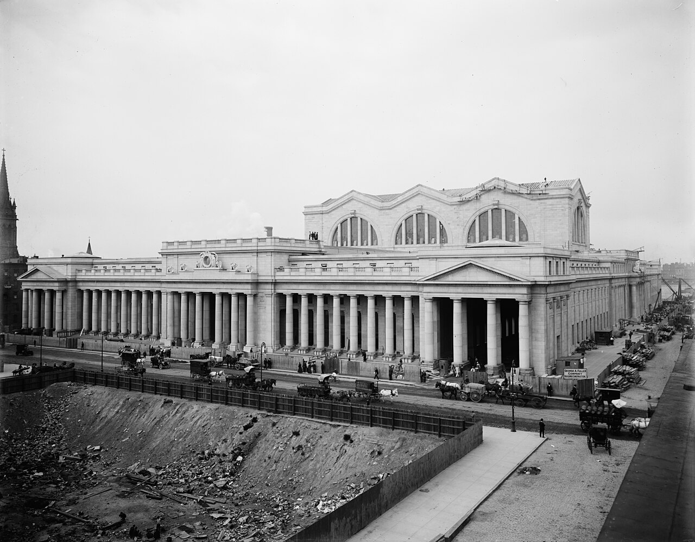
*Pennsylvania Station's colonnade, with the waiting room's arched windows behind. Building materials, a contractor's hut and a sign reading "George A. Fuller Company, Building Construction" are still on the pavement on the right, so this was probably taken shortly before the opening in 1910. Detroit Publishing Co.; Library of Congress, Prints and Photographs Division (det.4a23398), via Wikimedia Commons. Public domain.*

## Overview

The first Pennsylvania Station filled two whole blocks of Midtown Manhattan, about 8 acres, between Seventh and Eighth Avenues and 31st and 33rd Streets. Outside it was a low wall of pink granite with long Doric colonnades. Inside was a main waiting room modelled on the Roman Baths of Caracalla, about 150 ft (46 m) high, the largest indoor space in New York, and beyond it a concourse of glass and exposed steel vaults over the platforms. The tracks ran about 45 ft below the street, under the building, and reached New Jersey and Long Island through tunnels under the Hudson and East rivers.

It was built by the Pennsylvania Railroad under its president Alexander Cassatt, who died in 1906 before it was finished, to designs by Charles McKim, who died in 1909. It opened in 1910. Just 53 years later, in October 1963, the railroad began demolishing it to make way for a new Madison Square Garden, keeping the tracks in a low basement station underneath. Much of the stone and sculpture was dumped in the Meadowlands, the marshes of New Jersey. The loss shocked New York and led directly to the city's landmarks law of 1965.

**Outside the project's dates.** This project covers buildings from before 1900. Penn Station was begun in 1904 and opened in 1910, so it's a little late, but it's included at the owner's request: it is one of the buildings most often named in old-world and Tartaria discussions, and it was demolished in living memory with the fate of its stones well recorded.

## The main story

By 1900, the Pennsylvania Railroad's trains from the south and west stopped at the Hudson River in Jersey City, and passengers finished the journey into Manhattan by ferry. The railroad wanted to bring its trains straight into the city.

- **1901–1902** – Under its president Alexander Cassatt, the Pennsylvania Railroad plans tunnels under the Hudson and East rivers and a great station in Manhattan. It begins buying land in the Tenderloin district, between Seventh and Eighth Avenues.
- **1902** – Charles Follen McKim of McKim, Mead & White is chosen as architect.
- **1904** – Demolition of the buildings on the site begins. Some 500 buildings over about 28 acres are said to have been cleared for the station and its approaches, and thousands of residents of the Tenderloin were displaced. Ground is said to have been broken on 1 May 1904. A book of 1908 says the station excavation was "begun July 1, '04, after removing 400 buildings". (One modern source gives 1906 for the start of excavation.)
- **9 October 1906** – The Hudson River (North River) tunnels are completed.
- **28 December 1906** – Alexander Cassatt dies.
- **1904–1907** – The station site is dug out, mostly in rock, by the New York Contracting Company. The 1908 book gives the pit as 2,050 by 500 ft, 45 ft deep at the east end and 60 ft at the west, with 2,500,000 cubic yards excavated, concrete retaining walls 30 ft thick at the bottom and 5 ft at the top, and work "completed, '07". Modern accounts give more than 3 million cubic yards (2.3 million m³) for the project. The engineer B. F. Cresson's paper of 1910 describes the western contract alone as about 502,000 cubic yards, about 90 per cent of it rock. The spoil was carried in side-dump cars along a cut under Ninth Avenue and a trestle over Tenth Avenue to a pier at the foot of West 32nd Street, and tipped through chutes into scows.
- **18 March 1908** – The East River tunnels are completed.
- **1908** – Masonry work begins on the station building. The George A. Fuller Company is the builder. The superstructure stands on about 650 steel columns.
- **14 September 1909** – Charles McKim dies. William Symmes Richardson of the same firm sees the design through to completion. (One source gives 1908 for McKim's death.)
- **8 September 1910** – Long Island Rail Road trains begin using the station.
- **27 November 1910** – Pennsylvania Railroad trains begin running through the Hudson tunnels and the station opens fully.
- **Materials** – About 490,000 cu ft (14,000 m³) of pink Milford granite from Massachusetts for the exterior, said to have come to the site in the railroad's own wagons; 60,000 cu ft of interior stone; 27,000 short tons of steel; 15–17 million bricks (given as 48,000 short tons); 83,000 sq ft of skylights; 30,000 light bulbs. Figures vary between sources.
- **Cost** – An Interstate Commerce Commission report gives $114 million for the whole New York project, including the tunnels. Another source gives $112 million.
- **The building** – A low granite block with 84 Doric columns in its colonnades. Inside, an arcade lined with shops led to the main waiting room: about 314 ft long, 109 ft wide and 150 ft high (other sources say about 300 by 110 ft), with coffered vaults on eight Corinthian columns about 60 ft high. Its walls were Italian travertine on the lower parts and plaster made to look like travertine above, on a steel frame. Beyond was the concourse, roofed with steel lattice arches and glass. Adolph Weinman made the sculpture: four clocks over the entrances, each flanked by female figures of Day and Night, and 22 stone eagles.
- **1940s–1950s** – Rail traffic falls with the rise of cars and planes. The railroad, short of money, covers parts of the interior with advertising and modern ticket counters.
- **1960–1962** – The Pennsylvania Railroad sells the air rights over the station to the developers of a new Madison Square Garden, led by Irving Felt, in return for a new, smaller station below street level and a share in the new complex. Sources date the deal and its announcement between 1960 and 1962.
- **2 August 1962** – Architects and protesters, including the Action Group for Better Architecture in New York (AGBANY), picket the station.
- **28 October 1963** – Demolition begins.
- **30 October 1963** – A *New York Times* editorial, "Farewell to Penn Station", says that "any city gets what it admires, will pay for, and, ultimately, deserves".
- **1965** – New York City passes its landmarks law and sets up the Landmarks Preservation Commission, largely in response.
- **1966** – Demolition of the building is complete (some sources say 1968). Much of the granite, the clocks and most of the Day and Night figures are dumped in the Meadowlands in New Jersey. Some pieces are rescued: a Night figure and part of a column by the Brooklyn Museum (through Ivan Karp and the Anonymous Arts Recovery Society), and a Day and Night pair, now the Eagle Scout Memorial Fountain in Kansas City. At least 18 of the 22 eagles survive in various places, including four on the Market Street Bridge in Philadelphia.
- **1968** – The new Madison Square Garden opens over the tracks.
- **2021** – Moynihan Train Hall opens in the James A. Farley Building across Eighth Avenue, the old General Post Office by the same architects, giving the station a grand hall again.

## The alternative view

The official account is clear and unusually well documented: a modern railway company built a Roman-style station on a steel frame between 1904 and 1910, and pulled it down for property development in 1963–1966. In alternative history circles, though, the old Penn Station is one of the most often cited "lost" buildings, alongside the Singer Building and the 1915 San Francisco fair. The points below look at why, and test the main themes of this project against the evidence. Each carries an evidence label: **Documented**, **Observed**, **Reported** or **Speculative** (see the [research brief](https://github.com/martinv678/our-old-world/blob/main/CLAUDE.md)).

### Named as a "Tartarian" building

**Reported** – Accounts of the Tartaria theory say its followers count the original Penn Station among the buildings of a lost worldwide civilisation, demolished in the 20th century to hide the evidence. On that view, a building of this scale, in the style of imperial Rome, was too grand and too finely made to have been put up by a railway company in six years, and its destruction only 53 years later was a way to remove it (**Speculative**).

The specific researchers making this claim about Penn Station haven't yet been identified for this entry. Their arguments should be found and checked against the evidence below (see [Leads to follow up](#leads-to-follow-up)).

### A Roman bath in steel and granite

**Documented** – The station was a deliberate copy of ancient Rome. McKim is said to have measured the ruins of the Baths of Caracalla (AD 212–216), and the main waiting room reproduced the plan, coffered vaults and great clerestory windows of the baths' central hall, at a scale said to approach the nave of St Peter's. The outside colonnades were Roman Doric.

But it wasn't built as the Romans built. The vaults, columns and walls hid a frame of steel, and the upper walls of the waiting room were plaster painted to match the travertine below. The concourse beside it didn't hide its steel at all: it was openly an iron and glass structure of 1910. This is the same pattern as [Tower Bridge](../../uk/tower-bridge/tower-bridge.md#a-steel-bridge-in-medieval-clothes): a new structure made to look old. Here the question isn't whether an old building was claimed as new, but why a modern company chose to build a copy of the ancient world.

### "From the same quarries as the Colosseum"

**Reported** – The Pennsylvania Railroad is said to have boasted in its advertising that the station's travertine came from the same ancient Italian quarries as the Colosseum and the Pantheon. Sources disagree on where the stone was quarried (the Roman Campagna or Tivoli). For this project, the advertising matters as much as the stone: the railway was openly selling its new building as a continuation of ancient Rome. The original advertisements should be found and quoted exactly.

### Demolished after 53 years, and dumped in a marsh

**Documented** – The station was demolished from 28 October 1963, only 53 years after it opened, while it was still in daily use. It wasn't destroyed by fire, war or decay, but sold for the value of the space above it. The granite, the clocks and most of the sculpture were trucked away and dumped in the Meadowlands of New Jersey. A widely reproduced photograph shows one of Weinman's figures lying in the landfill.

A colour photograph of 25 June 1966 (see [Images](#images)) shows the Seventh Avenue front still standing, with the Day and Night figures and four eagles in place and the clock between them covered with a dark sheet, while the steel of the new building rose behind the columns. So the old front was kept up as a screen while the new building went up behind it (**Observed**).

This fits the [fire and demolition](../../../ALTERNATIVE-VIEW.md#the-main-ideas) theme: a grand building removed soon after it was built. It is also very like the [Anhalter Bahnhof](../../germany/anhalter-bahnhof/anhalter-bahnhof.md) in Berlin, a great 19th-century station blown up in 1959–1960, leaving one fragment. On the alternative view, these demolitions of the late 1950s and 1960s removed the evidence of an older world under the cover of modernisation (**Speculative**).

The ordinary explanation is well recorded: the railroad was losing money, the air rights were valuable, and the demolition was argued over in public at the time. The protests, the *New York Times* editorial and the landmarks law that followed show that New Yorkers saw it as a loss, not a cover-up. The most useful question for this project is narrower: **why was the stone dumped rather than reused or sold?** Granite of this quality had value. The demolition contracts should say what happened to it.

### A whole neighbourhood cleared first

**Reported** – Before the station could be built, about 500 buildings (400 for the station pit itself, according to the 1908 book) over some 28 acres of the Tenderloin were demolished, including houses, churches and businesses, and thousands of people moved out. The site was not empty land. That makes the [map check](#map-check) unusually easy here: maps and photographs from before 1904 should show exactly what stood on these blocks, and whether anything there was older or grander than the records say.

### Below the street, but by design

**Observed** (explained) – The waiting room and concourse were below street level, reached by stairs and ramps down from the arcade, and the tracks lay about 45 ft below the street. In other buildings, rooms below street level are a sign of [mud flood](../../../ALTERNATIVE-VIEW.md#the-main-ideas) burial. Here they are not: the excavation of the site is recorded in detail, in engineering papers and in photographs, and the depth was set by the tunnels under the rivers.

### Who built it: names and records

**Observed** (gap) / **Speculative** (interpretation) – The owner's point: the station is only about 115 years old, so there should be records of the people who built it, by name, not just of the company and its architects. Here is what has been found so far.

**Named people:**

- **The railway:** Alexander Cassatt (president, died 1906) and his successors, who ran the project. Samuel Rea, the vice-president in charge of the New York extension, is also named in histories of the project (**Reported**).
- **The engineers:** several wrote signed papers on the work for the American Society of Civil Engineers in September 1910, including B. F. Cresson Jr. ("The Terminal Station – West"), George C. Clarke ("The Site of the Terminal Station") and Alfred Noble ("The East River Division") (**Documented**).
- **The designers and artists:** Charles McKim and William Symmes Richardson (architects), Adolph Weinman (sculpture) and Jules Guérin (murals) (**Documented**).
- **The contractors:** the George A. Fuller Company (the building), the New York Contracting Company (the station pit) and the United Engineering & Contracting Company (tunnels under Fifth Avenue), all named in captions of 1908 (**Documented**).
- **The photographers:** L. H. Dreyer (the railway's progress photographs), the Bain News Service, the Byron Company and Wurts Bros. (**Documented**).

**Unnamed people:** no names have been found online for the bricklayers, steel erectors, riveters, stone setters, carvers or plasterers, and the size of the workforce isn't given in any source found. The carvers of Weinman's eagles and figures haven't been identified either: a Brooklyn Museum writer who looked into it found no specifics.

**The tunnel deaths:** PBS says more than a dozen workers were killed building the tunnels, many from the bends. A *99% Invisible* episode on sandhogs puts deaths from the bends on the Pennsylvania Railroad tunnels at **at least 50**, and says the men were first recorded as dying of natural causes and the death certificates were later shown to have been **falsified** to hide the conditions (**Reported**). If so, this is a documented case of records about this project being altered, though by the contractors to hide deaths, not to hide the building's origins. The names of the dead haven't been found yet.

**Records that should exist:**

- **Pay and contract records:** the Smithsonian's Penn Station collection includes **"Contract Material Vouchers, 1907–1908"** (Series 4). The Pennsylvania Railroad's own records are at the Pennsylvania State Archives (Manuscript Group 286) and the Hagley Museum and Library. Neither catalogue, as reached so far, mentions payrolls for the station.
- **Death certificates** in the New York City Municipal Archives, for the men killed on the works.
- **The 1905 New York State census and the 1910 United States census**, which record occupations and sometimes employers.
- **Newspapers** of 1904–1910, which reported accidents, strikes and deaths by name.
- **Union records** of the bricklayers, ironworkers, stonecutters and sandhogs.

**Weighing it up:** the people in charge are well recorded, as for any big project of the time. Ordinary labourers were rarely recorded by name: contractors' time books were usually thrown away, and labourers appear in the records mainly when they died, went on strike or were counted in a census. So the missing names are not unusual in themselves. But the deaths, strikes and payrolls should have left named records. Finding them, or finding that they are missing, is a fair test. Searching the vouchers, the death certificates and the newspapers for names is the next step.

### What were the figures made of?

**Reported** – The Day and Night figures are usually described as carved in pink granite, like the outside of the station. But the Brooklyn Museum's catalogue gives its Night figure as **Tennessee marble**, and a museum blog says conservators found this when the sculpture was cleaned in 2004. A trade article of the 1900s is said to describe the statuary as Knoxville marble. So the station's most famous sculpture may not be the stone that histories say it is. The Kansas City pair and the surviving eagles could be checked the same way.

### An incredible interior

**Documented** (the interior) / **Speculative** (interpretation) – The owner's starting point for this building is the inside, and it is the part people remember. The arcade led down into a main waiting room about 314 ft long, 109 ft wide and 150 ft high, under coffered vaults carried on Corinthian columns some 60 ft tall, lit by three great semicircular windows high in the walls. Jules Guérin painted six large murals for it. Beyond it, the concourse was a forest of slender steel columns carrying glass vaults over the platforms, a space the Library of Congress catalogues as "The hall of iron". Contemporary and later writers compared the waiting room to the nave of St Peter's in Rome.

For the [master builders](../../../ALTERNATIVE-VIEW.md#skill-and-precision-the-master-builders-argument) argument, the questions are where the carvers, plasterers and stone setters came from, how the coffers and the giant columns were made and set so exactly, and whether anything had to be redone. The sources found so far describe the method rather than the men. The lower walls and stair columns were real travertine. Most of the rest was thin stone and plaster sheets on a steel frame, made to look like solid masonry. Some sources say the vaults were Guastavino tile. That would make the room a modern steel building dressed as a Roman one, like [Tower Bridge](../../uk/tower-bridge/tower-bridge.md#a-steel-bridge-in-medieval-clothes). But the claim is unconfirmed, and **no photograph of the interior being built has been seen yet** for this entry (see below).

The interior photographs in [Images](#images) show it as finished: the waiting room in 1911 and again in 1962, when the Historic American Buildings Survey recorded it before the demolition, and the concourse in Joseph Pennell's etching of 1919 and in 1962. By 1962 a low modern ticket counter had been built across the waiting room floor, but the vaults, columns and windows were unchanged.

### The construction record: what has been seen

**The owner's view** (**Speculative**) – The owner doesn't accept the construction photographs as proof that the station was built from scratch. Their reading is that the photographs show a space being cleared and dug out, not the building itself being erected.

**What the photographs show** (**Documented**) – That was true of the images first added to this entry, which show the pit, the tunnels and the finished front. Since then, four glass-plate negatives from the Bain News Service, now in the Library of Congress, have been found on Wikimedia Commons (see [Images](#images)). Each has its date written by hand on the plate:

1. **"Penn. R.R. Site, Oct. '08"** – the pit, with trestles, a small locomotive, stacked steel and the rock walls of the excavation. No building yet.
2. **"P.R.R. Terminal, Oct. '08"** – the **steel skeleton** of the station: columns, girders and floor beams over the whole site, with derricks working on top and Macy's store behind.
3. **"P.R.R. Terminal, Oct. '08"** (plate 487-9) – the **granite colonnade being built**: the columns standing with no roof between them, the pediment set, derricks and steelwork above, cut stone blocks lying on the ground, and the "George A. Fuller Company, Building Construction" sign.
4. **"Penn. R.R. Station, New York, May '09"** – the stone front finished, with the **steel roof over the waiting room still being put up**, derricks on top and the arched windows framed but open to the sky.

Taken together, these show the building going up in stages over seven months: an empty pit, a steel frame, stone set onto it, and the roof last. They are numbered in sequence (487-7, 487-8, 487-9), which fits a news agency's set taken on one visit.

**What still hasn't been seen:** the **interior** being built. No photograph has yet been found of the waiting room's columns, vaults or coffers going up, or of the concourse's steel and glass being erected. The catalogues list more: the Smithsonian's collection (prints and stereographs of 1904–1909, glass plates of 1908–1910), the Museum of the City of New York's construction views of 1908 by Wurts Bros., the railroad's own progress photographs by L. H. Dreyer and others (1907–1910) at Hagley and Columbia, and Columbia's dated plates such as "Penna. Sta. Feb. 11, 09" and "Mar. 26, 09". Their contents haven't been checked, because those sites are blocked here. If the interior was photographed under construction, that is where it will be.

**Other records:** the 1908 book *Pennsylvania Railroad Tunnels and Terminals in New York City* by William Wirt Mills, the engineering papers of September 1910, and the paintings of the pit by George Bellows (1907–1909) and Ernest Lawson (1906).

For the [photo record argument](../../../ALTERNATIVE-VIEW.md#missing-construction-photographs-the-photo-record-argument), the outside of Penn Station now has a dated construction sequence, like [Tower Bridge](../../uk/tower-bridge/tower-bridge.md#a-benchmark-for-construction-photographs). The interior is the open question.

### "Founded" or built?

**Documented** – The words used for Penn Station are "built", "erected", "ground broken" and "excavation", and the record shows the building actually going up after the ground was broken: the pit in 1906, the steel and masonry in 1908–1909, the finishing in 1910. On the [found dead](../../../ALTERNATIVE-VIEW.md#founded-not-built-the-found-dead-argument) argument, this is a clear counter-example: there is no gap between the "foundation" and the building.

### Themes that don't fit

- **[Letters in dates](../../../ALTERNATIVE-VIEW.md#letters-in-dates-the-j-argument):** no date stone or dated inscription has been found yet. The plate dates on the 1909 photographs are written in ordinary figures ("Feb. 11, 09").
- **[Sound and cymatics](../../../ALTERNATIVE-VIEW.md#sound-and-cymatics-the-resonance-argument):** there were no rose windows, organ or bells. The waiting room's acoustics are not recorded in the sources found.
- **Lost energy technology:** nothing obvious. The station was lit by about 30,000 electric bulbs and its trains were electric, both openly modern.
- **Clocks:** each of the four entrances had a Weinman clock flanked by Day and Night. In the 1966 demolition photograph the Seventh Avenue clock is covered with a sheet. In the waiting room photograph of 1911, a large clock high in the arch is too faint to show whether it has hands; the hanging clock in the 1962 concourse photograph clearly has them. The clocks haven't yet been checked for hands in early images, as was done for [Manchester Town Hall](../../uk/manchester-town-hall/manchester-town-hall.md#a-clock-without-hands).

### Map check

**Speculative** (not yet done) – Maps of the blocks between Seventh and Eighth Avenues and 31st and 33rd Streets from before 1904 (for example the Sanborn fire insurance maps and the Bromley and Robinson atlases) should show the buildings that were cleared, with their dates and materials. This hasn't been done yet.

### Anomaly log

| Anomaly | Evidence | Label | Source |
|---|---|---|---|
| Named by Tartaria theorists as a building of a lost civilisation | Accounts of the theory | Reported | Wikipedia (Tartarian Empire); The Spinoff |
| Waiting room copied from the Baths of Caracalla, on a hidden steel frame, with plaster made to look like stone | Histories of the design; a 1910 architectural journal | Documented | ArchDaily; 1910 journal (usmodernist.org) |
| Railway advertised its travertine as from the same quarries as the Colosseum and Pantheon | Secondary account | Reported | Search result; original adverts not yet found |
| Demolished after only 53 years, while in use | Histories; photographs | Documented | PBS; NYPAP |
| Stone, clocks and sculpture dumped in the Meadowlands rather than reused | Histories; photograph of a figure in the landfill | Documented | Brooklyn Museum; Untapped New York |
| Day figure missing for decades; one said to have been found by a recycling firm in 1995 | Secondary accounts | Reported | Ephemeral New York; Untapped New York |
| About 500 buildings in the Tenderloin cleared for the site (400 for the station pit, according to a book of 1908) | Histories; 1908 book | Reported | Lost New England; PBS; Mills (1908) |
| Start date given as 1904 or 1906; McKim's death as 1908 or 1909 | Sources disagree | Documented | PBS; ArchDaily; American-Rails |
| Waiting room and concourse below street level | Plans and photographs; explained by the tunnels | Observed | 1910 plans (Wikimedia Commons) |
| Front still standing in June 1966, clock covered, new steel rising behind | Colour photograph, 25 June 1966 | Observed | Wikimedia Commons (TrainWeb) |
| No names found for the ordinary workers; workforce size unknown | Searches so far | Observed | This project |
| Tunnel deaths recorded as natural causes; death certificates said to have been falsified | Secondary account | Reported | 99% Invisible (Sandhogs) |
| Night figure catalogued as Tennessee marble, not pink granite | Museum catalogue; conservation in 2004 | Reported | Brooklyn Museum |
| Dated glass plates show the pit (Oct. 1908), the steel frame (Oct. 1908), the colonnade being set (Oct. 1908) and the roof steel (May 1909) | Photographs dated on the plate | Documented | Library of Congress (Bain News Service) |
| No photograph yet seen of the interior being built; the owner doubts the construction record | Catalogues list more photographs, not yet checked | Observed | Smithsonian; MCNY; Hagley; Columbia |

### Timeline check

**What we know:** ground was broken in 1904 and the station opened fully on 27 November 1910, about six and a half years later. The pit was dug from 1 July 1904 to 1907. The dated Bain photographs show the steel frame up across most of the site in October 1908 and the roof steel over the waiting room still going up in May 1909, so steel erection took roughly one and a half to two years (about 450–600 working days). Masonry ran from 1908 to the opening, about two to two and a half years (about 600–750 working days). These figures assume a six-day week of about 300 working days a year.

**The working:**

- **Excavation:** the 1908 book gives 2,500,000 cubic yards for the station pit, dug from 1 July 1904 to 1907. Over about three years (about 900 working days), that's about **2,800 cubic yards a day**, or roughly 5,000 tonnes of rock and earth a day. (Modern accounts give more than 3 million cubic yards, which may include the approaches.) Cresson's paper gives about 502,000 cubic yards for the western contract alone. The spoil went by rail to the West 32nd Street pier and onto scows. At several hundred cubic yards per scow (an assumption, not checked), that's a handful of scow-loads a day: a large but ordinary operation for New York harbour, where such spoil was regularly dumped.
- **Granite:** 490,000 cu ft is about 13,900 m³, or roughly 36,800 tonnes at 2.65 tonnes per m³. Over about two and a half years of masonry work (about 750 working days), that's about 50 tonnes a day. At roughly 30 tonnes to a railway wagon (an assumption), that's about **two wagon-loads a day**, from Milford, Massachusetts, on the railway network. On site, about 800 cu ft a day is about **16 blocks set a day**, if the average block was about 50 cu ft or 4 tonnes (an assumption). With several derricks, each one was setting only one or two blocks a day.
- **Steel:** 27,000 short tons is about 24,500 tonnes. Over 450–600 working days, that's about **45–60 short tons a day**, or one or two wagon-loads. If the average beam or column weighed about 2 tons (an assumption), that's about **25–30 pieces lifted a day** across the whole site. The October 1908 photographs show at least eight to ten derricks working, so each derrick was making only about **three lifts a day**. The roughly 650 steel columns work out at **one or two a day**.
- **Bricks:** 15–17 million bricks over 600–750 working days is about **20,000–28,000 bricks a day**. At the commonly quoted period rate of 500–1,000 bricks per bricklayer per day (not confirmed here), that's about **20–55 bricklayers working at once**, plus labourers carrying for them. Compare about 6,500 bricks a day at [Manchester Town Hall](../../uk/manchester-town-hall/manchester-town-hall.md#timeline-check).
- **Delivery:** unlike the Victorian buildings in this project, which relied on horses and carts for the last mile, Penn Station was built by a railway company on top of its own tracks and beside the river. Materials could come by rail and water almost to the site.

**What else was being built in New York at the same time:** the station wasn't alone. In the same years the city was building Grand Central Terminal (1903–1913), the New York Public Library (1902–1911), the Queensboro Bridge (1903–1909), the Manhattan Bridge (1901–1909), the Singer Building (1906–1908), the Metropolitan Life Tower (1907–1909), the Municipal Building (1909–1914) and the first subway lines, as well as the railroad's own tunnels under two rivers. On the [logistics argument](../../../ALTERNATIVE-VIEW.md#materials-and-delivery-the-logistics-argument), the combined demand for stone, steel and labour in one city in one decade is worth adding up (**Speculative**). But by 1904–1910 the United States had a national railway network, steel mills producing millions of tons a year, and steam shovels and electric derricks, all of which are in the records for this site.

**Comparison:** the Empire State Building (1930–1931) put up about 57,000 tons of steel in about six months, rising about four and a half storeys a week. That's roughly twice Penn Station's tonnage in a third of the time, or about five to six times the daily rate, only about 20 years later. By that standard Penn Station's pace was ordinary for steel-frame building in New York.

**What the arithmetic doesn't capture:** the skilled work. Carving the capitals, the eagles and Weinman's figures, setting the travertine, and making the plaster coffers of the vaults can't be measured in tons a day. That is where the [master builders](../../../ALTERNATIVE-VIEW.md#skill-and-precision-the-master-builders-argument) question is strongest: who did this work, and how many of them were there?

**Working still needed:**

1. The size of the workforce, which none of the sources found gives.
2. The average weight of the steel pieces and the size of the granite blocks, and the start and finish dates of each trade.
3. Whether the 3 million cubic yards includes the tunnels.
4. Where the scows took the spoil.

**Verdict:** **Plausible.** Six years for a steel-framed building of this size, with railway delivery, steam and electric machinery and a recorded excavation, fits the period. Penn Station is a useful yardstick for the older buildings in this project: what took a modern railway company six years with steel, rail and machinery is a fair comparison for what was claimed by Victorian builders with less.

### Comparison buildings

| Building | Where | Built | Link |
|---|---|---|---|
| Baths of Caracalla | Rome, Italy | AD 212–216 | The model for the waiting room |
| James A. Farley Building (former General Post Office) | New York, USA | 1910s | By the same architects, across Eighth Avenue; survives, now Moynihan Train Hall |
| Grand Central Terminal | New York, USA | 1903–1913 | Rival Beaux-Arts terminal, saved from demolition by the landmarks law in the 1970s |
| Union Station | Washington DC, USA | 1903–1908 | Beaux-Arts station, also modelled on Roman baths |
| [Anhalter Bahnhof](../../germany/anhalter-bahnhof/anhalter-bahnhof.md) | Berlin, Germany | 1876–80 | Great station demolished 1959–1960, leaving one fragment |
| [Tower Bridge](../../uk/tower-bridge/tower-bridge.md) | London, UK | 1886–94 | Steel frame clad in stone to look old; well photographed |
| [Palace of Fine Arts](../palace-of-fine-arts-chicago/palace-of-fine-arts-chicago.md) | Chicago, USA | 1891–93 | Classical building of the American Beaux-Arts movement; Burnham's fair, where McKim also worked |
| [St Pancras](../../uk/st-pancras/st-pancras.md) | London, UK | 1865–76 | Great terminus threatened with demolition in the 1960s, but saved |

### What would support the alternative view

- Evidence that something older stood on the site before 1904, in maps, photographs or the excavation records
- Construction photographs that turn out to be misdated, retouched or of a different building
- A thorough search of the progress photographs that finds no image of the waiting room or concourse being built
- Large gaps in the material, workforce or cost records that the official account can't fill
- Evidence that the stone was dumped to stop it being examined, rather than for cost

### What would weaken it

- The dated Bain photographs of 1908–1909 already show the steel frame, the colonnade and the roof going up
- Photographs of the interior being built, if they are in the Smithsonian, Museum of the City of New York, Hagley or Columbia collections
- The engineering papers of 1910 describing the excavation and building in detail
- The demolition contracts showing why the stone was dumped
- The Pennsylvania Railroad's accounts, contracts and correspondence for the station

## Open questions for contributors

- **The Tartaria claim:** Which researchers have written about Penn Station as an "old world" building, and what evidence do they give?
- **Workforce:** How many men built the station and dug the pit, and where did the stonecutters and carvers come from?
- **The spoil:** Where did the scows dump the excavated rock?
- **The stone:** Why was the granite dumped in the Meadowlands rather than sold or reused? Has any of it been recovered?
- **The travertine adverts:** What exactly did the railway's advertising say about the stone?
- **The workers:** What are the names of the men who built the station, and of those killed on the works? How many were there?
- **The interior:** Is there any photograph of the waiting room's columns, vaults and coffers, or the concourse, being built? Who were the carvers and plasterers?
- **The clocks:** Do early photographs show hands on Weinman's four clocks?
- **The site:** What stood on the two blocks before 1904?

## Leads to follow up

- **Smithsonian, National Museum of American History, Archives Center:** "Penn Station, New York, Photographs" (AC1048), 1904–1910.
- **Museum of the City of New York:** Byron Company excavation views (1906) and Wurts Bros. construction views (1908).
- **Hagley Museum and Library:** Pennsylvania Railroad records, progress photographs by L. H. Dreyer, 1907–1910.
- **Columbia University, Avery Library:** McKim, Mead & White photographs of the station, 1908–1910.
- **Library of Congress:** Historic American Buildings Survey record HABS NY-5471 (photographs and history made before the demolition), and the Detroit Publishing Co. photographs.
- **American Society of Civil Engineers, *Transactions* vol. LXVIII (September 1910):** papers by B. F. Cresson ("The Terminal Station – West") and George C. Clarke ("The Site of the Terminal Station"), on Project Gutenberg.
- **Smithsonian, Penn Station collection, Series 4:** "Contract Material Vouchers, 1907–1908", for contractors' and possibly workers' names.
- **Pennsylvania State Archives, Manuscript Group 286** (Penn Central Railroad Collection) and **Hagley**: Pennsylvania Railroad records, for payrolls and correspondence.
- **New York City Municipal Archives:** death certificates for men killed on the station and tunnels, 1904–1910.
- **Censuses of 1905 and 1910:** occupations such as "laborer, Penn. station" or "sandhog".
- **Jill Jonnes, *Conquering Gotham* (2007):** a detailed history of the station and tunnels, which may name workers.
- **Brooklyn Museum:** the Night figure and the column fragment, and the story of their rescue.
- **New York Preservation Archive Project:** the campaign to save the station.
- **Sanborn and Bromley maps** of the Tenderloin before 1904.
- **Newspapers:** the *New York Times* and other papers for 1904–1910 and 1962–1966.

## Research notes

<!-- Owner's notes: add observations, hunches and links here. Claude reads this section first and doesn't remove it. -->

## Images

Click any image to enlarge it.

*Pennsylvania Station, after May 1909 and probably shortly before the opening in 1910 (a Bain photograph of May 1909 from the same spot still shows the roof steel going up). In the foreground is a cleared and excavated block across the street. On the right are the builder's hut, its sign ("George A. Fuller Company, Building Construction") and stacked timber, so the photograph shows the end of construction. Detroit Publishing Co.; Library of Congress (det.4a23398), via Wikimedia Commons. Public domain.*

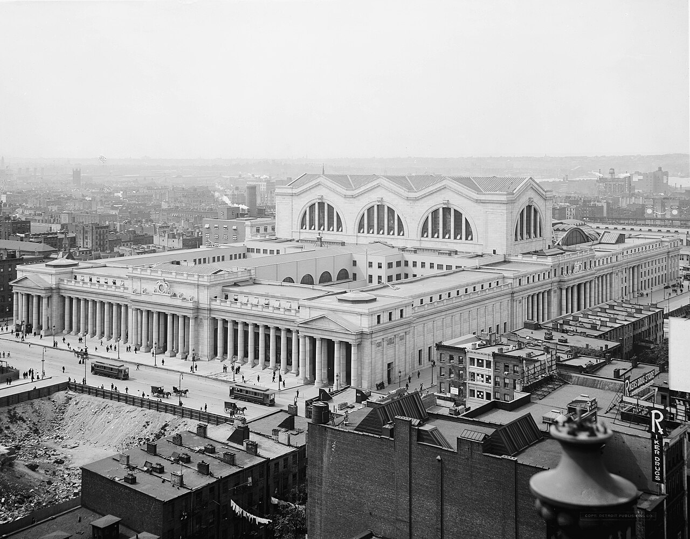
*The station from the north-east, 1910s, with the tenements of the old neighbourhood around it. Its size against the surrounding streets is clear. In the bottom left is what seems to be the same excavated block as in the photograph above. Which block it is hasn't been checked; the General Post Office site across Eighth Avenue, dug in these years, is one possibility. Detroit Publishing Co., catalogued as between 1910 and 1920; Library of Congress (det.4a24329), via Wikimedia Commons. Public domain.*

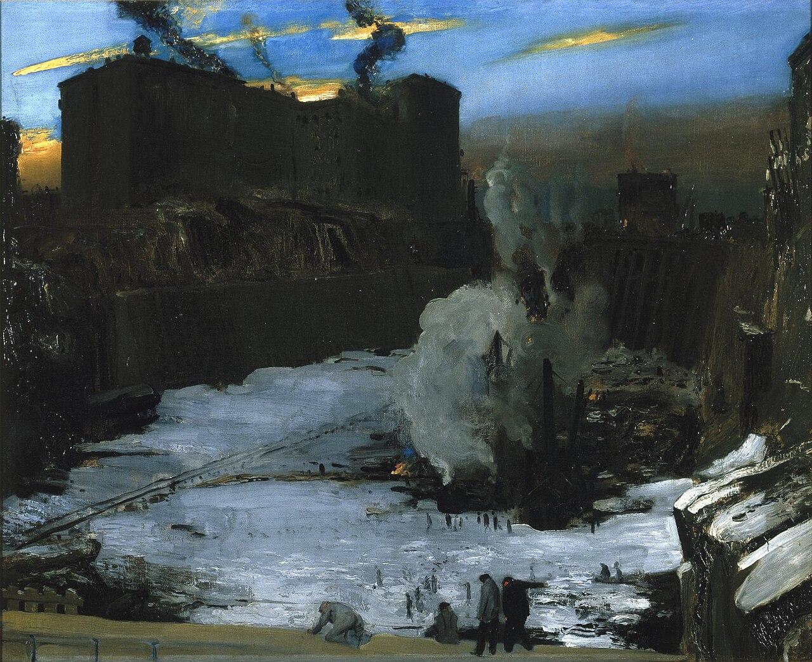
*"Pennsylvania Station Excavation", oil on canvas by George Bellows, about 1907–1909 (Brooklyn Museum, 67.205.1). The pit, with steam engines working in it and the old neighbourhood's tenements on the rim. Via Wikimedia Commons. Public domain.*

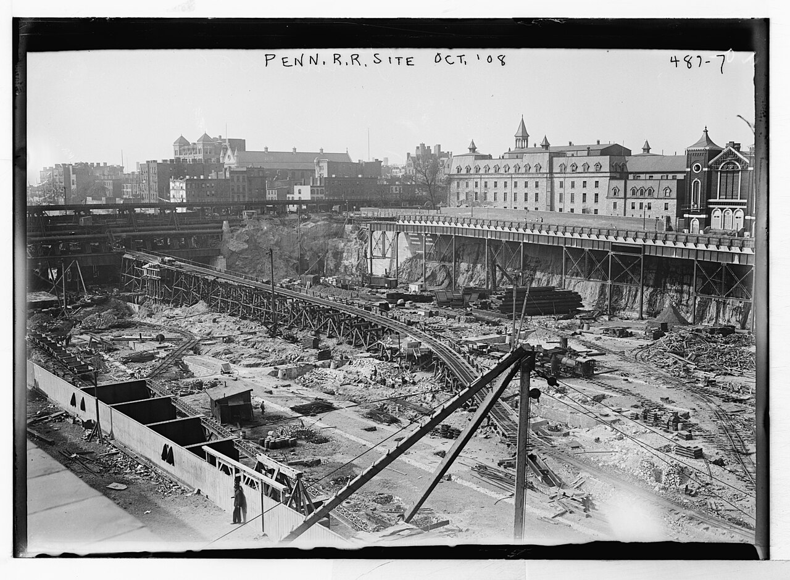
*"Penn. R.R. Site, Oct. '08", written on the plate (no. 487-7): the pit before the steel went up. Bain News Service; Library of Congress (LCCN 2014682318), via Wikimedia Commons. Public domain.*

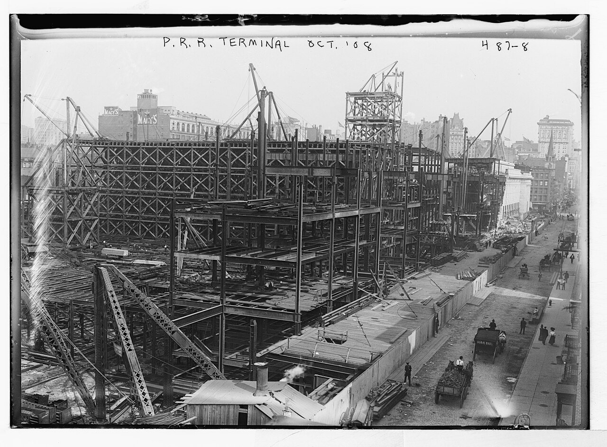
*"P.R.R. Terminal, Oct. '08" (plate 487-8): the steel skeleton of the station, with derricks on top and Macy's store behind. Bain News Service; Library of Congress (LCCN 2014682319), via Wikimedia Commons. Public domain.*

*"P.R.R. Terminal, Oct. '08" (plate 487-9): the granite colonnade being set onto the steel, with derricks above and the builder's sign on the left. Bain News Service; Library of Congress (LCCN 2014682320), via Wikimedia Commons. Public domain.*

*"Penn. R.R. Station, New York, May '09" (plate 342-13): the stone front finished, with the steel roof over the waiting room still being put up. It is taken from almost the same spot as the photograph at the top of this entry, which must therefore be later. Bain News Service; Library of Congress (LCCN 2014681599), via Wikimedia Commons. Public domain.*

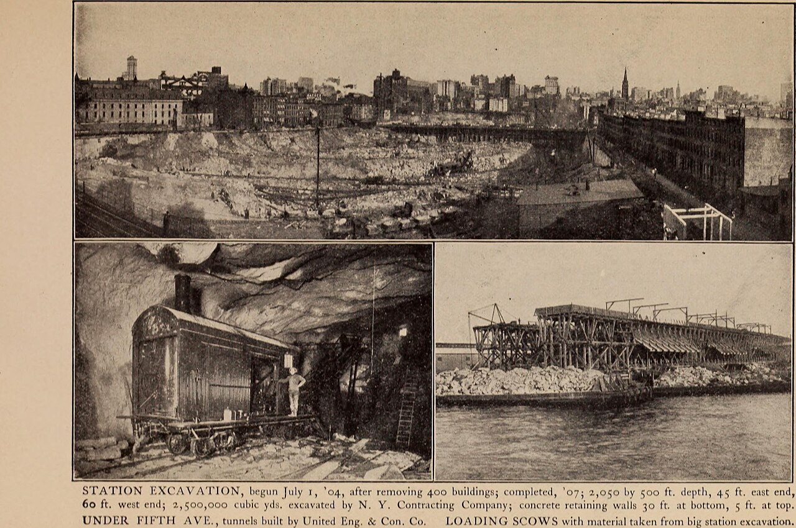
*A page from* Pennsylvania Railroad Tunnels and Terminals in New York City *by William Wirt Mills (Moses King, 1908). The printed caption reads: "STATION EXCAVATION, begun July 1, '04, after removing 400 buildings; completed, '07; 2,050 by 500 ft. depth, 45 ft. east end, 60 ft. west end; 2,500,000 cubic yds. excavated by N. Y. Contracting Company; concrete retaining walls 30 ft. at bottom, 5 ft. at top. UNDER FIFTH AVE., tunnels built by United Eng. & Con. Co. LOADING SCOWS with material taken from big station excavation." Internet Archive Book Images, via Wikimedia Commons. No known copyright restrictions.*

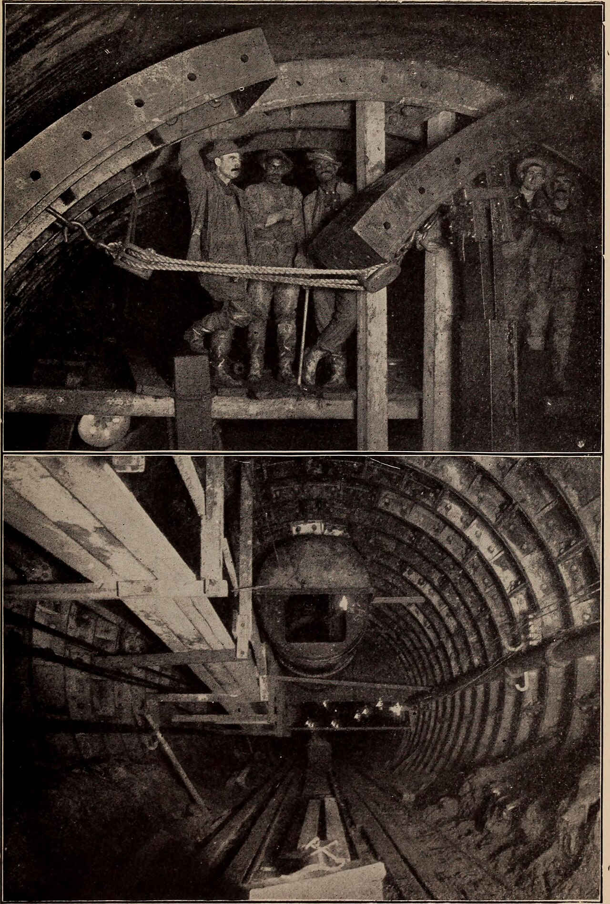
*Building the tunnels that brought trains to the station: workmen in a tunnelling shield, and a finished length of tunnel lined with iron rings. From the same 1908 book (Internet Archive Book Images, via Wikimedia Commons). No known copyright restrictions.*

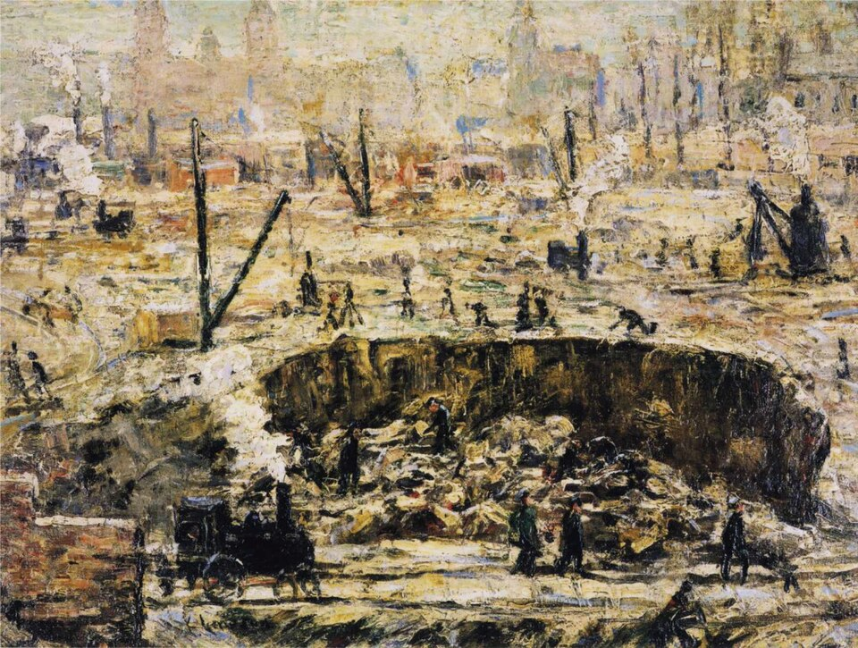
*"Excavation – Penn Station", oil on canvas by Ernest Lawson, 1906 (Frederick R. Weisman Art Museum). Workmen, derricks and a small steam locomotive work around the pit in winter. Via Wikimedia Commons (from The Athenaeum). Public domain.*

*The Seventh Avenue front on 25 June 1966, during the demolition. Weinman's Day and Night figures and four eagles are still in place, but the clock between them is covered with a dark sheet, with a ladder above. A banner advertises the "New Madison Square Garden Sports Center" and "Redeveloped Pennsylvania Station", and the steel frame of the new building can be seen through the colonnade. Photograph by Hikki Nagasaki, via TrainWeb and Wikimedia Commons, where it is marked as public domain (not independently checked).*

*The main waiting room in 1911, from the steps down from the arcade, with the statue of Alexander Cassatt in its niche on the left. A large clock is set high in the arch on the right; at this resolution its hands can't be made out. Library of Congress (LCCN 2004670836), via Wikimedia Commons. Public domain.*

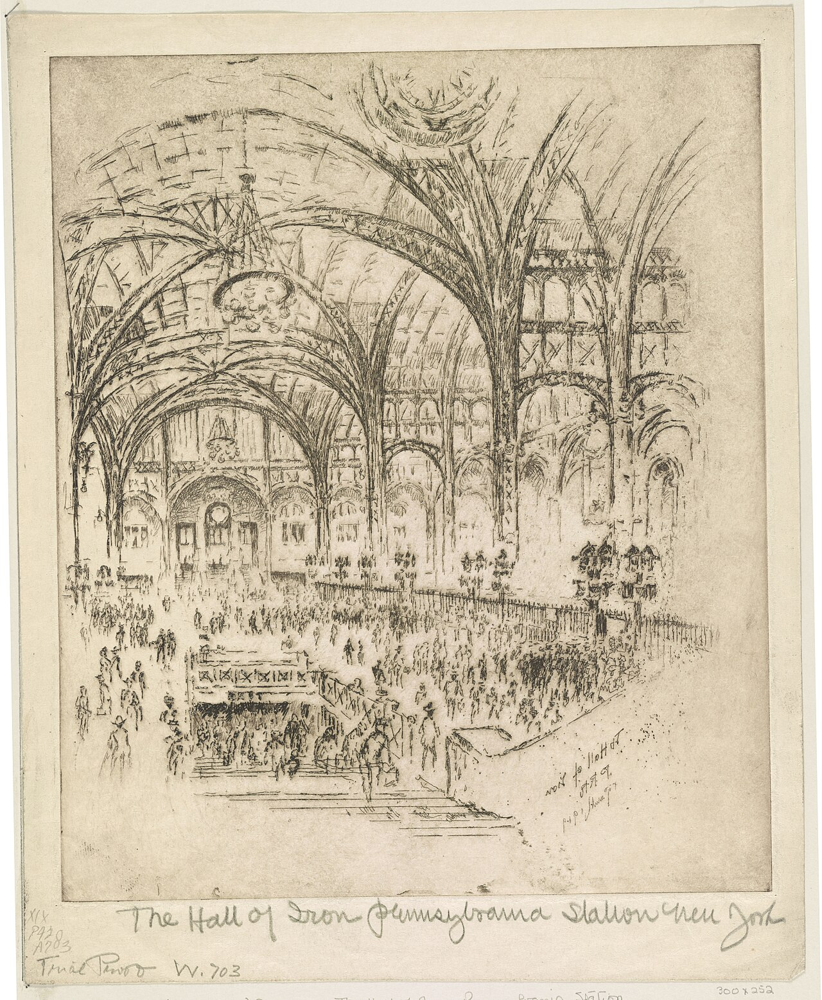
*"The Hall of Iron, Pennsylvania Station, New York": the concourse, etched by Joseph Pennell in 1919 (trial proof). Library of Congress (LCCN 2003673809), via Wikimedia Commons. Public domain.*

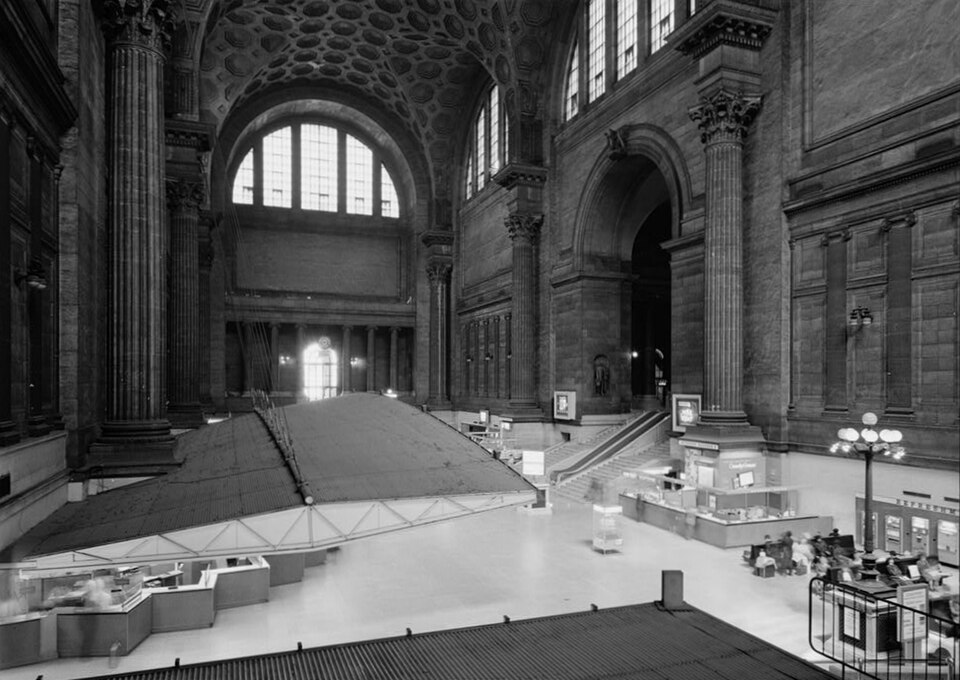
*The waiting room on 8 May 1962, photographed for the Historic American Buildings Survey before the demolition. The coffered vault, columns and arched windows are intact, but a modern ticket counter with a sloping canopy has been built across the floor. Cervin Robinson; Library of Congress (HABS NY-5471), via Wikimedia Commons. Public domain.*

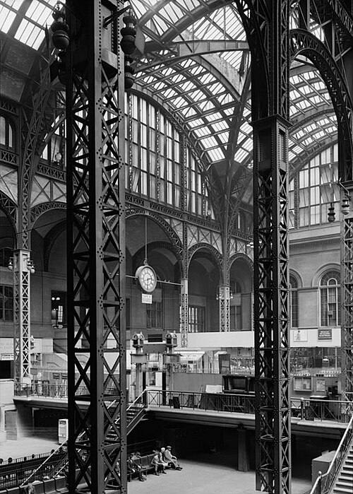
*The concourse in May 1962: riveted steel lattice columns and arches under a glass roof, with a hanging clock. Cervin Robinson for the Historic American Buildings Survey; Library of Congress (HABS NY-5471), via Wikimedia Commons. Public domain.*

## Sources

- Wikipedia – Pennsylvania Station (1910–1963): https://en.wikipedia.org/wiki/Pennsylvania_Station_(1910%E2%80%931963) (read through search results; the site is blocked in this environment)
- PBS American Experience – The Construction of Penn Station: https://www.pbs.org/wgbh/americanexperience/features/the-rise-and-fall-of-penn-station-construction-penn-station/
- PBS American Experience – The Destruction of Penn Station: https://www.pbs.org/wgbh/americanexperience/features/the-rise-and-fall-of-penn-station-destruction
- B. F. Cresson Jr., "The New York Tunnel Extension of the Pennsylvania Railroad: The Terminal Station – West", *Transactions of the American Society of Civil Engineers*, vol. LXVIII (September 1910), Project Gutenberg: https://www.gutenberg.org/ebooks/17302
- Smithsonian NMAH Archives Center – Penn Station, New York, Photographs: https://si.edu/object/archives/sova-nmah-ac-1048
- Smithsonian NMAH – West 32nd Street Pier from South West: https://americanhistory.si.edu/collections/archival-item/sova-nmah-ac-1048-ref708
- Museum of the City of New York – Penn. Depot Excavations: https://collections.mcny.org/Collection/Penn.%20Depot%20Excavations.-2F3XC58P6DNO.html
- Columbia University Libraries – Penna. Sta. Feb. 11, 09: https://dlc.library.columbia.edu/catalog/cul:jsxksn04v8
- Columbia University Libraries – View of interior Main Waiting Room looking towards the Arcade: https://dlc.library.columbia.edu/catalog/cul:np5hqbzndd
- Library of Congress – HABS NY-5471, Pennsylvania Station: https://tile.loc.gov/storage-services/master/pnp/habshaer/ny/ny0400/ny0411/data/ny0411data.pdf
- Architectural journal, September 1910 (usmodernist.org, NYA-1910-09): https://www.usmodernist.org/NYA/NYA-1910-09.pdf
- ArchDaily – AD Classics: Pennsylvania Station: https://www.archdaily.com/475072/ad-classics-pennsylvania-station-mckim-mead-and-white
- American-Rails – Pennsylvania Station (NYC): https://www.american-rails.com/pnstn.html
- Lost New England – Pennsylvania Station, New York City: https://lostnewengland.com/2020/06/pennsylvania-station-new-york-city/
- Rethink Penn Station – History: https://www.rethinkpennstationnyc.org/history
- Brooklyn Museum – Night, Clock Figure from Pennsylvania Station: https://www.brooklynmuseum.org/objects/90654
- Brooklyn Museum – Partial Column, from Penn Station: https://www.brooklynmuseum.org/objects/90655
- Untapped New York – Where Are the 22 Eagles of Original Penn Station?: https://www.untappedcities.com/eagles-penn-station/
- Untapped New York – This Fountain in Kansas City Contains a Remnant of NYC's Penn Station: https://www.untappedcities.com/kansas-city-fountain-nyc-penn-station/
- Ephemeral New York – Day and Night sculptures: https://ephemeralnewyork.wordpress.com/tag/day-and-night-sculptures/
- New York Preservation Archive Project – Pennsylvania Station: https://www.nypap.org/preservation-history/pennsylvania-station/
- Michael Froio – From Iron Fortunes to Railroads: a brief history of McKim, Mead and White: https://michaelfroio.wordpress.com/2013/05/14/from-iron-fortunes-to-railroads-a-brief-history-on-mckim-mead-and-white/
- Wikipedia – Milford pink granite: https://en.wikipedia.org/wiki/Milford_pink_granite
- PA State Archives – MG-286, Penn Central Railroad Collection: https://www.phmc.state.pa.us/bah/dam/mg/mg286PRR.htm
- 99% Invisible – Sandhogs (transcript): https://99percentinvisible.org/episode/sandhogs/transcript/
- Brooklyn Museum tech blog – Remembering Penn Station: https://techblog.brooklynmuseum.org/2010/09/08/remembering-penn-station/
- Wikipedia – Tartarian Empire: https://en.wikipedia.org/wiki/Tartarian_Empire
- The Spinoff – Inside the wild architecture conspiracy theory gaining traction online: https://thespinoff.co.nz/irl/14-01-2022/inside-the-wild-architecture-conspiracy-theory-gaining-traction-online
- William Wirt Mills, *Pennsylvania Railroad Tunnels and Terminals in New York City* (New York: Moses King, 1908), Internet Archive: https://archive.org/details/pennsylvaniarail00mill
- Hagley Museum and Library – Pennsylvania Railroad Company records (progress photographs of the Pennsylvania Terminal, 1907–1910), as reported in search results
