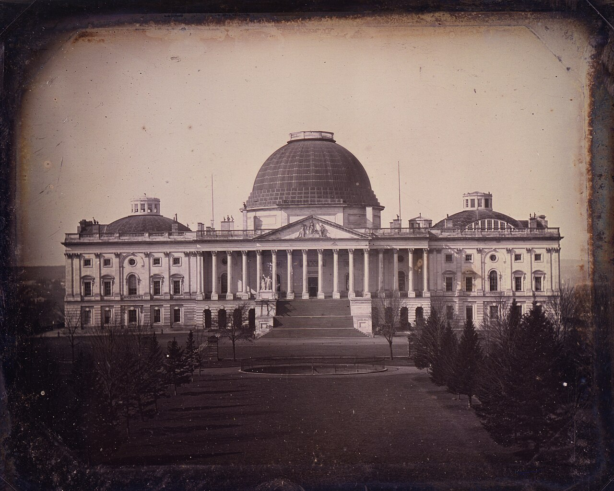
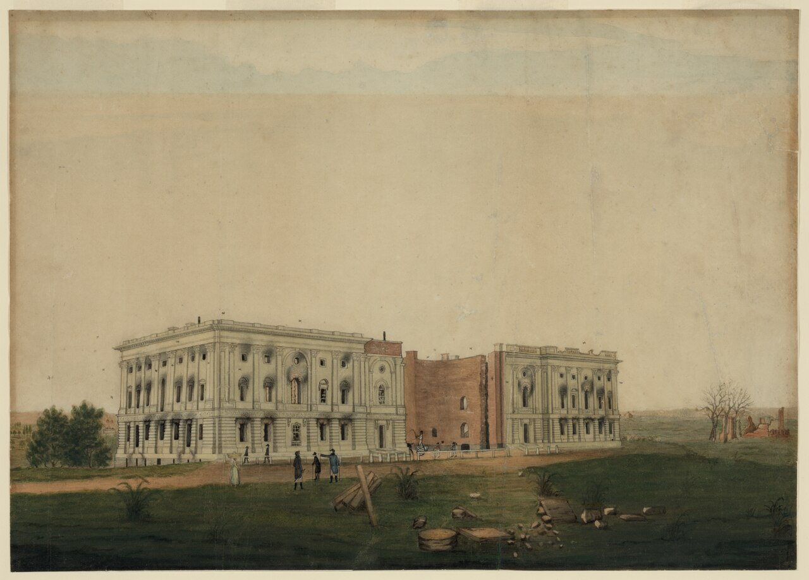
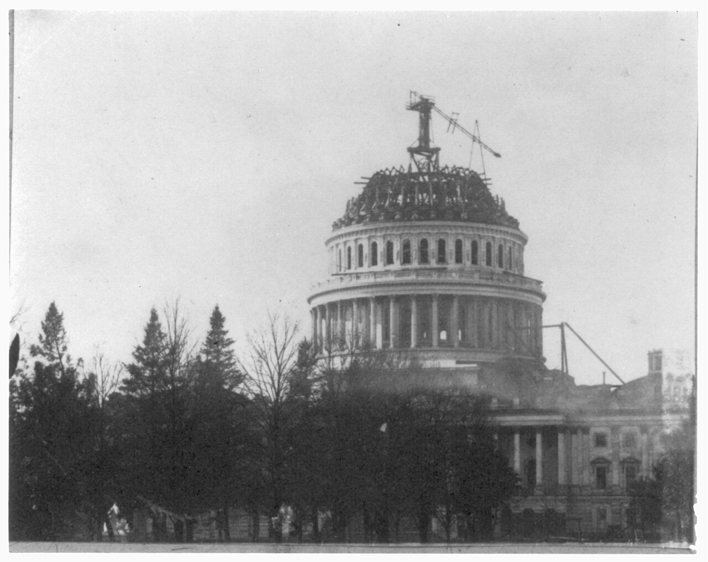
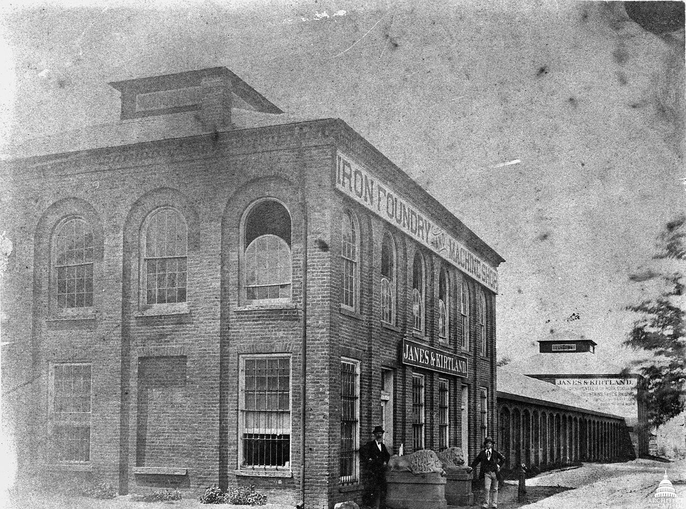

# United States Capitol

| | |
|---|---|
| **Location** | First Street SE, Capitol Hill, Washington, District of Columbia, USA |
| **Near** | The National Mall, the Library of Congress and the Supreme Court |
| **Built** | 1793–1829; extended 1851–1868; cast-iron dome 1855–1866 |
| **Architect** | William Thornton (original design), with Stephen Hallet, George Hadfield and James Hoban; Benjamin Henry Latrobe; Charles Bulfinch; Thomas U. Walter (wings and dome), with the engineer Montgomery C. Meigs |
| **Style** | Neoclassical: Aquia sandstone centre, marble wings, cast-iron dome |
| **Type** | [Government building](../../../README.md#government-building) |
| **Original use** | Seat of the United States Congress (and, until 1935, the Supreme Court; until 1897, the Library of Congress) |
| **Status** | In use |
| **Features** | [Dome](../../../GLOSSARY.md#dome), [Portico](../../../GLOSSARY.md#portico), [Monolithic columns](../../../GLOSSARY.md#monolithic-columns), [Rooftop sculpture](../../../GLOSSARY.md#rooftop-sculpture) |
| **Fires** | 24 August 1814: burned by British troops; 24 December 1851: fire destroyed the Library of Congress in the west front, with about 35,000 of its 55,000 books; 1898: gas explosion and fire in the Senate wing (reported) |

*The east front in about 1846, with Bulfinch's low dome: the earliest known photograph of the Capitol. Daguerreotype by John Plumbe; Library of Congress (cph.3g03595), via Wikimedia Commons. Public domain.*

## Overview

The Capitol stands at the east end of the National Mall on Capitol Hill, the former Jenkins Hill, which Pierre L'Enfant is said to have called "a pedestal waiting for a monument". It is the seat of the US Congress: the Senate meets in the north wing and the House of Representatives in the south wing, and between them is the Rotunda under the great white dome.

It wasn't built in one go. The original sandstone building went up in stages from 1793 to 1829, under a series of architects, and was burned by British troops in 1814 and rebuilt. Between 1851 and 1868 it was more than doubled in length by two marble wings, and its low wooden dome was replaced by a much larger one of cast iron, painted to look like stone, finished in 1866 in the middle of the Civil War. The east front was rebuilt further out in 1958–1962, and its old sandstone columns now stand in a field at the National Arboretum.

## The main story

- **1663** – Francis Pope is said to have acquired land here and named it "Rome", and the stream below it the "Tiber" (formerly Goose Creek). The Tiber name certainly survived into the 19th century; the story about Pope comes from later secondary sources.
- **1790–1791** – Congress chooses a site on the Potomac for the federal capital. Pierre L'Enfant's plan of 1791 puts the "Congress House" on Jenkins Hill.
- **1792–1793** – A design competition fails to produce a winner. A late entry by William Thornton, a physician and amateur architect, is chosen in 1793. Stephen Hallet, a runner-up, is employed to work it out and is later dismissed; George Hadfield and James Hoban follow.
- **18 September 1793** – George Washington lays the cornerstone at the south-east corner with Masonic ceremony, placing an engraved silver plate made by the Georgetown silversmith Caleb Bentley.
- **1793–1800** – The north wing is built of Aquia sandstone from a government quarry on Aquia Creek, Virginia. Enslaved and free Black workers work alongside white labourers, both at the quarry and on site.
- **17 November 1800** – Congress meets in the unfinished Capitol for the first time.
- **1803–1811** – Benjamin Henry Latrobe builds the south wing for the House.
- **24 August 1814** – British troops set fire to the Capitol during the War of 1812, burning the interiors of both wings. A rainstorm is said to have stopped the fire spreading further.
- **1815–1817** – Latrobe rebuilds the wings, adding his American "corncob" and "tobacco leaf" columns, until he resigns.
- **1818–1829** – Charles Bulfinch completes the centre, with the Rotunda and a low dome of wood covered in copper. The building is finished by about 1829.
- **24 December 1851** – Fire destroys the Library of Congress in the west front, with about 35,000 of its 55,000 books.
- **4 July 1851** – President Millard Fillmore lays the cornerstone of the extension. Thomas U. Walter designs two new wings for the Senate and House, built of brick faced with marble from Lee, Massachusetts. Their porticoes have **100 Corinthian columns with monolithic shafts**, said to be of marble from Cockeysville, Maryland. The House moves into its new chamber in 1857 and the Senate in 1859.
- **3 March 1855** – Congress authorises a new dome. Walter designs a double dome of cast iron, about 8,909,200 lb (about 4,040 tonnes), said to be about half what a stone dome would have weighed. The ironwork is cast and erected by the New York foundry of Janes, Fowler, Kirtland & Co. Montgomery Meigs, the army engineer in charge, has the work photographed.
- **1861–1862** – At the start of the Civil War, work stops. Abraham Lincoln is inaugurated on 4 March 1861 under the half-built dome, surrounded by scaffolding and cranes. Work restarts in 1862.
- **1860–1862** – Thomas Crawford's bronze Statue of Freedom is cast in five sections at the foundry of Clark Mills, near Washington. Philip Reid, an enslaved worker at the foundry, works out how to separate the plaster model into sections for casting.
- **2 December 1863** – The last section of Freedom, the head and shoulders, is raised to the top of the dome, to a 35-gun salute.
- **1865** – Constantino Brumidi paints *The Apotheosis of Washington* in the eye of the inner dome, about 180 ft above the Rotunda floor.
- **1866** – The dome is completed.
- **1874–1892** – Frederick Law Olmsted lands the grounds; his marble terraces on the west front are built in 1884–1892.
- **1897** – The Library of Congress moves out to its own building across the street.
- **1898** – A gas explosion and fire damage part of the Senate wing (reported; details not yet checked).
- **1958–1962** – The east front of the centre section is rebuilt 32 ft 6 in further east, in marble, as a copy of the sandstone front. The old sandstone walls become interior walls. The **24 sandstone columns** of the east portico are taken down and stored.
- **1984–1990** – Twenty-two of the old columns are set up as the "National Capitol Columns" in a meadow at the US National Arboretum, designed by Russell Page and dedicated in 1990.
- **2005** – A congressional task force reports on the use of enslaved labour in building the Capitol.
- **2013–2016** – The dome is fully restored, repairing more than 1,000 cracks and defects in the cast iron.

## The alternative view

The official account is of a young republic building itself a temple of government on a hill, slowly and with many architects, then enlarging it with a modern iron dome. Looked at from an "old world" perspective, several things invite a second look: a lost cornerstone, a "Rome" on the "Tiber" before the city existed, a burning, a dome of iron dressed as stone with electricity painted at its summit, and a front taken down and moved to a park. Each point below carries an evidence label: **Documented**, **Observed**, **Reported** or **Speculative** (see the [research brief](https://github.com/martinv678/our-old-world/blob/main/CLAUDE.md)).

### Named as a "Tartarian" building

**Reported** – Accounts of the Tartaria theory list the US Capitol among the famous buildings its followers say were built by a lost civilisation and later claimed. On that view, the classical temple on the hill was inherited, not built, by the new republic (**Speculative**). The specific researchers who make this claim about the Capitol haven't been identified yet.

### The lost cornerstone

**Documented** – The cornerstone Washington laid on 18 September 1793, and the silver plate placed with it, have never been found. Searches were made at the building's centenary in 1893, again in the 1950s, and in the 1990s, when the stonework was examined with metal detectors (one source says 1991) and the US Geological Survey took soil samples under the south-east corner looking for traces of silver. Nothing was found. The Architect of the Capitol says the footings were later underpinned and that the plate could easily have been lost then, and it now identifies one stone as probably the cornerstone on circumstantial evidence.

For this project, it is a striking gap: the founding stone of the nation's most important building, laid by its first president in a public ceremony, can't be located. It fits the theme of **missing or convenient records**. The ordinary explanation is that early foundations were later dug under and rebuilt, and small objects were lost.

### The date on the plate

**Reported** – The plate's wording survives only in newspaper accounts of 1793, such as the *Columbian Mirror and Alexandria Gazette* and the Boston *Columbian Centinel*. It began: "This south-east corner-stone of the Capitol of the United States of America in the city of Washington, was laid on the 18th day of September 1793", and is reported to have gone on to give the date "in the thirteenth year of American independence" and "in the year of Masonry 5793".

Two things stand out for the [letters in dates](../../../ALTERNATIVE-VIEW.md#letters-in-dates-the-j-argument) theme. First, the year 1793 is written in ordinary figures in the newspaper reprints, though the plate itself can't be checked. Second, the plate is reported to have used **three different ways of counting years**: from Christ (1793), from American independence, and the Masonic "year of Light" (5793, adding 4,000 years). And 1793 was the 18th year from the Declaration of Independence in 1776, not the 13th (**Observed**, in the reported text). The thirteenth year would count from about 1781, the year of Yorktown and the Articles of Confederation, or the figure may be a copying error. The full wording should be checked against the original 1793 newspapers.

### A "Rome" on the "Tiber"

**Reported** – Long before the city existed, the land is said to have been owned by a Francis Pope, who in 1663 named it "Rome" and the creek below it the "Tiber". The Tiber Creek name is genuine and appears on early maps of Washington; the story about Pope comes from secondary sources and may be a later embellishment. The hill was then called Jenkins Hill, and L'Enfant is said to have described it as "a pedestal waiting for a monument".

On the alternative view, a "Rome" on a "Tiber", with a temple to be built on its hill, sounds less like a new foundation than a place being given back an older name (**Speculative**). It also connects to the ["founded", not built](../../../ALTERNATIVE-VIEW.md#founded-not-built-the-found-dead-argument) theme: the language used for the Capitol is "the cornerstone was laid", and the records then show it going up wing by wing over 36 years, with payrolls, letters and quarrels between architects.

### Burned in 1814

**Documented** – British troops set fire to the Capitol on 24 August 1814, with the President's House and other public buildings. The interiors of both wings were gutted. The Library of Congress burned again in 1851. On the [fire and demolition](../../../ALTERNATIVE-VIEW.md#the-main-ideas) theme, the Capitol is a building that was burned and then "rebuilt" by a new architect, and much of what we see today dates from after the fire. But the burning was an act of war, witnessed and reported at the time, and drawings of the ruined building survive (see [Images](#images)).

### An iron dome dressed as stone

**Documented** – The great dome looks like masonry but is cast iron, about 4,000 tonnes of it, painted to look like stone. It was cast in New York and shipped to Washington. Walter is said to have based it on the great domes of Europe: St Peter's in Rome, St Paul's in London, the Panthéon in Paris and, for its iron construction, [Saint Isaac's Cathedral](../../russia/saint-isaacs-cathedral/saint-isaacs-cathedral.md) in Saint Petersburg, whose dome had an iron frame.

On the [lost energy technology](../../../ALTERNATIVE-VIEW.md#the-main-ideas) theme, the Capitol has a large metal dome, topped by a bronze figure, at the highest point of the city (**Speculative** as to any function). The dome also needed a great deal of maintenance: by 2013 it had more than 1,000 cracks, caused by water rusting the iron.

### Electricity painted in the dome

**Documented** (painting) / **Speculative** (interpretation) – In *The Apotheosis of Washington* (1865), painted in the eye of the dome, Washington rises into the heavens among gods and goddesses. In the group representing Science, the goddess Minerva points to a wheel **generating electricity, which is stored in batteries**, while Benjamin Franklin, Robert Fulton and a figure usually identified as Samuel Morse (one source says it is the architect, Thomas U. Walter) look on. Other groups show Vulcan at an anvil and a cannon, and Mercury handing a bag of gold to Robert Morris.

This is one of the clearest examples in the project of **electricity symbolism** at the top of a domed building. The ordinary reading is that in 1865 the telegraph and electrical science were the marvels of the age and were painted as such.

### Sound in the old House chamber

**Reported** – The old House chamber, now National Statuary Hall, is a half-round room with a partly elliptical ceiling. A whisper at one spot can be heard clearly across the room, and tour guides say John Quincy Adams used this from his desk to overhear his opponents. The story is probably a legend, but the acoustic effect is real and can be tested today from the brass plaque marking his desk. On the [sound and cymatics](../../../ALTERNATIVE-VIEW.md#sound-and-cymatics-the-resonance-argument) theme, it's an example of a shaped room focusing sound. There are no rose windows, and the measured acoustics haven't been found.

### The east front moved to a meadow

**Documented** – In 1958–1962 the east front of the centre section was rebuilt 32 ft 6 in further out, in marble, as a copy of the old sandstone front, which survives inside as interior walls. The 24 sandstone columns of the east portico were taken down. After decades in storage, 22 of them were set up in 1990 in a meadow at the National Arboretum, standing alone on a platform like the ruins of a temple.

This is the same pattern as Manchester's old town hall front, re-erected as a [colonnade in Heaton Park](../../uk/manchester-town-hall/manchester-town-hall.md#the-old-town-hall-moved-to-a-park), and London's [Temple Bar](../../uk/royal-courts-of-justice/royal-courts-of-justice.md#temple-bar-a-gate-taken-down-next-door). For this project, the Arboretum columns are worth looking at closely: they are among the oldest surviving parts of the Capitol, and they can be examined up close.

### An empty tomb under the Rotunda

**Documented** – Two storeys below the Rotunda is a chamber built as a tomb for George Washington, under the Crypt with its 40 sandstone Doric columns. Washington's family kept his body at Mount Vernon, and the tomb has always been empty. For the alternative view, it's one more space in the building whose purpose was never fulfilled.

### Who built it: named on the payroll

**Documented** – Unlike [Penn Station](../pennsylvania-station-new-york/pennsylvania-station-new-york.md#who-built-it-names-and-records), where no ordinary worker has yet been found by name, the Capitol's early payrolls survive in the National Archives (Record Group 217). They record **385 payments between 1795 and 1801 for "Negro hire"**, the yearly hire of enslaved workers, paid to their owners, with the workers mostly listed by first name: for example, "Nace", hired from Teresa Bent, and "Harry" and "Gabe", from Elizabeth Brent. A congressional task force reported on them in 2005 and concluded that "no one will ever know how many slaves helped to build the United States Capitol". Philip Reid, who solved the casting of the Statue of Freedom, is also known by name.

So here the records do name the workers, in a building more than a century older than Penn Station. This answers the owner's question about Penn Station from the other direction: where the government paid the workers or their owners directly, the names were kept.

### Construction photographs

**Documented** – The Capitol was built before photography, so its first phase is known from drawings: Thornton's and Latrobe's designs, and views of the burned building in 1814. The earliest known photograph of it is John Plumbe's daguerreotype of about 1846, showing Bulfinch's low dome. The new dome, by contrast, is one of the best-photographed buildings of the 19th century: Meigs employed John Wood as a "photographic draftsman" from 1856 to 1861, and there are photographs of the iron ribs going up, the scaffolding, the cranes and the iron foundry, and of Lincoln's inauguration under the half-built dome in March 1861 (see [Images](#images)).

### Anomaly log

| Anomaly | Evidence | Label | Source |
|---|---|---|---|
| Washington's cornerstone and silver plate of 1793 never found, despite searches in 1893, the 1950s and the 1990s | Architect of the Capitol; histories | Documented | AOC; WJLA |
| Plate reported to date itself by three calendars, including "the thirteenth year of American independence" (1793 was the 18th) and "the year of Masonry 5793" | 1793 newspaper accounts, as reported | Reported | Columbian Centinel; Masonic histories |
| Land called "Rome" and creek called "Tiber" in 1663, before the city | Secondary accounts | Reported | Ghosts of DC |
| Burned by British troops in 1814; library fire in 1851 | Histories; drawings | Documented | AOC; Senate |
| Dome of about 4,000 tonnes of cast iron painted to look like stone | Architect of the Capitol | Documented | AOC; PBS |
| Minerva with an electric generator and batteries in the dome fresco | The painting; Capitol guides | Documented | AOC; Visitor Center brochure |
| Whispering effect in the old House chamber | On site; tour guides | Reported | AOC; Wikipedia |
| East front rebuilt in 1958–1962; 22 sandstone columns set up in a meadow in 1990 | Histories; on site | Documented | National Arboretum; HMdb |
| Washington's tomb below the Rotunda always empty | Histories | Documented | Wikipedia; Mental Floss |
| Payrolls name enslaved workers by first name and owner, 1795–1801 | National Archives payrolls; 2005 report | Documented | PolitiFact; Snopes; NARA |

### Timeline check

**What we know:** the original building took from 1793 to about 1829, some 36 years with a war and a fire in between. The extension took 1851–1868, and the dome 1855–1866.

**The working:**

- **The dome:** about 8,909,200 lb is about 4,040 tonnes of cast iron. Work ran from 1855 to 1866, with a stop in 1861–1862, so roughly nine working years, or about 2,700 working days. That's about **1.5 tonnes of iron a day**, a small amount for a big foundry, delivered from New York by rail or ship. The difficulty wasn't quantity but casting and fitting thousands of curved pieces exactly, high in the air.
- **The marble wings:** 100 monolithic Corinthian column shafts for the porticoes, cut in Maryland, plus the Lee marble facing. Over the 17 years of the extension, the columns alone work out at about **six a year**. Each had to be quarried as one piece, carried to Washington and raised. The size and weight of each shaft haven't been found yet.
- **The original building:** the volume of Aquia sandstone hasn't been found. The stone came by boat about 40 miles up the Potomac from Aquia Creek.
- **Workforce:** for 1795–1801 the payrolls give 385 payments for hired enslaved workers alone; the total workforce in each period hasn't been worked out yet.

**Verdict for now:** **Plausible**, but slow. This is the opposite of an "impossible timeline": the Capitol took about 75 years from cornerstone to finished dome, with many architects, quarrels, a war, a fire and a pause for another war. The difficult parts were skilled ones: the carved sandstone and marble, Latrobe's columns, the monolithic shafts and the iron dome.

### Comparison buildings

| Building | Where | Built | Link |
|---|---|---|---|
| [Saint Isaac's Cathedral](../../russia/saint-isaacs-cathedral/saint-isaacs-cathedral.md) | Saint Petersburg, Russia | 1818–58 | Iron-framed dome that Walter studied; monolithic columns |
| [Palace of Westminster](../../uk/palace-of-westminster/palace-of-westminster.md) | London, UK | c. 1840–70 | Parliament rebuilt after a fire, in the same years as the Capitol extension |
| [St George's Hall, Liverpool](../../uk/st-georges-hall-liverpool/st-georges-hall-liverpool.md) | Liverpool, UK | 1841–54 | Neoclassical hall with giant columns, built in the same years |
| [Leeds Town Hall](../../uk/leeds-town-hall/leeds-town-hall.md) | Leeds, UK | 1853–58 | Classical civic building with a tower, built while the Capitol dome was designed |
| [Royal Exhibition Building](../../australia/royal-exhibition-building/royal-exhibition-building.md) | Melbourne, Australia | 1879–80 | Large dome on the other side of the world |
| Texas State Capitol | Austin, USA | 1882–88 | One of many state capitols that copied the dome (on the research list) |
| St Peter's Basilica | Rome, Italy | 1506–1626 | One of Walter's models for the dome |

### What would support the alternative view

- Evidence that something stood on Jenkins Hill before 1793, in maps, deeds or archaeology
- The original 1793 newspaper accounts confirming the plate's unusual dating
- Gaps or contradictions in the building accounts and payrolls that the official account can't explain
- Signs in the Arboretum columns, or the sandstone walls kept inside the east front, that don't fit a building of 1793–1829

### What would weaken it

- The building accounts and payrolls in the National Archives, which record the work year by year
- The architects' drawings and letters (Thornton, Latrobe, Bulfinch, Walter), many of them in the Library of Congress
- Meigs's journals and the photographs of the dome going up
- The 1814 drawings of the burned building and the reports of the fire

## Open questions for contributors

- **The plate:** What exactly did the 1793 newspapers print of its wording? Why "the thirteenth year of American independence"?
- **The cornerstone:** Has the stone the Architect of the Capitol identifies been examined by independent researchers?
- **Rome and the Tiber:** What do the 17th-century land records say about Francis Pope and the names "Rome" and "Tiber"?
- **The columns:** How big and heavy is each monolithic column shaft, and how were they moved and raised?
- **The workforce:** How many people built each phase, and how many were enslaved?
- **The 1898 explosion:** What happened, and what was damaged?
- **The Tartaria claim:** Which researchers have written about the Capitol, and what evidence do they give?

## Leads to follow up

- **National Archives, Record Group 217:** the Capitol payrolls of the 1790s, including the "Negro hire" payments.
- **Architect of the Capitol:** the 2005 report *History of Slave Laborers in the Construction of the United States Capitol*, and the AOC's records on the cornerstone searches.
- **Library of Congress:** Thornton's, Latrobe's and Walter's drawings; the photographs of the dome under construction; the 1846 daguerreotype; the drawings of the burned Capitol in 1814.
- **US Senate, *Montgomery C. Meigs and the Building of the Nation's Capital*:** Meigs's journals, 1853–1861.
- **Newspapers of 1793:** the *Columbian Mirror and Alexandria Gazette* (25 September 1793) and the *Columbian Centinel* (5 October 1793), for the plate's wording.
- **Maryland land records:** for Francis Pope's "Rome" of 1663.
- **US National Arboretum:** the National Capitol Columns, to photograph and measure.

## Research notes

<!-- Owner's notes: add observations, hunches and links here. Claude reads this section first and doesn't remove it. -->

## Images

Click any image to enlarge it.

*The east front in about 1846, before the extension and the iron dome. Bulfinch's low dome of wood and copper is in the centre, and the sandstone east portico, whose columns now stand at the National Arboretum, is below it. Daguerreotype by John Plumbe; Library of Congress (cph.3g03595), via Wikimedia Commons. Public domain.*

*"U.S. Capitol after burning by the British", watercolour by George Munger, 1814. The two wings stand as shells with burned-out windows, and the centre section between them, where the Rotunda would later go, had not yet been built. Library of Congress (LCCN 2004662324), via Wikimedia Commons. Public domain.*

*The new dome under construction, about 1860: the drum and its columns are up, the iron ribs of the upper dome are being raised, and a crane stands at the top. Library of Congress (LCCN 2009631424), via Wikimedia Commons. Public domain.*

*The iron foundry of Janes & Kirtland in New York, which cast the iron for the dome. US Capitol (Architect of the Capitol), via Wikimedia Commons. Public domain.*

## Sources

- Architect of the Capitol – First cornerstone: https://www.aoc.gov/explore-capitol-campus/art/first-cornerstone
- US Senate – Washington lays Capitol cornerstone: https://www.senate.gov/about/historic-buildings-spaces/capitol/washington-lays-capitol-cornerstone.htm
- WJLA – Capitol cornerstone's whereabouts still baffle historians: https://wjla.com/features/dmv-250/story/capitol-cornerstones-whereabouts-still-baffle-historians-scholars-amateur-sleuths-george-washington-free-masons-potomac-river-government-island-american-history
- Atlas Obscura – Missing Capitol Building cornerstone: https://assets.atlasobscura.com/places/the-capitol-buildings-missing-cornerstone-washington-dc
- Phoenixmasonry – George Washington laying the cornerstone: https://www.phoenixmasonry.org/masonicmuseum/gw_laying_the_cornerstone_mural_medallion.htm
- Wikipedia – United States Capitol cornerstone laying: https://en.wikipedia.org/wiki/United_States_Capitol_cornerstone_laying (read through search results; the site is blocked in this environment)
- PolitiFact – Legend of slaves building Capitol is correct: https://www.politifact.com/factchecks/2009/jan/20/nancy-pelosi/legend-slaves-building-capitol-correct/
- Snopes – Did slaves help build the U.S. Capitol?: https://www.snopes.com/fact-check/slaves-build-us-capitol/
- National Archives – press release and images, 2009: https://www.archives.gov/press/press-releases/2009/nr09-28-images
- US Capitol Historical Society – From Freedom's Shadow: https://capitolhistory.org/?p=10442
- Architect of the Capitol – Statue of Freedom: https://www.aoc.gov/art/other-statues/statue-freedom
- US Senate – Philip Reid and the Statue of Freedom: https://www.senate.gov/artandhistory/history/common/generic/Civil_War_ReidPhilip_StatueofFreedom.htm
- Architect of the Capitol – Apotheosis of Washington: https://www.aoc.gov/explore-capitol-campus/art/apotheosis-washington
- Capitol Visitor Center – Constantino Brumidi brochure: https://www.visitthecapitol.gov/sites/default/files/documents/brochures/low-res/CVC_17-115_BrumidiArtistCapitol.pdf
- PBS NewsHour – The Capitol dome at 150: https://www.pbs.org/newshour/classroom/posts/2013/12/the-capitol-dome-at-150-a-symbol-of-democracy-in-need-of-repair
- Washington Times – Capitol dome refurbishment completed (2016): https://m.washingtontimes.com/news/2016/nov/15/capitol-dome-refurbishment-completed-ahead-of-sche/
- Architect of the Capitol – Hall of Columns: https://www.aoc.gov/explore-capitol-campus/buildings-grounds/capitol-building/house-wing/hall-of-columns
- EverGreene – U.S. Capitol North Extension: https://evergreene.com/projects/us-capitol-north-wing/
- White House Historical Association – Days of destruction: the United States Capitol: https://www.whitehousehistory.org/days-of-destruction-the-united-states-capitol
- Roll Call – The long, accident-prone history of getting the Library of Congress out of the Capitol: https://www.rollcall.com/2017/08/08/the-long-accident-prone-history-of-getting-the-library-of-congress-out-of-the-capitol/
- Architect of the Capitol – National Statuary Hall: https://www.aoc.gov/capitol-buildings/national-statuary-hall
- HMdb – National Capitol Columns: https://www.hmdb.org/m.asp?m=918
- Wikipedia – Washington's Tomb (United States Capitol): https://en.wikipedia.org/wiki/Washington%27s_Tomb_(United_States_Capitol)
- Mental Floss – The empty crypt beneath the US Capitol: https://www.mentalfloss.com/history/government-politics/us-capitol-building-crypt
- Ghosts of DC – Washington's hidden Roman legacy: https://ghostsofdc.org/2014/02/11/washington-originally-called-rome/
- Ghosts of DC – A rare look at the Capitol dome under construction: https://ghostsofdc.org/2015/10/08/incredibly-rare-1860s-photo-of-capitol-dome-construction/
- Boston Globe – Lincoln inauguration photographer John Wood: https://www.bostonglobe.com/2024/04/28/opinion/lincoln-inauguration-john-wood-photographer
- Discover Magazine – What is the lost empire of Tartaria?: https://www.discovermagazine.com/what-is-the-lost-empire-of-tartaria-45702
